# banyancms/filament-media-library

**[READ ONLY]** Subtree split of the `filament-media-library` package from [BanyanCMS/banyan](https://github.com/BanyanCMS/banyan).

A governed **media library for Filament v5**. It holds images, documents, video, audio and archives in folders. A folder can be shared, members-only or password protected.

- Every image has alt text and every other file has a title.
- Replacing a file adds a version and keeps the old one.
- Crops follow a focal point that an editor sets.
- Licences expire, and the library warns before they do.
- An asset that is still used cannot be deleted.
- Every change is a Laravel event that you can write to your own audit log.

Editors manage files in one place. They pick files from any form with a `MediaPicker` field. Your site asks for an image by size and gets a signed, cached crop that follows the focal point. It links to a PDF, a video or an audio file through one signed file route. Files are checked on upload by what they are, not by what they are called.

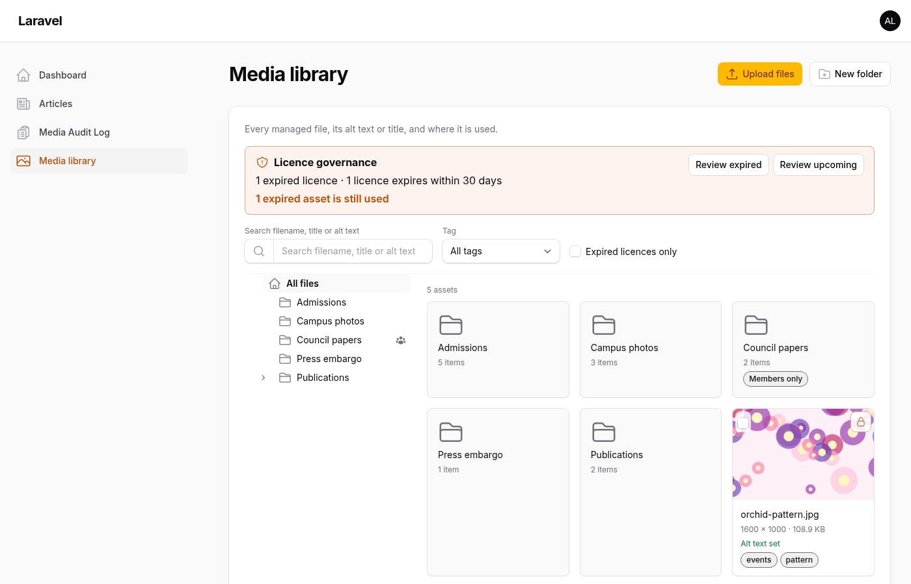

It is a standalone Filament plugin and needs no other Banyan package. It was extracted from [Banyan CMS](https://github.com/BanyanCMS/banyan), whose media library runs on it. Licensed **MIT**.

> **Building a real feature?** Read the **[usage guide](docs/guide.md)**. It walks through a complete, tested example (articles with a hero image and a gallery). It covers who may upload, putting images on a model, keeping "where is it used" correct, showing images on your site, an audit log, licence expiry, documents and video, folders and folder access, customising and testing.

> **Where to change it:** the source lives in the Banyan monorepo at `packages/filament-media-library`. This repository is its published split. Open issues and pull requests against the [monorepo](https://github.com/BanyanCMS/banyan).

---

## Contents

- [What you get](#what-you-get)
- [Inspiration and how it compares](#inspiration-and-how-it-compares)
- [Requirements](#requirements)
- [Installation](#installation)
- [Quick start: an image on an article in five steps](#quick-start-an-image-on-an-article-in-five-steps)
- [Who may do what](#who-may-do-what)
- [The library and the asset page](#the-library-and-the-asset-page)
- [File kinds and accepted types](#file-kinds-and-accepted-types)
- [Upload safety](#upload-safety)
- [MediaPicker: choosing a file in a form](#mediapicker-choosing-a-file-in-a-form)
- [Where an asset is used](#where-an-asset-is-used)
- [Showing an image](#showing-an-image)
- [Delivering files](#delivering-files)
- [Previews](#previews)
- [The file component](#the-file-component)
- [Folders](#folders)
- [Folder access](#folder-access)
- [Writing from code](#writing-from-code)
- [Data model and querying from your code](#data-model-and-querying-from-your-code)
- [Audit log: events](#audit-log-events)
- [Licence expiry](#licence-expiry)
- [Configuration](#configuration)
- [Existing tables and custom table names](#existing-tables-and-custom-table-names)
- [Look and feel, dark mode, languages](#look-and-feel-dark-mode-languages)
- [Overriding pages and views](#overriding-pages-and-views)
- [Using it in more than one panel](#using-it-in-more-than-one-panel)
- [Exceptions](#exceptions)
- [Testing](#testing)
- [Running the example](#running-the-example)
- [FAQ and troubleshooting](#faq-and-troubleshooting)
- [Licence](#licence)

---

## What you get

- **A library page** (folder tree, grid, search, tag filter, licence filters) and **a page per asset** (preview, details, focal point, usage, version history). You add both to a panel with one line.
- **Five kinds of file.** Images, documents (PDF, Word, Excel, PowerPoint, OpenDocument, CSV, text), video (MP4, WebM), audio (MP3, M4A, WAV) and ZIP archives. The kind comes from the file's bytes. The uploader never chooses it.
- **Upload safety.** The type is detected from the content and the extension must agree. Office files with macros and zip bombs are refused. An `AssetUploading` event and a `FileScanner` hook can refuse anything else before a byte is written. A ClamAV scanner ships as an opt-in.
- **Previews.** A PDF shows in the browser's own viewer. Video and audio play in the panel with captions and a transcript. PDFs get first-page thumbnails when Imagick and Ghostscript are installed.
- **Folders and sub-folders**, with a tree, breadcrumbs, move, and delete rules that never lose a file. Each folder is **shared**, **members-only** or **password protected**. Access can only get stricter down the tree.
- **Alt text is required for images, and a title for everything else.** This is checked in three places: the form, the repository (a seeder or an import cannot skip it) and the database.
- **Versions.** Replacing a file adds a version and keeps the old file. Nothing is overwritten.
- **Focal point.** An editor clicks or drags on the image. Every crop keeps that point in frame.
- **Licence expiry.** An asset can have an expiry date. The library shows how many licences have lapsed or are about to, and how many of those are still used.
- **Usage tracking and delete protection.** An asset that is used somewhere cannot be deleted. The asset page lists where it is used.
- **`MediaPicker`**, a form field that chooses an asset anywhere in your forms. Editors can also upload through it. It offers images by default. `->documents()`, `->videos()`, `->audio()` and `->kinds([...])` widen it, and `->folder()` limits it to one folder.
- **One signed file route** for everything that is not a rendition. It sends `nosniff` and a stored content type, supports `Range` requests for seeking, and uses temporary URLs on S3-style disks. Files in restricted folders use short-lived, session-checked addresses instead.
- **`<x-media-library::file>`**, a Blade component that renders an asset the way its kind needs. It prints a responsive image, a link with the title, format and size, or a player with captions.
- **Signed renditions.** `RenditionService::url()` returns a signed URL for any size. The image is made on the first request and then cached. Replacing the file or moving the focal point changes the URL.
- **`MediaThumbnailColumn`** for Filament tables.
- **Events for an audit log.** There is one for every change to an asset or a folder, written inside the change's own transaction. Payloads never hold alt text, titles, filenames, folder names or passwords.
- **Gate abilities** for access. Anything that changes the library is closed by default. `media.manage-all` is for the library administrator.
- **Any Laravel disk**, configurable table names, and English, Traditional Chinese and Simplified Chinese.
- **No queue, no scheduler, no JavaScript build.** Renditions and PDF thumbnails are made on request. Expiry is computed when you read it.

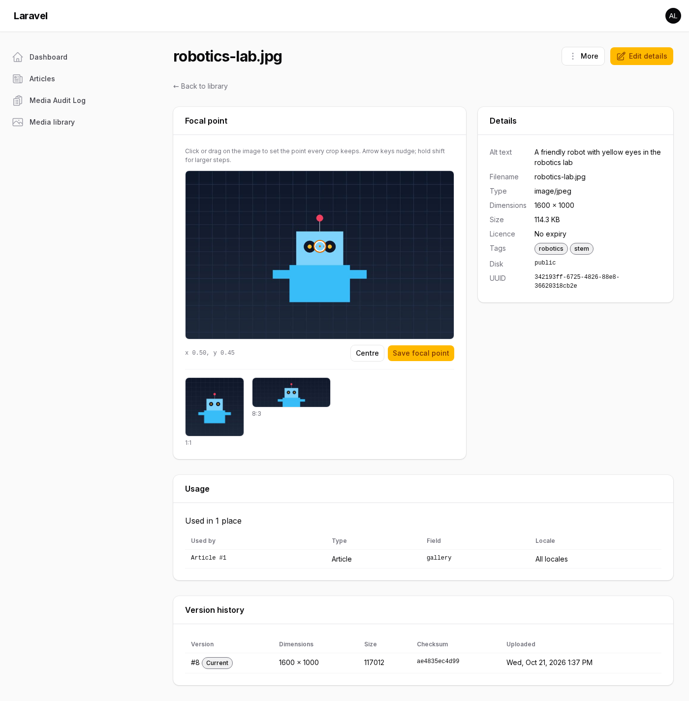

## Inspiration and how it compares

### Where the ideas come from

This library was built for Banyan, a CMS for government, public bodies and schools. Many of these organisations are moving away from WordPress and looking at Drupal or Umbraco instead. The design borrows from those systems and from image services:

- **Drupal Media and the Focal Point module.** A media item is a reusable entity, not a file attached to one record. Every crop keeps the point an editor chose.
- **Umbraco's media section.** One shared library for the whole site. It shows "where is this used?" before anything is deleted.
- **The WordPress media library.** The grid, the per-asset page and alt text as a core field. Here alt text is required, not optional.
- **Image CDNs such as imgix and Cloudinary.** Renditions are made on request from a URL and cached. They are signed so nobody can use the URL as a free resizing service.
- **Digital asset management (DAM) practice.** Licence expiry, version history instead of overwriting, and an audit trail of who changed what. Public-sector content needs these.
- **WordPress folder plugins (FileBird, Real Media Library) and TomatoPHP's media manager.** WordPress needs a plugin for folders, and large libraries are hard to use without them. Folders here are built in. You can limit a folder to a team or protect it with a password.

The main idea is that **a file is a governed asset**, not just an upload. It has an accessible description or title, a rights window, a history and a list of the pages that depend on it.

### How it differs from other Filament media plugins

All of these are good tools that solve different problems. This summary comes from each project's public page as of October 2026. Check those pages for current details.

| | **This library** | [Media Library Pro](https://filamentphp.com/plugins/ralphjsmit-media-library-manager) (Ralph J. Smit) | [Crumbls Filament Media Library](https://github.com/Crumbls/filament-media-library) | [TomatoPHP Media Manager](https://github.com/tomatophp/filament-media-manager) | [Media Action](https://filamentphp.com/plugins/hugomyb-media-action) (hugomyb) |
| --- | --- | --- | --- | --- | --- |
| **What it is** | A governed media library: files, folders, picker, renditions, events | A media manager for the admin panel | A WordPress-style media library | A folder-based file manager | A preview action, not a library |
| **Licence** | MIT | Paid (listed at €99) | MIT | MIT | MIT |
| **Storage** | Its own tables (`media_assets`, versions, tags, usages, folders). No spatie/laravel-medialibrary | Built on spatie/laravel-medialibrary | spatie/laravel-medialibrary plus its own `media_library` and `mediables` tables | spatie/laravel-medialibrary plus folders | None; it plays a URL you pass in |
| **Organising** | Folders and sub-folders (shared, members-only or password protected), tags, search, licence filters | Folders, filters, sorters | Grid, search, type filter | Folders and sub-folders, shared or password-protected | n/a |
| **Alt text** | **Required** for images, with a required title for other files (database, service and form) | Not listed | Optional field | Not listed | n/a |
| **Cropping** | Focal point: every rendition crops around it automatically | Not listed | Manual crop, rotate and flip (CropperJS) | Responsive images; no crop tool listed | n/a |
| **Replacing a file** | Adds a version; old files kept; URLs change, so caches never show old pixels | Not listed | Not listed | Not listed | n/a |
| **"Where is it used"** | Usage tracking; deleting a used asset is refused | Not listed | Polymorphic attachments | Model trait | n/a |
| **Licence and rights expiry** | Warnings, "still used" counts, picker hides expired assets | Not listed | Not listed | Not listed | n/a |
| **Audit and integration** | Events inside the transaction (an audit failure rolls back); Banyan webhooks | Custom actions | Roadmap | Folders API | n/a |
| **Permissions** | Gate abilities (managing is closed until you define it), plus per-folder members and passwords | Permissions | Not listed | Per-user folder access | n/a |
| **Image engine** | Laravel's own `Illuminate\Image` | Spatie conversions | Spatie conversions | Spatie conversions | n/a |
| **File types** | Images, documents, video, audio, archives | Files | Files | Files | Video, audio, PDF and images (preview) |

**When to choose another plugin.**

- You already use spatie/laravel-medialibrary collections on your models.
- You need SVG, video transcoding or streaming (HLS), full-text search inside documents, or a password per file instead of per folder. This library does not have these yet.
- You only need to preview a file in a modal. Media Action does that and works with any library, including this one.

**When to choose this one.**

- Accessibility and rights are requirements, not extras.
- The same file is reused on many pages.
- Replacing or deleting a file must be safe and traceable.
- Documents must be uploaded safely, and some must stay inside a team.
- You need crops that keep the subject in frame without an editor cropping every size by hand.

## Requirements

- PHP 8.3+, Laravel 13, Filament v5, Livewire v4.
- `ext-gd` (default) or `ext-imagick`. Image work uses Laravel's own image component (`Illuminate\Image`, the `Image` facade), which drives `intervention/image` v4. Set `media-library.driver` to `null` to use your app's `images.default`.
- `ext-fileinfo` (detects what an upload really is) and `ext-zip` (inspects zip, Office and OpenDocument files). The package requires both.
- Optional: `ext-imagick` with Ghostscript, for first-page thumbnails of PDFs ([Previews](#previews)).
- A database. Table names are configurable. See [Configuration](#configuration).

## Installation

```bash
composer require banyancms/filament-media-library
php artisan migrate
php artisan filament:assets
```

Laravel discovers the service provider automatically. `filament:assets` publishes the library's stylesheet. Run it again after you update the package.

The migrations create seven tables: `media_assets`, `media_versions`, `media_tags`, `media_asset_tag`, `media_usages`, `media_folders` and `media_folder_members`.

One migration creates all seven tables. If you use 0.1, read [UPGRADE.md](UPGRADE.md) before you update.

If you want other table names, or you already have these tables, read [Configuration](#configuration) **before** you run `migrate`.

Add the plugin to a panel:

```php
use Banyan\FilamentMediaLibrary\MediaLibraryPlugin;

public function panel(Panel $panel): Panel
{
    return $panel
        // ...
        ->plugin(MediaLibraryPlugin::make());
}
```

The panel now has **Media library** at `/admin/media` (the sidebar item) and one page per asset at `/admin/media/{uuid}`.

**Storage.** Files go to the disk named by `media-library.disk` (default `public`, env `MEDIA_LIBRARY_DISK`). The library always serves originals, renditions and every other file through signed routes, never by a URL straight to the disk. So the disk can be private, and you do **not** need `php artisan storage:link`. To use S3, point the config at an S3 disk. Nothing else changes.

If you accept large files, raise PHP's `upload_max_filesize` and `post_max_size`. Raise Livewire's temporary-upload limit in `config/livewire.php` too. Set them to match `uploads.kinds.*.max_size`.

## Quick start: an image on an article in five steps

This adds a hero image to an `Article` resource. It is the shortest useful path. The [guide](docs/guide.md) explains each step in more detail.

### 1. Decide who may upload

Any signed-in user can browse the library and pick an image. **Uploading, replacing, editing and deleting are refused until you define `media.manage`.** Define it in `AppServiceProvider::boot()`:

```php
use Illuminate\Support\Facades\Gate;

Gate::define('media.manage', fn (User $user): bool => $user->is_editor);
```

### 2. Add a column that holds the asset id

```php
Schema::table('articles', function (Blueprint $table): void {
    $table->unsignedBigInteger('hero_id')->nullable();
});
```

The picker stores an **id**, not a path or a URL. For a gallery, use a `json` column and cast it to `array`.

### 3. Put the picker in your resource

```php
use Banyan\FilamentMediaLibrary\Forms\MediaPicker;
use Banyan\FilamentMediaLibrary\Tables\MediaThumbnailColumn;

// In the form
MediaPicker::make('hero_id')->label('Hero image')->thumbnails(),

// In the table
MediaThumbnailColumn::make('hero_id')->label('Hero'),
```

Add `hero_id` to the model's `$fillable` (or use `$guarded = []`).

### 4. Record that the article uses the image

The picker stores ids only. It does not know which record it belongs to, so **your model must tell the library what it uses**. Delete protection, the licence report and the "used by" table all read this. Without it, the library thinks every asset is unused and lets editors delete it.

```php
use Banyan\FilamentMediaLibrary\Usage\UsageRecorder;

final class Article extends Model
{
    protected static function booted(): void
    {
        static::saved(function (self $article): void {
            app(UsageRecorder::class)->sync($article, 'hero_id', $article->hero_id === null ? [] : [(int) $article->hero_id]);
        });

        static::deleted(fn (self $article) => app(UsageRecorder::class)->forget($article));
    }
}
```

For more than one field, use the reusable trait from the example, [`RecordsMediaUsage`](examples/Articles/Concerns/RecordsMediaUsage.php).

### 5. Show the image

```php
use Banyan\FilamentMediaLibrary\Models\MediaAsset;
use Banyan\FilamentMediaLibrary\Rendering\RenditionService;

$hero = MediaAsset::find($article->hero_id);
$src = app(RenditionService::class)->url($hero, 1200, 630, 'crop');
```

```blade
alt_text }}">
```

The alt text belongs to the asset and is never empty. The feature now works from end to end. For a PDF, a video or an audio file instead of an image, see [Delivering files](#delivering-files) and [The file component](#the-file-component).

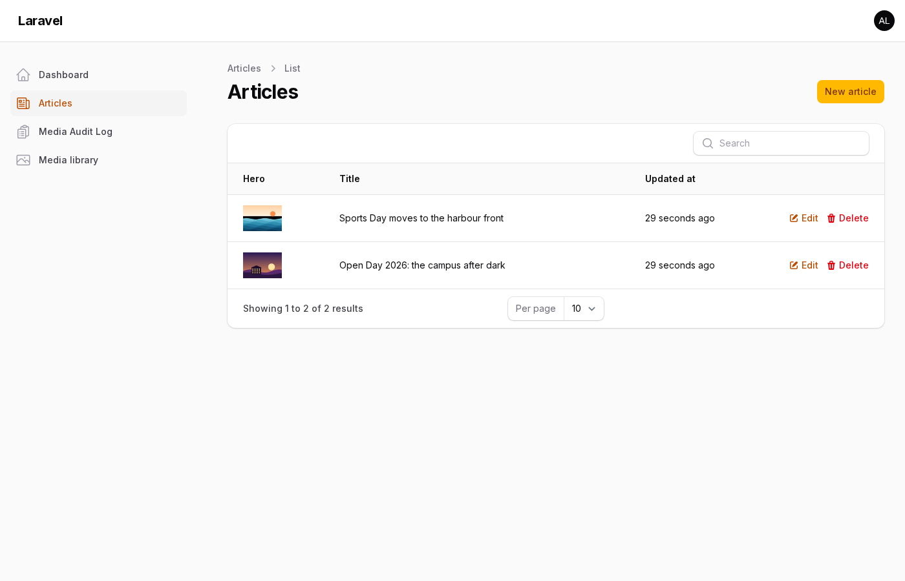

---

## Who may do what

There are three Laravel Gate abilities. Their names are in `media-library.abilities`.

| Ability | Default name | Allows | When it is not defined |
| --- | --- | --- | --- |
| view | `media.view` | Open the library and asset pages | Any signed-in user |
| manage | `media.manage` | Upload, replace, edit details, refocus, retag, move, delete (including the picker's "Upload new") | **Nobody** |
| manage all | `media.manage-all` | The library administrator: sees and manages every folder, including members-only and password-protected ones, without being a member or unlocking, and may change any folder's access | **Nobody** |

Folders add a second layer on top of these abilities. [Folder access](#folder-access) decides who may open each folder. A `manage` role inside a members-only folder is a grant of its own.

Managing is refused until you define it, so a missing permission never defaults to open:

```php
Gate::define('media.manage', fn (User $user): bool => $user->is_editor);
```

If your permissions do not live in a Gate ability, give the library a fallback. The library asks it **only while the matching ability is undefined**:

```php
use Banyan\FilamentMediaLibrary\Access\MediaLibraryGate;

MediaLibraryGate::manageUsing(fn (): bool => auth()->user()?->hasRole('editor') === true);
MediaLibraryGate::manageAllUsing(fn (): bool => auth()->user()?->hasRole('super-admin') === true);
```

All checks return `false` for a guest. Every write checks the gate again on the server (page actions, the focal point save and the picker's upload all do). A hidden button is not the only protection.

Two more points:

- The library asks `Gate::allows()` first, so a `Gate::before()` grant counts, even when `media.manage` was never defined with `define()`. Permission packages such as spatie/laravel-permission and super-admin shortcuts work this way. Only when nothing grants the ability, and it is undefined, does `manageUsing()` (or `manageAllUsing()`) decide. A blanket `Gate::before()` super-admin grant also grants `media.manage-all`.
- `MediaGovernanceService` and the other classes you call from code do **not** check the gate. Only the pages and the picker do. See [Writing from code](#writing-from-code).

A signed-in user who may not manage sees a read-only library:


## The library and the asset page

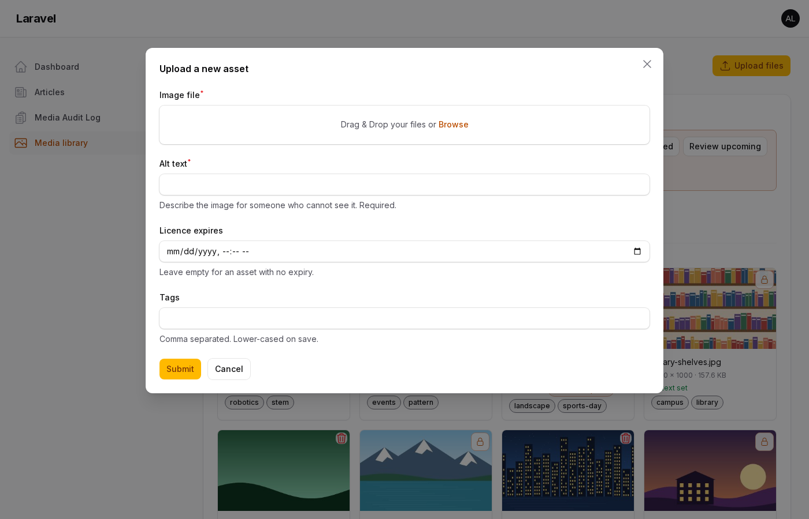

- **Upload files** (managers only) asks for the file. Then it asks for the **alt text** (required for an image) or a **title** (required for every other kind, and used as the link text). You can also add a licence expiry date and comma-separated tags. Tags are lower-cased on save. If you open the dialog inside a folder, the upload goes into that folder. You upload one file at a time. The form turns away a type that is not on the list with a short message. The real check is the [upload guard](#upload-safety) behind it.
- The grid shows the folder tiles of the open folder first, then the newest **120** assets. **Load more** shows the next 120, with a "Showing 120 of N" count. The search box (filename, title or alt text), the tag filter and the licence filters narrow the grid. Inside a folder they search that folder and everything below it. **Search the whole library** searches everything.
- A card shows a thumbnail for an image (and for a PDF, when [thumbnails are available](#previews)) or a kind icon. It also shows the kind, size and filename. A trash icon means the asset is unused. A padlock means it is used. Click a card to open the asset page. Tick cards to move several files at once ([Folders](#folders)).
- On the asset page, **Edit details** changes alt text (images) or title (everything else) and licence expiry. **More** holds Move to folder, Edit tags, Captions (video), Transcript (video and audio), Replace file and, for an asset nothing uses, Delete asset. You set the focal point on the image itself. It exists for images only.
- **Version history** lists every file the asset has had. It is a record only. This release has no restore or download button. A replacement must be the same kind. Replacing a PDF with an image is refused.

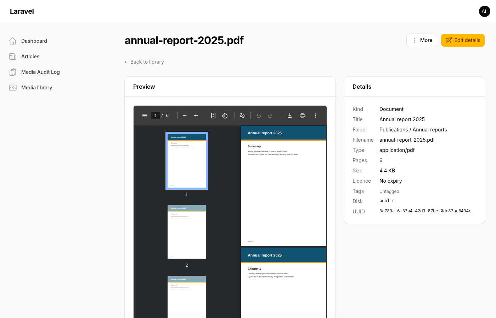

## File kinds and accepted types

Every asset has a **kind**: `image`, `document`, `video`, `audio` or `archive` (the `MediaKind` enum). The library works out the kind from the file's bytes at upload. The uploader never chooses it, because a kind the uploader could pick is a kind the uploader could lie about. The kind decides the validation, the preview and which text is required.

These are the defaults in `media-library.uploads.kinds`. A type that is not listed is refused with `UnsupportedFileType`.

| Kind | Accepted | Extensions | Default maximum |
| --- | --- | --- | --- |
| `image` | JPEG, PNG, GIF, WebP, AVIF | `jpg` `jpeg` `jpe` `png` `gif` `webp` `avif` | 12 MB (`12288` KB) |
| `document` | PDF; Word, Excel and PowerPoint (`docx` `xlsx` `pptx`, without macros); OpenDocument text, spreadsheet and presentation; CSV; plain text; WebVTT captions | `pdf` `docx` `xlsx` `pptx` `odt` `ods` `odp` `csv` `txt` `vtt` | 50 MB (`51200` KB) |
| `video` | MP4 (H.264/AAC), WebM | `mp4` `m4v` `webm` | 500 MB (`512000` KB) |
| `audio` | MP3, M4A (AAC), WAV | `mp3` `m4a` `wav` | 100 MB (`102400` KB) |
| `archive` | ZIP | `zip` | 100 MB (`102400` KB) |

These are never accepted, whatever the extension: HTML, XML, SVG, JavaScript, executables, and the macro-enabled `docm`, `xlsm` and `pptm`. An Office file that contains `vbaProject.bin` is refused even when it is named `.docx`. SVG needs sanitising first, so it is not in this release.

Change the lists and limits in the config, per kind:

```php
'uploads' => [
    'kinds' => [
        'document' => ['mime_types' => ['application/pdf'], 'max_size' => 20480], // PDFs only, 20 MB
        // ... the other kinds as in the default config
    ],
],
```

`max_size` is in kilobytes. The older flat `uploads.max_size` and `uploads.mime_types` keys still work. They mean the image kind when `kinds.image` is absent. If you list a type under `image`, the decoder still cannot read it. For example, adding `image/svg+xml` does not make SVG work. A WebVTT file (`text/vtt`) is a document that must start with `WEBVTT`. It exists to be a video's captions.

An asset stores these fields:

- `kind`
- `title`
- `page_count` (for a PDF, when the library can read it)
- `duration_seconds` (video and audio). It is left null because reading it needs ffmpeg or getID3, and this package depends on neither. Fill it yourself if you know it.
- `mime_type` (the detected type)

`$asset->kind` is a `MediaKind`. These helpers are available: `$asset->isImage()`, `$asset->formatLabel()` ("PDF", "DOCX") and `$asset->displayName()` (the title, or the filename).

## Upload safety

The same checks run in `MediaRepository::store()` and `replace()`, whatever the entry point: the library, the picker's upload button, or `MediaGovernanceService::upload()` from a job. They run **before anything is written**. A refused file leaves no row and no file on the disk. The checks run in this order:

1. **Detect the type from the bytes** with `finfo`. The library ignores the file's name and the browser's claim. It tells zip-based formats (Office, OpenDocument) from plain zips by what is inside them. For CSV and plain text it uses the extension, because the content cannot tell them apart.
2. **The extension must agree** with the detected type, or the file is refused with `ExtensionMismatch`. This stops a `cv.docx` that is really HTML, and `report.pdf.exe`.
3. **The type must be on the allow-list** (`UnsupportedFileType`). A replacement must be the **same kind** as the asset (`KindMismatch`).
4. **The kind's size limit** (`FileTooLarge`).
5. **Kind-specific checks:**
   - an image must decode (`UnreadableImage`);
   - a PDF must start with `%PDF-`;
   - for a zip, an Office file or an OpenDocument file, the library lists the entries. It refuses the file if there are more than `uploads.archive.max_entries` (default 5000) or if the entries expand to more than 1 GB (`UploadRejected`, a zip-bomb guard);
   - an Office file with macros is refused (`UnsupportedFileType`).
6. **The `AssetUploading` event**, then the **scanner**, if you set one (see below).
7. **The required text.** An image needs alt text (`AltTextRequired`). Everything else needs a title (`TitleRequired`).

The form's own file field also lists the accepted types and size. So a wrong file is usually turned away with a short message before it reaches the guard. Code that calls the services directly gets the guard and nothing else. This is why the guard is the real check.

### Refusing a file yourself: `AssetUploading`

The library dispatches this event after the built-in checks pass and before the scanner. It is a plain event, not a `MediaEvent`, and it is not an audit entry. It carries the temporary file's path.

```php
use Banyan\FilamentMediaLibrary\Enums\MediaKind;
use Banyan\FilamentMediaLibrary\Events\AssetUploading;
use Banyan\FilamentMediaLibrary\Exceptions\UploadRejected;
use Illuminate\Support\Facades\Event;

Event::listen(function (AssetUploading $upload): void {
    // $upload->path, ->filename, ->mimeType (detected), ->kind (MediaKind), ->sizeBytes
    if ($upload->kind === MediaKind::Document && str_contains($upload->filename, 'draft')) {
        throw UploadRejected::because('drafts are not published here.');
    }
});
```

A listener that throws refuses the upload. Do not put the filename in the message. The uploader sees the exception text, and it may be logged.

### Scanning: `FileScanner` and ClamAV

Name a class in `media-library.uploads.scanner` that implements `Banyan\FilamentMediaLibrary\Contracts\FileScanner`. It runs last, on a temporary copy of the bytes. `null` (the default) scans nothing.

```php
use Banyan\FilamentMediaLibrary\Contracts\FileScanner;
use Banyan\FilamentMediaLibrary\Scanning\ScanResult;

final class MyScanner implements FileScanner
{
    public function scan(string $path): ScanResult
    {
        return $this->engine->isInfected($path)
            ? ScanResult::infected('Malware detected.')   // shown to the uploader; never the filename
            : ScanResult::clean();
    }
}
```

An infected result throws `UploadRejected` with that reason. If a scanner cannot reach its engine, it should **throw** and not return clean. An unscanned file must not look safe. The library resolves the class from the container, so it can take dependencies. A class that does not implement `FileScanner` throws a `LogicException`.

A ClamAV scanner ships as an opt-in example. It sends clamd's `INSTREAM` command over a socket. It is not a dependency and stays off until you name it:

```php
// config/media-library.php
'uploads' => [
    'scanner' => \Banyan\FilamentMediaLibrary\Scanning\ClamAvScanner::class,
    'clamav' => [
        'socket' => 'unix:///var/run/clamav/clamd.ctl',   // or tcp://127.0.0.1:3310; this is the default
        'timeout' => 10,                                    // seconds to connect; the default
    ],
    // ... kinds, archive
],
```

When clamd is unreachable, the scanner throws, so uploads fail until clamd is back. A scanner that fails open protects nothing during an outage.

clamd refuses a stream longer than its `StreamMaxLength` (25 MB by default) with an error, and that also fails the upload. Raise it in `clamd.conf` to at least your largest `max_size`.

Laravel's config merge is shallow. An `uploads` array that you publish replaces the default one. Anything you leave out falls back to the built-in defaults.

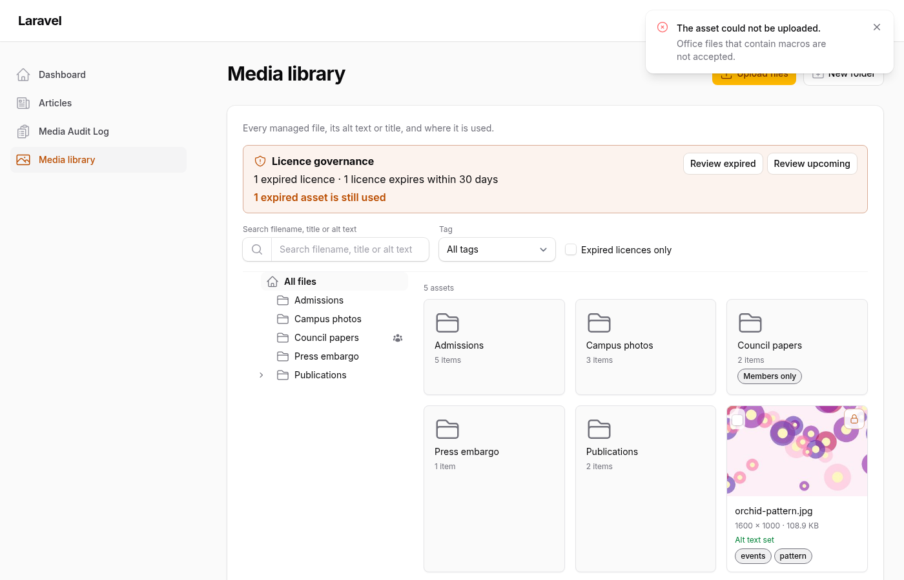

## MediaPicker: choosing a file in a form

```php
use Banyan\FilamentMediaLibrary\Enums\MediaKind;
use Banyan\FilamentMediaLibrary\Forms\MediaPicker;

MediaPicker::make('hero_id');                       // one asset: stores an id. Images only, the default
MediaPicker::make('gallery')->multiple();           // many assets: stores a list of ids
MediaPicker::make('hero_id')->thumbnails();         // a 48px thumbnail beside each option
MediaPicker::make('hero_id')->uploadable(false);    // no "Upload new" button on this field

MediaPicker::make('report_id')->documents();        // PDFs, Office files, CSV, text
MediaPicker::make('tour_id')->videos();             // MP4 and WebM
MediaPicker::make('message_id')->audio();           // MP3, M4A, WAV
MediaPicker::make('bundle_id')->archives();         // ZIP
MediaPicker::make('any_id')->anyKind();             // every kind
MediaPicker::make('media_id')->kinds([MediaKind::Image, MediaKind::Video]);

MediaPicker::make('report_id')->documents()->folder($reports);   // only this folder and below, and uploads go there
MediaPicker::make('note_id')->documents()->allowRestricted();    // intranet: offer restricted folders too
```

`MediaPicker` extends Filament's `Select`. So `->label()`, `->required()`, `->helperText()`, `->hint()`, `->live()`, `->maxItems()` and the other `Select` methods work as usual.

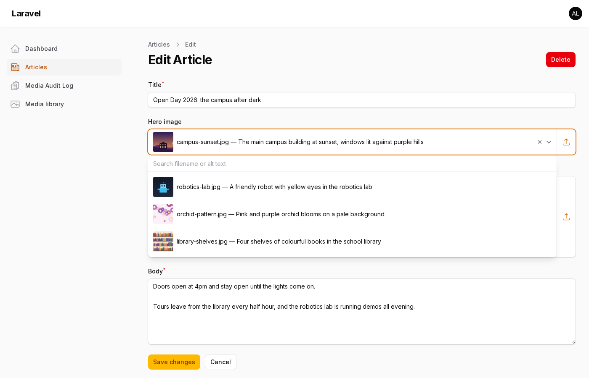

- **Kinds.** A field offers images unless you say otherwise. So a field written before file kinds existed behaves as before, and a "hero image" field is never given a PDF. `->kinds([])` falls back to images, never to everything. The kinds apply to the options, the search and the inline upload. The library also checks a saved value against them.
- **Options** are the newest 50 selectable assets of those kinds. Typing searches filename, title and alt text and returns up to 50 matches. An image option shows the filename and the alt text. Any other kind shows the title and the kind. When folders are on, the option also shows the folder path (for example "in Publications / Annual reports"), so you can tell two files with the same name apart.
- **Expired assets are not offered.** Choosing an asset starts a new usage, and expiry exists to stop that for a lapsed licence. If a record already holds an asset that has since expired, it still shows, labelled "Licence expired".
- **`->folder($folder)`** takes a `MediaFolder` or its uuid. It offers only that folder and the folders below it, and an inline upload goes into that folder. A uuid that matches no folder offers nothing, never the whole library. The picker ignores it when `folders.enabled` is `false`.
- **Folder access applies.** The picker only offers assets that the signed-in user may browse. A file in a members-only folder that the user is not in does not appear in the options, the search results or the Livewire payload. The server checks a saved value again, so a hand-made request cannot select a file the picker would not have offered.
- **Restricted folders are hidden by default**, even from people who can open them. A restricted file cannot be shown on a public page ([Folder access](#files-in-restricted-folders-and-public-pages)). `->allowRestricted()` offers them, for intranet sites and back-office fields.
- **Upload new** (the button at the end of the field) opens the same dialog as the library. It requires alt text for an image or a title for anything else. It goes through the same upload guard and audited path, and it selects the new asset. It accepts only the field's kinds. Only users who may manage the target folder see it, and the gate is checked again when the dialog is submitted. Wait for the file to finish uploading before you submit.
- **Thumbnails** are off by default. They turn every option into HTML. An image gets a 48px crop. A PDF gets its first page when [thumbnails are available](#previews). Anything else gets the kind's icon. The plain list is the cheapest for a screen reader and a slow connection.
- **Accessibility.** The picker is a standard searchable `Select`, so it has Filament's keyboard and screen-reader behaviour. The library does not ship its own widget.

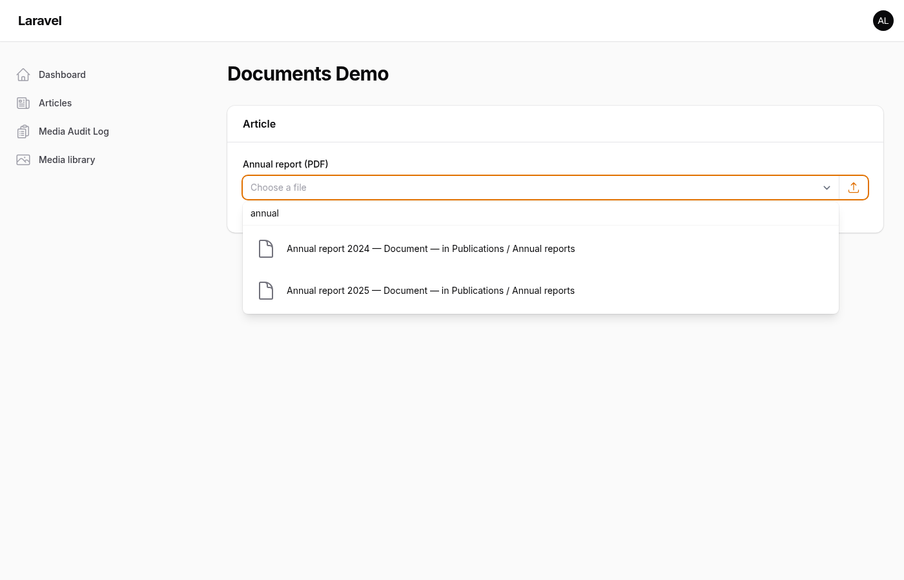

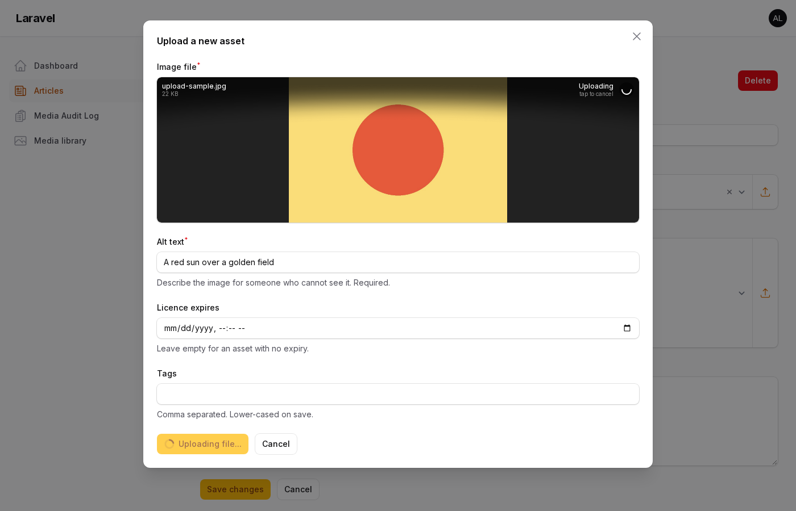

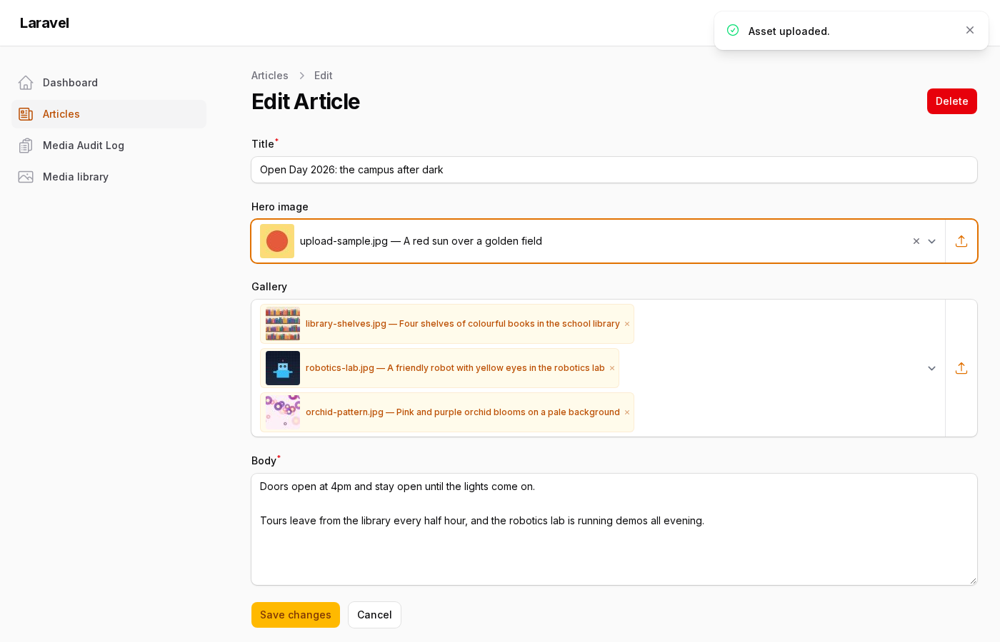

## Where an asset is used

The library blocks deletion, counts "still used" licences and lists usages on the asset page. To do this, it asks a `UsageResolver`. The default resolver reads the rows that `UsageRecorder` writes:

```php
use Banyan\FilamentMediaLibrary\Usage\UsageRecorder;

$recorder = app(UsageRecorder::class);

// When a post is saved: replace what its `hero` field uses (a list of asset ids).
$recorder->sync($post, 'hero', [$post->hero_id]);

// Per locale, if the field differs by language.
$recorder->sync($post, 'hero', [$post->hero_id], 'en');

// When a post is deleted.
$recorder->forget($post);
```

`sync()` replaces the assets that one field of one model (and one locale) uses. `forget()` drops everything a model uses. The model must be saved and have an int or string key, or you get an `InvalidArgumentException`. Model events do not fire for query-builder updates or `insert()`, so a bulk import must call `sync()` itself. The guide shows a reusable trait, a backfill, and the details.

If your app already knows its references, bind your own `Banyan\FilamentMediaLibrary\Contracts\UsageResolver` in a service provider. It has four methods:

```php
interface UsageResolver
{
    /** @return list<AssetUsage> */
    public function usages(int $assetId): array;           // the asset page's "Usage" table

    public function count(int $assetId): int;              // delete protection

    /** @return array<int, int> asset id => live usage count */
    public function counts(array $assetIds): array;        // one query for a library page

    public function whereUsed(Builder $query, string $assetIdColumn): void; // the licence report
}
```

This short example reads an `article_media` pivot table directly and links each usage to its edit page:

```php
use Banyan\FilamentMediaLibrary\Contracts\UsageResolver;
use Banyan\FilamentMediaLibrary\Usage\AssetUsage;
use Illuminate\Database\Query\Builder;
use Illuminate\Support\Facades\DB;

final class ArticleUsageResolver implements UsageResolver
{
    public function usages(int $assetId): array
    {
        return DB::table('article_media as m')
            ->join('articles as a', 'a.id', '=', 'm.article_id')
            ->where('m.media_asset_id', $assetId)
            ->orderBy('a.id')
            ->get(['a.id', 'a.title', 'm.role'])
            ->map(fn (object $row): AssetUsage => new AssetUsage(
                label: 'Article: '.$row->title,
                type: 'Article',
                field: (string) $row->role,
                url: ArticleResource::getUrl('edit', ['record' => $row->id]),
            ))
            ->all();
    }

    public function count(int $assetId): int
    {
        return DB::table('article_media')->where('media_asset_id', $assetId)->count();
    }

    public function counts(array $assetIds): array
    {
        return DB::table('article_media')
            ->whereIn('media_asset_id', $assetIds)
            ->groupBy('media_asset_id')
            ->selectRaw('media_asset_id, COUNT(*) as n')
            ->pluck('n', 'media_asset_id')
            ->map(fn (mixed $n): int => (int) $n)
            ->all();
    }

    public function whereUsed(Builder $query, string $assetIdColumn): void
    {
        $query->whereExists(fn (Builder $q) => $q->selectRaw('1')->from('article_media as m')->whereColumn('m.media_asset_id', $assetIdColumn));
    }
}

// In a service provider's register():
$this->app->singleton(UsageResolver::class, ArticleUsageResolver::class);
```

"Used" must mean **live**. If the owner of a usage has been deleted, that usage must stop counting. Otherwise a safe delete is refused and a licence report raises a false alarm.

## Showing an image

```php
use Banyan\FilamentMediaLibrary\Rendering\RenditionService;

$renditions = app(RenditionService::class);

$renditions->url($asset, 1200, 630, 'crop');      // 1200x630, cropped around the focal point
$renditions->url($asset, 1200, 630, 'contain');   // fits inside 1200x630, no crop
$renditions->url($asset, 800);                    // 800px wide, height follows
$renditions->url($asset);                         // the original bytes
```

| Call | Result |
| --- | --- |
| width and height, `'crop'` (or no fit) | Cropped to that box around the focal point |
| width and height, `'contain'` | Scaled to fit inside the box, never upscaled |
| one dimension only | Scaled to that size, never upscaled (always `contain`) |
| neither | The original file, untouched |

The library limits sizes to `renditions.max_dimension` (default 4096). The output keeps the original format, so a JPEG stays a JPEG. Lossy formats use `renditions.quality`.

You can build a srcset from three calls:

```blade
url($asset, 1200, 630, 'crop') }}"
    srcset="{{ $renditions->url($asset, 600, 315, 'crop') }} 600w, {{ $renditions->url($asset, 1200, 630, 'crop') }} 1200w"
    sizes="(min-width: 52rem) 52rem, 100vw"
    width="1200" height="630"
    alt="{{ $asset->alt_text }}">
```

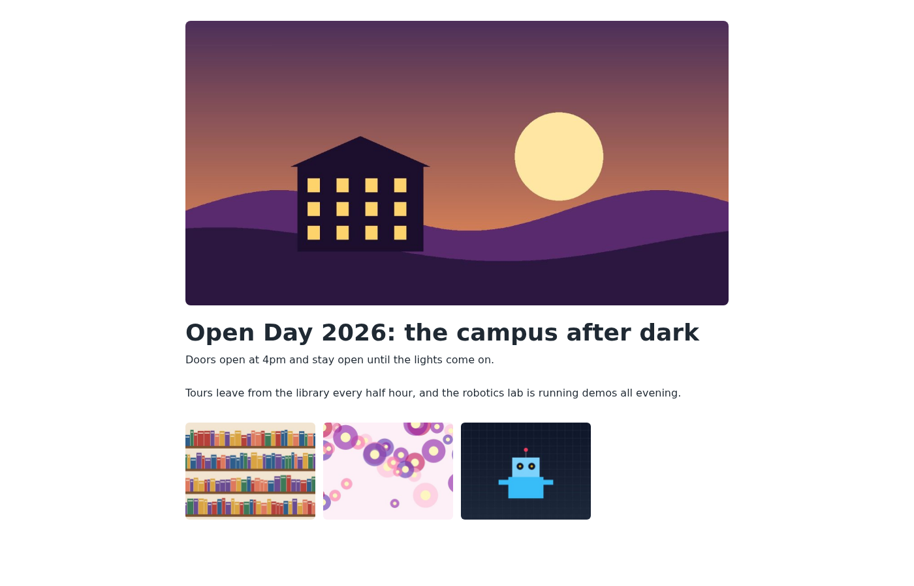

**The URL is signed.** The route `media/{uuid}/render` (named `media-library.render`, both configurable) uses Laravel's `signed` middleware. Its query string tells the server to spend CPU and disk, so only signed requests are allowed. The route has no session and no cookies. A request with a missing or altered signature gets `403`. The signature does not expire, so a URL stays valid for as long as `APP_KEY` stays the same.

**Caching and versioning.** The first request makes the rendition around the focal point and stores it on the disk. Every later request is a disk read. The response carries `Cache-Control: public, max-age=31536000, immutable`. The URL includes the current version and the focal point. So when you replace the file or move the focal point, you get a **new** URL, and browsers and CDNs never show the old pixels. You can cache the URLs freely, including in your HTML cache.

**Tables.** In a Filament table, `MediaThumbnailColumn::make('hero_id')` shows the thumbnail of an asset id (a list of ids shows each one). `->thumbnailSize(96, 64)` changes the crop. The default is 80 by 80.

## Delivering files

`$asset->url($w, $h, $fit)` returns a signed rendition for an image ([Showing an image](#showing-an-image)). One signed **file route** serves every other file, and the original of an image:

```php
$asset->fileUrl();       // inline for an image, PDF, video and audio; an attachment for everything else
$asset->downloadUrl();   // always an attachment
```

```blade
<a href="{{ $asset->downloadUrl() }}">Download {{ $asset->displayName() }}</a>
<video controls src="{{ $asset->fileUrl() }}"></video>
```

The route is `GET /media/{uuid}/file` (named `media-library.file`). Change both in `routes.file`, and keep `{uuid}`. The route has the `signed` middleware and no session, so it is cacheable. The signature covers the current version and the `download` flag. So nobody can switch a link between inline and attachment by editing it, and a replaced file gets a new address that no cache serves stale. An unsigned or altered request gets `403`. An unknown asset or a missing file gets `404`.

The response always carries these headers:

- `Content-Type` is the type detected at upload and stored with the asset. The library never guesses it from the request.
- `X-Content-Type-Options: nosniff`, so a browser cannot treat a stored file as another type.
- `Content-Disposition` is `inline` for images, PDFs, video and audio. It is `attachment` for every other kind, or when you ask for `downloadUrl()`. The suggested filename is the asset's title plus the stored extension ("Annual report 2025.pdf"). If there is no title, it is the stored filename. The library replaces slashes, quotes, control characters, `%`, `:`, `*`, `?`, `<`, `>` and `|`, and cuts the name at 150 characters. An RFC 6266 `filename*` carries a non-ASCII name.
- `Cache-Control: public, max-age=31536000, immutable`.

**Ranges and seeking.** Video and audio need `Range` requests to seek. What happens depends on the disk:

| Disk | What the route does |
| --- | --- |
| Local (`public`, `local`) | Streams the file with Symfony's `BinaryFileResponse`, which answers `Range` requests. Seeking works |
| One with temporary URLs (S3, R2) | A download or a top-level visit gets a `302` to a short-lived provider URL (`delivery.temporary_url_minutes`, default 5) with the content type and disposition set on it, and the provider does the ranging. An **embed** (the PDF preview, `<video>`, `<audio>`, which browsers mark with `Sec-Fetch-Dest`) is streamed from your own origin with `Range` support instead, so a strict CSP (`frame-src 'self'`, `media-src 'self'`) does not block it. `delivery.redirect_to_storage`: `downloads` (default), `always` or `never` |
| Anything else | Streams the whole file. There is no `Range` support, so video plays but does not seek |

A members-only or password-protected file is served from different routes, which check the session and use short-lived addresses ([Folder access](#files-in-restricted-folders-and-public-pages)). `fileUrl()` and `downloadUrl()` pick the right route for you. They throw `AccessDenied` for a restricted file that the signed-in user may not browse, so an empty `src` is never printed by accident. Check `$asset->isDeliverable()` first when you are not sure.

## Previews

The asset page shows each kind the way a browser can show it natively. There is no conversion, no queue and no extra JavaScript. The previews use classes, not inline styles.

| Kind | What the asset page shows |
| --- | --- |
| Image | The focal point editor and two crop previews |
| PDF | An inline `<iframe>` of the file route, which is the browser's own viewer, with the page count, an **Open in new tab** link and **Download** |
| Video | An HTML5 `<video controls preload="metadata">`, with the captions attached to it as a `<track>`, and **Download** |
| Audio | An HTML5 `<audio controls>`, the transcript under it, and **Download** |
| Word, Excel, PowerPoint, OpenDocument, CSV, text, ZIP | A kind icon, the size, the details and **Download** |

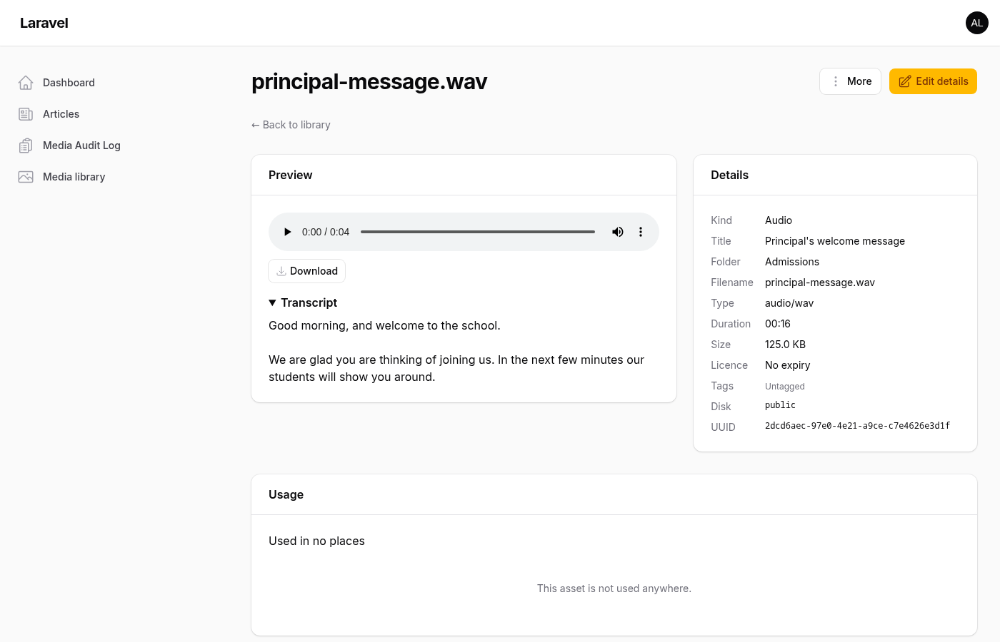

**Captions and transcripts.** On a video's asset page, **More, Captions** attaches a WebVTT file (`.vtt`) that is already in the library as a document. On a video or audio file, **More, Transcript** stores the spoken words as plain text. The text shows in a collapsible block under the player. In code:

```php
$media->setCaptions($video, $vttAsset, (string) $user->id);   // null removes them; video only
$media->setTranscript($audio, $text, (string) $user->id);     // null removes it; video and audio only
```

Both throw `CompanionNotAllowed` for the wrong kind. `setCaptions()` also throws it if the file is not WebVTT. The events say whether a transcript exists, never what it says. `$video->captionsUrl()` returns the address of the captions file. It returns `null` when there are no captions or the signed-in user may not have them.

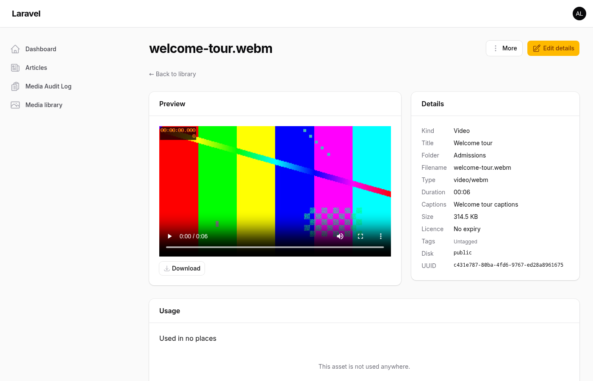

**Page count and duration.** The library reads a PDF's page count at upload by counting page objects. A PDF that keeps its pages inside compressed object streams shows no count. The library does **not** read the duration of video and audio, because that needs ffmpeg or getID3 and the package depends on neither. `duration_seconds` stays null unless your app sets it. There is no video poster frame either.

**PDF thumbnails.** In the grid and the picker, a PDF shows its first page when the `PdfThumbnailer` contract has an implementation that works on your server. If not, it shows a kind icon. The default implementation uses `ext-imagick`, which needs Ghostscript:

```bash
apt install ghostscript php-imagick   # then restart PHP-FPM
```

If Imagick is not loaded, or its `PDF` format is not readable, nothing breaks. The card shows the icon. Many Linux distributions disable the PDF coder in ImageMagick's `policy.xml`, so allow reading PDF there.

Thumbnails are made on the first request at 160, 320 or 640 pixels wide. They are cached next to the renditions (the version is in the path, so a replaced PDF gets a new one) and served by the rendition route. A malformed PDF costs the card an icon, never a 500.

To use another renderer (a service, `pdftoppm`), bind your own:

```php
use Banyan\FilamentMediaLibrary\Contracts\PdfThumbnailer;

$this->app->singleton(PdfThumbnailer::class, MyPdfThumbnailer::class);
```

It has two methods: `available(): bool`, and `thumbnail(string $pdfBinary, int $width): ?string`, which returns PNG bytes or `null`.

## The file component

`<x-media-library::file>` renders an asset the way its kind needs, so a template does not need a branch for each kind:

```blade
<x-media-library::file :asset="$article->report" />
<x-media-library::file :asset="$hero" :width="1200" :height="630" sizes="(min-width: 52rem) 52rem, 100vw" class="rounded" />
```

| Kind | What it prints |
| --- | --- |
| Image | `` with a `srcset` of 600, 1200 and 1800 pixel renditions, `sizes`, the alt text, `loading="lazy"` and `decoding="async"` |
| PDF | `<a>` to `fileUrl()` (opens in the browser) with the link text "Annual report 2025 (PDF, 2.4 MB)" |
| Other documents and archives | The same link, to `downloadUrl()` |
| Video | `<video controls preload="metadata">`, a captions `<track>` when there is one, and a download link as the fallback inside it |
| Audio | `<audio controls preload="metadata">` with a download link as the fallback |

Video and audio with a transcript also get a `<details>` block that holds it. The link text is the title, format and size. This is the WCAG-friendly way to name a document link. Extra attributes (`class`, `id`, `data-*`) go onto the element. `width`, `height` and `sizes` apply where they make sense.

A file in a members-only or password-protected folder is not for the public. When the visitor may not have it, the component prints a lock icon with the label "Restricted file" and nothing else. It prints no URL, title or filename. A signed-in user who may browse the folder gets the file.

## Folders

Folders help you organise a large library. They are on by default. Set `media-library.folders.enabled` to `false` for a flat library. Then all folder UI is hidden, and every asset reads as being at the root.

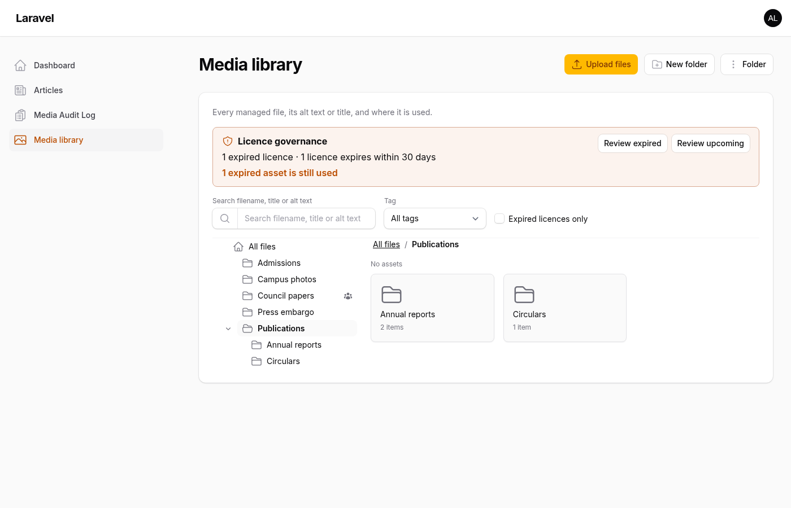

- **Tree and navigation.** The library page has a collapsible tree that you can use with the keyboard (`role="tree"`), and breadcrumbs. The current folder is also the folder that **Upload files** and **New folder** act on.
- **Folder actions.** **New folder** creates a folder inside the open folder. The **Folder** menu holds **Access…**, **Rename folder**, **Move folder** and **Delete folder**.
- **Moving files.** Tick cards in the grid and use **Move to folder…**, or open an asset and use **More, Move to folder**. Moving an asset keeps its id, its uuid and its usages. Files that the user may not change stay where they are, and a notice says so.
- **Deleting a folder** is allowed only when it is empty. If it is not empty, the action offers **Move its contents to the parent folder first**. This lifts the sub-folders and files up one level, then deletes the empty folder, all or nothing. It never cascades and never deletes a file.
- **Search** inside a folder covers that folder and everything below it. **Search the whole library** widens it. The tag and licence filters work the same way.

`MediaFolderService` enforces these rules, whatever asks:

- A name is 1 to 120 characters, with no slash or control character. It must be unique among its siblings, compared case-insensitively.
- A folder cannot be moved into its own subtree (`FolderCycle`). `folders.max_depth` limits nesting (default 8, `FolderTooDeep`).
- Renaming or moving a folder to a name that a sibling already has is refused (`FolderNameTaken`).
- Each folder keeps a materialised `path` (`/12/45/`) and `depth`, so a whole subtree is one query. Only the service writes them. Never set `parent_id` by hand.

### The service

All folder writes go through `MediaFolderService`. Each write is one transaction, and events are dispatched before the commit, as in `MediaGovernanceService`. Like it, **it does not check the gate**. The pages and the picker check access before they call it. Code that calls it on a user's behalf must do the same ([Folder access](#folder-access)).

```php
use Banyan\FilamentMediaLibrary\Folders\MediaFolderService;

$folders = app(MediaFolderService::class);

$reports = $folders->create(null, 'Annual reports', (string) $user->id);          // top level
$y2025 = $folders->create($reports, '2025', (string) $user->id);                    // sub-folder
$folders->rename($y2025, '2025-26', (string) $user->id);
$folders->move($y2025, null, (string) $user->id);                                   // to the top level
$folders->moveAssets([$asset, $other], $reports, (string) $user->id);               // returns how many moved
$folders->delete($y2025, (string) $user->id);                                       // must be empty
$folders->deleteMovingContentsToParent($reports, (string) $user->id);               // lift, then delete

$media->upload($bytes, 'report.pdf', '', (string) $user->id, null, 'Annual report 2025', $reports);
```

| Method | Returns | Throws |
| --- | --- | --- |
| `create(?MediaFolder $parent, string $name, string $actorId, ?int $siteId = null)` | `MediaFolder` | `InvalidFolderName`, `FolderTooDeep`, `FolderNameTaken` |
| `rename(MediaFolder $folder, string $name, string $actorId)` | `MediaFolder` | `InvalidFolderName`, `FolderNameTaken` |
| `move(MediaFolder $folder, ?MediaFolder $to, string $actorId)` | `MediaFolder` | `FolderCycle`, `FolderTooDeep`, `FolderNameTaken` |
| `delete(MediaFolder $folder, string $actorId)` | `void` | `FolderNotEmpty` |
| `deleteMovingContentsToParent(MediaFolder $folder, string $actorId)` | `void` | `FolderNameTaken` |
| `moveAssets(array $assets, ?MediaFolder $to, string $actorId)` | `int` | none (assets already there are skipped) |
| `setAccess(...)`, `addMember(...)`, `removeMember(...)` | | See [Folder access](#folder-access) |

`$siteId` tags a top-level folder with a site, for hosts with several sites (see the Banyan adapter's README). A standalone install never uses it. To tell the page which site the editor is working on, call `MediaLibraryPage::currentSiteUsing(fn (): ?int => ...)` once. That site's top-level folders then list first.

### Events

Each change dispatches an event: `FolderCreated`, `FolderRenamed`, `FolderMoved`, `FolderDeleted` and, for assets, `AssetMoved`. They are `MediaFolderEvent`s (or a `MediaAssetEvent`). They carry ids and counts only, never a folder name. The full table is under [Audit log: events](#audit-log-events).

### From your own code

```php
use Banyan\FilamentMediaLibrary\Models\MediaAsset;
use Banyan\FilamentMediaLibrary\Models\MediaFolder;

$folder = MediaFolder::findByUuid($uuid);

$folder->breadcrumbs();          // ancestors and the folder itself, outermost first
$folder->ancestors();            // parent, grandparent ... outermost first
$folder->children;               // direct sub-folders
$folder->descendantsQuery();     // everything below it, one query
$folder->contains($other);       // is $other this folder, or below it?

MediaAsset::query()->inFolder($folder)->get();                 // directly in it
MediaAsset::query()->inFolder($folder, true)->get();           // in it or below it
MediaAsset::query()->inFolder(null)->get();                    // unfiled: the library root
MediaAsset::query()->ofKind(MediaKind::Document)->latest()->get();
MediaAsset::query()->visibleTo($user)->search('annual')->get(); // only what $user may see
```

## Folder access

Every folder has an **access mode**. Choose it with **Folder, Access…** on the library page:

| Mode | Who can browse and pick | Who can upload, edit and delete inside |
| --- | --- | --- |
| **Same as the folder above** (`inherit`, the default) | As the parent; at the top level it means shared | As the parent |
| **Shared** | Anyone with `media.view` | Anyone with `media.manage` |
| **Members only** | The folder's owner, its members and holders of `media.manage-all` | The owner, members with the `manage` role, and `media.manage-all`. `media.manage` is not needed: the role is the grant |
| **Password protected** | Anyone with `media.view` who has **unlocked** it | Anyone with `media.manage` who has unlocked it |

A member has one of two roles: `view` (browse and pick) or `manage` (also upload, edit and delete). The owner is the person who created the folder.

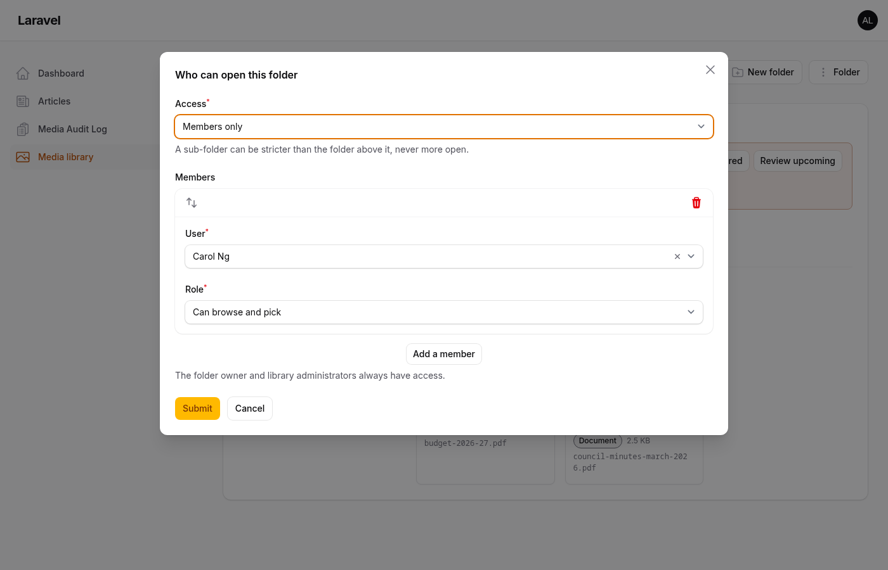

### Access only narrows down the tree

A folder's *effective* access is the access of the nearest ancestor (or the folder itself) that is not `inherit`. `$folder->effectiveAccess()` reports it.

What the library **enforces** is stricter: **a user must pass every folder on the path from the top.** So a `shared` sub-folder of a members-only folder stays members-only. A child can never make its parent's contents public. The parent's name also never appears in a child's breadcrumb or picker label for someone who may not open the parent. The access dialog says: "A sub-folder can be stricter than the folder above it, never more open." `$folder->isRestricted()` is true if any folder on the path is members-only or password protected.

### Who is exempt

- **The folder's owner and `media.manage-all`** open a members-only folder without being members.
- **Neither needs to unlock a password folder.** The owner chose the password, and the administrator can reset it, so typing it would protect nothing. Everyone else must unlock, including `media.manage` holders.
- **Only the owner or `media.manage-all` may change a folder's access, password or members.** They can do this only while they could manage the folder anyway.
- **The password does not bypass the Gate.** A user still needs `media.view`.

### Password folders: unlock and throttle

Set a password of at least 8 characters in the access dialog. The library stores it with `Hash::make()`. It never shows the password again, and never puts it in an event, log or message. To keep the current password, leave the field empty. Setting a new password **locks the folder again for everyone**. So does leaving the mode and coming back.

A person who has not unlocked the folder sees it in the tree with a lock and a **Locked** tile. They see no count, no files and no sub-folders, and a panel with an **Unlock** button.

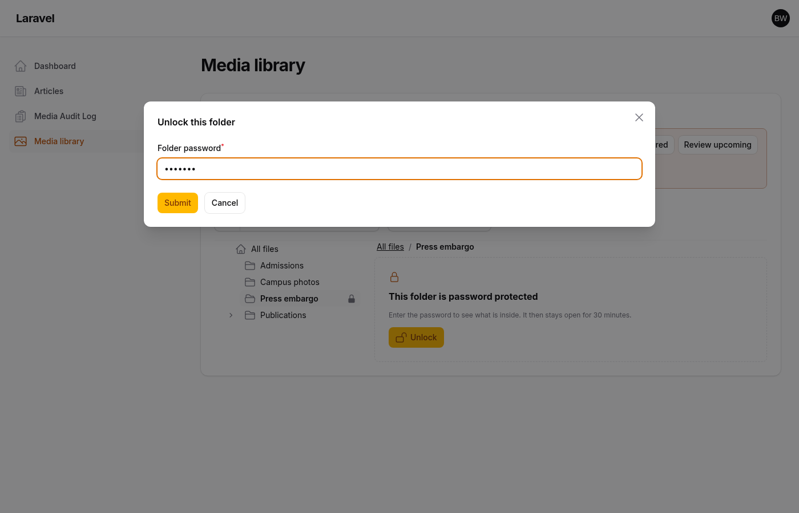

- **The unlock lasts `folders.unlock_minutes`** (default 30) and covers the folder's whole subtree. It is kept on the server, in the session, as an expiry per folder. It is never in a cookie the client can forge, and it is tied to the current password.
- **Five wrong attempts per user per folder in 15 minutes are throttled** (Laravel's `RateLimiter`). After that, even the right password is refused until the window passes. The dialog says how many minutes to wait.
- **Failures are audited.** Each wrong attempt, and each throttled one, dispatches `FolderUnlockFailed` with the number of attempts and never the password. A successful unlock is not an event, to avoid noise.

### What a person without access sees

A restricted folder is **absent** for a user who may not open it. It is not greyed out and it does not say "access denied". It is not in the payload at all. It is not in the tree, the folder tiles, the breadcrumbs, the search results, the picker options or the asset page. It is also not in the Livewire payload and HTML that carry them. (The package's tests search the page's HTML and its whole Livewire snapshot for the folder's name, its files and their ids.) A count never includes a file or folder the user cannot see.

A password folder is the one exception. It is *listed* (with a lock) so a person who knows the password can find it, but its contents are not.

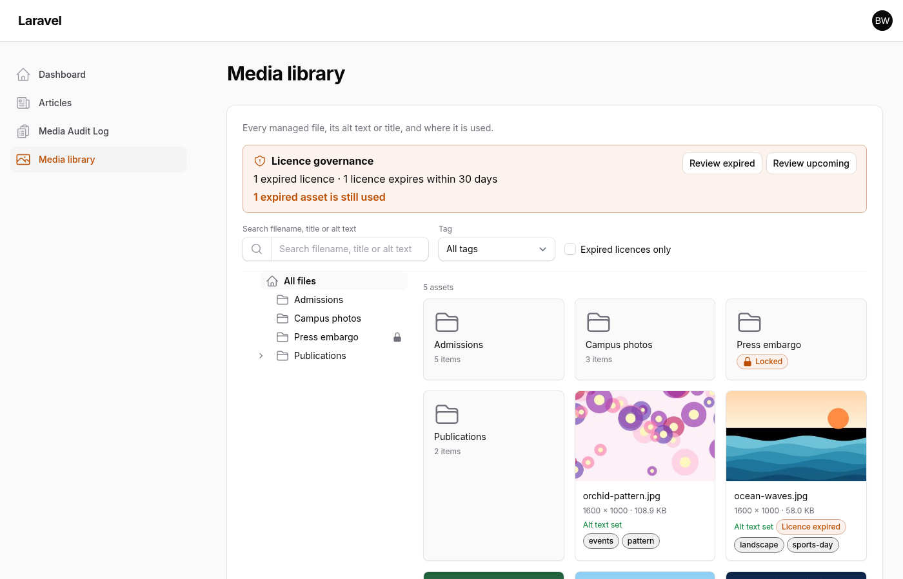

An asset's page (`/admin/media/{uuid}`) is a 404 for someone who may not see it, whether it exists or not. There is one exception. If the file is in a password folder that the person could unlock, they go to that folder's unlock form. Every refusal in the delivery routes is a 404, never a 403, so nothing confirms that a file exists.

### Files in restricted folders, and public pages

Ordinary file and rendition URLs are signed and permanent, so anyone who holds one can open it. That cannot be true for a member's file. For an asset whose path holds a members-only or password folder:

- `fileUrl()`, `downloadUrl()` and `url()` return a **temporary** signed URL (`delivery.restricted_url_minutes`, default 10). The library issues it only to a user who may browse the folder. For anyone else, these methods throw `AccessDenied`.
- The URL points at **different routes**, `restricted-file` and `restricted-render`. They run inside your `web` middleware (`delivery.restricted_middleware`) because they need the visitor's session. On every request they check again that the signed-in user may browse the folder. A leaked URL fails for a logged-out visitor. It also fails for the same person once their membership is removed or the folder is locked again.
- The public routes answer **404** for a restricted file. So an old permanent address stops working when the file moves into a restricted folder.
- Restricted answers are `Cache-Control: private, no-store`.

**A restricted file cannot be used on a public page.** For this reason, the picker hides restricted folders by default, and `<x-media-library::file>` prints a lock instead of a restricted file. To use restricted files on an intranet, where every visitor signs in, add `->allowRestricted()` to the field.

An editor may move files that are still used on pages into a restricted folder. An editor may also restrict a folder that holds such files. In both cases the dialog warns how many files are in use and asks for a confirmation. The server checks the confirmation again. The move is allowed, but those pages lose the file.

If you build a public page from assets yourself, select only what is safe to show:

```php
MediaAsset::query()->unrestricted()->whereIn('id', $ids)->get();   // no restricted folder on its path
```

### From your own code

```php
use Banyan\FilamentMediaLibrary\Access\FolderAccess;
use Banyan\FilamentMediaLibrary\Enums\FolderAccessMode;

$access = app(FolderAccess::class);

$access->canBrowse($folderOrAsset, $user);   // may this user see inside? null means the library root
$access->canManage($folderOrAsset, $user);   // may they upload, edit and delete there?
$access->canAdminister($folder, $user);      // may they change its access, password and members?
$access->unlock($folder, $password);         // bool; throttled; remembered in the session
$access->isUnlocked($folder);
$access->isRestricted($folderOrAsset);

$folders->setAccess($folder, FolderAccessMode::Members, null, $actorId);
$folders->addMember($folder, $user->id, 'view', $actorId);       // or 'manage'; changes the role if already a member
$folders->removeMember($folder, $user->id, $actorId);
$folders->setAccess($press, FolderAccessMode::Password, 'a-long-password', $actorId);
```

`FolderAccess` is the one place where the library decides folder access. The grid, the tree, the asset page, the picker, the file routes and `MediaAsset::visibleTo()` all ask it. In jobs and console commands, pass the user explicitly. Without a user, it asks the signed-in user, and if nobody is signed in, it passes nothing. It is registered as a scoped binding that caches the folder table for one request. The folder and member models clear that cache on every write.

`MediaFolderService::setAccess()` throws `InvalidFolderAccess` in these cases: a short password, a password on a folder that is not password protected, or a password mode without a password. Members are kept when you switch modes, and the library ignores them unless the mode is `members`. Member ids are your user ids (an integer). The member list in the dialog shows the user attribute named in `folders.member_label` (default `name`, falling back to `email`).

## Writing from code

All writes go through `MediaGovernanceService`. Each write runs in a transaction and announces itself with an event:

```php
use Banyan\FilamentMediaLibrary\Governance\MediaGovernanceService;

$media = app(MediaGovernanceService::class);

$asset = $media->upload($bytes, 'campus.jpg', 'The campus at dusk', (string) $user->id);
$report = $media->upload($pdf, 'ar-2025.pdf', '', (string) $user->id, null, 'Annual report 2025', $folder);
$media->updateDetails($asset, 'The campus at dusk, from the north gate', null, (string) $user->id);
$media->setFocalPoint($asset, 0.7, 0.4, (string) $user->id);
$media->syncTags($asset, ['campus', 'events'], (string) $user->id);
$media->setCaptions($video, $vtt, (string) $user->id);
$media->setTranscript($audio, 'Good morning, and welcome.', (string) $user->id);
$media->replace($asset, $newBytes, 'campus-2027.jpg', (string) $user->id);
$media->delete($asset, (string) $user->id);
```

| Method | Returns | Throws |
| --- | --- | --- |
| `upload(string $binary, string $filename, string $altText, string $actorId, ?DateTimeInterface $licenseExpiresAt = null, ?string $title = null, ?MediaFolder $folder = null)` | `MediaAsset` | `AltTextRequired`, `TitleRequired`, `UnreadableImage`, and the [upload guard](#upload-safety) exceptions |
| `replace(MediaAsset $asset, string $binary, string $filename, string $actorId)` | `MediaVersion` | `KindMismatch`, `UnreadableImage`, and the upload guard exceptions |
| `updateDetails(MediaAsset $asset, string $altText, ?DateTimeInterface $licenseExpiresAt, string $actorId, ?string $title = null)` | `void` | `AltTextRequired`, `TitleRequired` |
| `setCaptions(MediaAsset $video, ?MediaAsset $captions, string $actorId)` | `void` | `CompanionNotAllowed` |
| `setTranscript(MediaAsset $asset, ?string $transcript, string $actorId)` | `void` | `CompanionNotAllowed` |
| `setFocalPoint(MediaAsset $asset, float $x, float $y, string $actorId)` | `void` | none (clamped to 0 to 1) |
| `syncTags(MediaAsset $asset, array $names, string $actorId)` | `void` | none |
| `delete(MediaAsset $asset, string $actorId)` | `void` | `AssetReferenced` |

Notes on the arguments:

- The library detects the file type from the bytes and stores that. You do not pass a MIME type.
- `$altText` is required for an image. For any other kind it may be empty, and you pass `$title` instead.
- `$folder` files the new asset in a folder. `null` is the library root.
- `$actorId` is your user's id as a string. It goes into the event.
- `updateDetails()` sets the licence expiry to exactly what you pass, so `null` clears it. It leaves `$title` alone when it is null.
- `uploaded_by` on the asset is set only when the actor id is numeric.
- A replacement keeps the asset's folder, title and captions.

These methods do not check the gate or folder access. If you call them on behalf of a user, check `MediaLibraryGate::allowsManage()` and `app(FolderAccess::class)->canManage($folder)` yourself.

## Data model and querying from your code

You can read the tables freely from any controller, service, job or report. **Write only through `MediaGovernanceService`** ([Writing from code](#writing-from-code)). It keeps the asset and version records consistent, removes files on rollback and dispatches the events that your audit log and webhooks depend on.

### Tables

The names below are the defaults. Each one is configurable in `media-library.tables.*`. Banyan uses `cms_media_*`. In raw queries, read the name from `MediaConfig::table('assets')` and the others. Never hard-code it.

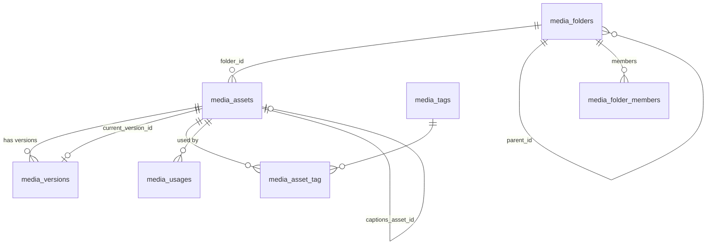

**`media_assets`**: one row per file (an image, document, video, audio file or archive). This is the row you reference from your own tables.

| Column | Type | Meaning |
| --- | --- | --- |
| `id` | bigint | Primary key. Store this in your own column (`hero_id`) |
| `uuid` | uuid, unique | Public identifier, used in URLs. Never expose `id` in a URL |
| `disk`, `path` | string | Where the **current** file lives. Each asset keeps the disk it was uploaded to |
| `filename` | string | Original filename of the current file. It can be personal data, so do not log it |
| `mime_type` | string | The type detected from the bytes, for example `image/jpeg` or `application/pdf` |
| `kind` | string(16), indexed | `image`, `document`, `video`, `audio` or `archive`. Derived at upload; never user-set. Existing rows read `image` |
| `title` | string(255), nullable | The human name, used as link text. Required for every kind except `image` |
| `size_bytes`, `width`, `height` | int | Of the current file. `width` and `height` are null for a non-image |
| `page_count` | int, nullable | A PDF's pages, when they could be counted. Informational |
| `duration_seconds` | int, nullable | Video and audio. Not read by the library; your app may set it. Informational |
| `captions_asset_id` | bigint, nullable | A video's WebVTT captions: another asset. Cleared if that asset is deleted |
| `transcript` | text, nullable | The words spoken in a video or audio file |
| `folder_id` | bigint, nullable, indexed | The folder it is filed in; null is the library root. Restrict on delete |
| `alt_text` | string, nullable | Required (and never empty) for an image; usually null for any other kind |
| `focal_x`, `focal_y` | decimal 0–1 | The point every crop keeps (0.5, 0.5 is the centre) |
| `license_expires_at` | timestamp, nullable | Null means no expiry |
| `current_version_id` | bigint, nullable | The version row of the current file |
| `uploaded_by` | bigint, nullable | Your user id, when it was numeric |
| `created_at`, `updated_at` | timestamp | |

**`media_versions`**: every file an asset has had. A replacement adds a row and the old file is kept.

| Column | Meaning |
| --- | --- |
| `id`, `media_asset_id` | Key, and the asset it belongs to (cascade on delete) |
| `disk`, `path`, `checksum` (sha256), `size_bytes`, `width`, `height` | The file |
| `kind` | The kind of that file, so a replacement can never change an asset's kind |
| `uploaded_by`, `created_at` | Who uploaded it and when (no `updated_at`) |

**`media_tags`** (`id`, `name` unique, lower-cased) and **`media_asset_tag`** (`media_asset_id`, `media_tag_id`): flat tags that editors write.

**`media_folders`**: the folder tree. Write it only through `MediaFolderService`.

| Column | Meaning |
| --- | --- |
| `id`, `uuid` | Key, and the public identifier used in URLs |
| `parent_id` | The parent folder; null is a top-level folder. Restrict on delete |
| `name` | 1 to 120 characters; unique per parent (`parent_id`, `name`), and case-insensitively in the service |
| `path`, `depth` | The ids from the top down, own id included (`/12/45/`), and the nesting level. They answer ancestor and subtree queries without recursion |
| `access` | `inherit` (the default), `shared`, `members` or `password` |
| `password_hash` | A `Hash::make()` hash, only when `access` is `password`. Hidden from serialisation; never returned, logged or put in an event |
| `owner_id`, `created_by` | Your user id of the creator. The owner may change the folder's access |
| `site_id` | Nullable. Tags a top-level folder with a site, for multi-site hosts |
| `created_at`, `updated_at` | |

**`media_folder_members`**: who may open a members-only folder.

| Column | Meaning |
| --- | --- |
| `media_folder_id` | The folder (cascade on delete) |
| `user_id` | Your user id |
| `role` | `view` (browse and pick) or `manage` (also upload, edit and delete). Primary key is (`media_folder_id`, `user_id`) |

**`media_usages`**: what the default resolver counts as "used". `UsageRecorder` writes it.

| Column | Meaning |
| --- | --- |
| `media_asset_id` | The asset |
| `usable_type`, `usable_id` | Your model (`getMorphClass()` and key, the key stored as a string) |
| `field` | Which field holds it, for example `hero_id` |
| `locale` | Nullable, for per-locale fields |

If you bound your own `UsageResolver`, your usages live wherever your resolver reads them. Always ask the resolver (below), not this table.

### Models

All models are in `Banyan\FilamentMediaLibrary\Models` and read the configured table names.

| Model | Relations | Helpers |
| --- | --- | --- |
| `MediaAsset` | `versions()` (newest first), `currentVersion()`, `tags()`, `folder()`, `captions()` | `isExpired()`, `isImage()`, `isRestricted()`, `isDeliverable()`, `url($w, $h, $fit)`, `fileUrl()`, `downloadUrl()`, `captionsUrl()`, `displayName()`, `formatLabel()`, `humanSize()`, `dimensions()`, `MediaAsset::findByUuid($uuid)`, `MediaAsset::formatBytes($bytes)` |
| `MediaVersion` | `asset()` | `shortChecksum()`, `humanSize()` |
| `MediaTag` | `assets()` | `MediaTag::normalise($name)` |
| `MediaFolder` | `parent()`, `children()`, `assets()`, `members()` | `effectiveAccess()`, `accessMode()`, `isRestricted()`, `breadcrumbs()`, `ancestors()`, `ancestorIds()`, `descendantsQuery()`, `subtreeQuery()`, `contains($other)`, `MediaFolder::findByUuid($uuid)`, `MediaFolder::pathLabels($folders)` |
| `MediaFolderMember` | | A row of `media_folder_members`; write it with `addMember()` and `removeMember()` |

Query scopes on `MediaAsset`:

| Scope | Selects |
| --- | --- |
| `selectable()` | Licence not expired, which is what the picker offers |
| `expired()` | Licence lapsed |
| `expiringWithin(int $days)` | Lapses within the next `$days` days |
| `search(string $term)` | Filename, title or alt text contains the term |
| `tagged(string\|array $names)` | Carries any of these tags |
| `used()` | Used somewhere, as the bound `UsageResolver` counts it |
| `ofKind(MediaKind\|list<MediaKind> $kinds)` | Of these kinds |
| `inFolder(?MediaFolder $folder, bool $recursive = false)` | Directly in the folder, or with `$recursive` in it or below it. `null` is the root: only unfiled assets, or with `$recursive` the whole library |
| `visibleTo(?Authenticatable $user = null)` | Only what this user may see: the root (when they may browse it) and the folders they may open. A password folder's assets are absent until it is unlocked. For admin surfaces, not public pages |
| `unrestricted()` | Only assets with no members-only or password folder on their path: what a public page may use |

`MediaFolder` has the scopes `visibleTo()` (folders a user may see in a tree) and `manageableBy()` (folders they may upload to).

### Helper services

| Class | Use it for |
| --- | --- |
| `Rendering\RenditionService` | `url($asset, $w, $h, 'crop'\|'contain')` gives a signed, cache-safe image URL; `$asset->url(...)` is the shortcut |
| `Contracts\UsageResolver` | `usages($id)`, `count($id)`, `counts([$ids])` (one query for a list), `whereUsed($query, 'column')` |
| `Usage\UsageRecorder` | `sync($model, 'field', [$ids])` and `forget($model)`, to keep usage correct |
| `Governance\MediaExpiryReport` | `summary()` gives the expired and expiring counts, and how many of them are still used |
| `Access\MediaLibraryGate` | `allowsBrowse()`, `allowsManage()`, `allowsManageAll()` and `actorId()` before acting on a user's behalf |
| `Access\FolderAccess` | `canBrowse()`, `canManage()`, `canAdminister()`, `unlock()`, `isUnlocked()`, `isRestricted()`: the one place where folder access is decided ([Folder access](#folder-access)) |
| `Folders\MediaFolderService` | Every folder write: `create`, `rename`, `move`, `delete`, `moveAssets`, `setAccess`, `addMember`, `removeMember` ([Folders](#folders)) |
| `Delivery\FileDelivery` | `url($asset, $download)`, `disposition($asset)`, `filename($asset)`: what the file route's addresses and headers are made of |
| `Rendering\Pdf\PdfThumbnailService` | `url($asset, $width)` gives a signed first-page thumbnail URL, or `null` when there is none |
| `Contracts\FileScanner`, `Contracts\PdfThumbnailer` | Bind or name your own ([Upload safety](#upload-safety), [Previews](#previews)) |
| `Support\MediaConfig` | `table('assets')` and typed config reads |

### Recipes

```php
use Banyan\FilamentMediaLibrary\Contracts\UsageResolver;
use Banyan\FilamentMediaLibrary\Enums\MediaKind;
use Banyan\FilamentMediaLibrary\Models\MediaAsset;
use Banyan\FilamentMediaLibrary\Support\MediaConfig;

// An article's hero image for an API response.
$hero = MediaAsset::query()->find($article->hero_id);
$data = $hero === null ? null : [
    'uuid' => $hero->uuid,
    'alt' => $hero->alt_text,
    'width' => $hero->width,
    'height' => $hero->height,
    'url' => $hero->url(1200, 630, 'crop'),
    'thumb' => $hero->url(320, 240, 'crop'),
];

// A list of articles with their heroes, without N+1 queries.
$heroes = MediaAsset::query()->whereIn('id', $articles->pluck('hero_id')->filter())->get()->keyBy('id');

// A gallery stored as a JSON array of ids, in the editor's order.
$gallery = MediaAsset::query()->whereIn('id', $article->gallery ?? [])->get()
    ->sortBy(fn (MediaAsset $a) => array_search($a->id, $article->gallery, true))->values();

// Licences to chase this month: expiring and still on a page.
$toRenew = MediaAsset::query()->expiringWithin(30)->used()->orderBy('license_expires_at')->get();

// Campus photos an editor may still pick.
$campus = MediaAsset::query()->selectable()->tagged('campus')->latest()->paginate(24);

// Every PDF in a folder and its sub-folders that this user may open, newest first.
$reports = MediaAsset::query()->visibleTo($user)->ofKind(MediaKind::Document)->where('mime_type', 'application/pdf')
    ->inFolder($folder, true)->latest()->get();

// A document list for a public page: nothing from a restricted folder.
$downloads = MediaAsset::query()->unrestricted()->ofKind(MediaKind::Document)->whereIn('id', $ids)->get();

// Where one asset is used, and usage counts for a whole list in one query.
$usages = app(UsageResolver::class)->usages($asset->id);   // list<AssetUsage>: label, type, field, locale, url
$counts = app(UsageResolver::class)->counts($ids);         // [asset id => count]

// A join from your own table, with the configured table name.
$rows = DB::table('articles as a')
    ->join(MediaConfig::table('assets').' as m', 'm.id', '=', 'a.hero_id')
    ->where('m.mime_type', 'image/png')
    ->get(['a.id', 'a.title', 'm.uuid', 'm.alt_text']);
```

**Your own columns.** Store the asset id (`unsignedBigInteger('hero_id')->nullable()`, or a JSON list for a gallery). You may add a foreign key to `media_assets.id` with `nullOnDelete()`. The library refuses to delete an asset that is still used. So the key mainly protects you from bulk imports.

**Do not** update `media_assets`, `media_versions` or `media_folders` with `DB::table()->update()` or `$asset->save()`. That skips alt-text and title validation, the upload guard, the version history, rendition cache keys, the folder `path` and `depth` columns and the events. Use the services.

## Audit log: events

Every change dispatches an event that implements `Banyan\FilamentMediaLibrary\Events\MediaEvent`. It has `name()`, `subjectType()`, `subjectId()`, `actorId()` and `payload()`. An event about one asset also implements `MediaAssetEvent` (with `assetId()`). An event about one folder implements `MediaFolderEvent` (with `folderId()`). The classes extend the abstract `AssetEvent` or `FolderEvent`. These hold the public `$assetId` (or `$folderId`) and `$actor`, and each event has a `NAME` constant, for example `AssetUploaded::NAME`. `subjectType()` is `media_asset` or `media_folder`.

| Event class | `name()` | Payload keys |
| --- | --- | --- |
| `AssetUploaded` | `media.asset.uploaded` | `asset_id`, `uuid`, `kind`, `folder_id`, `mime_type`, `size_bytes`, `width`, `height` |
| `AssetReplaced` | `media.asset.replaced` | `asset_id`, `uuid`, `kind`, `folder_id`, `version_id`, `superseded_version_id`, `size_bytes` |
| `AssetUpdated` | `media.asset.updated` | `asset_id`, `uuid`, `kind`, `folder_id`, `alt_text_changed` (bool), `title_changed` (bool), `license_expires_at` (ISO 8601 or null) |
| `FocalPointChanged` | `media.asset.refocused` | `asset_id`, `uuid`, `kind`, `folder_id`, `focal_x`, `focal_y` |
| `AssetTagged` | `media.asset.tagged` | `asset_id`, `uuid`, `kind`, `folder_id`, `tag_count` |
| `AssetMoved` | `media.asset.moved` | `asset_id`, `from_folder_id`, `to_folder_id` |
| `CaptionsChanged` | `media.asset.captions_changed` | `asset_id`, `uuid`, `kind`, `folder_id`, `captions_asset_id` (null when removed) |
| `TranscriptChanged` | `media.asset.transcript_changed` | `asset_id`, `uuid`, `kind`, `folder_id`, `has_transcript` (bool) |
| `AssetDeleted` | `media.asset.deleted` | `asset_id`, `uuid`, `kind`, `folder_id`, `usage_count` (the count at the moment of deletion) |
| `FolderCreated` | `media.folder.created` | `folder_id`, `uuid`, `parent_id`, `depth` |
| `FolderRenamed` | `media.folder.renamed` | `folder_id`, `uuid` |
| `FolderMoved` | `media.folder.moved` | `folder_id`, `from_parent_id`, `to_parent_id` |
| `FolderDeleted` | `media.folder.deleted` | `folder_id`, `uuid` |
| `FolderAccessChanged` | `media.folder.access_changed` | `folder_id`, `from`, `to` (modes), `members_count` |
| `FolderMembersChanged` | `media.folder.members_changed` | `folder_id`, `user_id`, `change` (`added`, `role_changed` or `removed`), `role` (null when removed), `members_count` |
| `FolderUnlockFailed` | `media.folder.unlock_failed` | `folder_id`, `attempts` |

Events are dispatched **inside the write's database transaction**. If a listener throws, the write is rolled back. So an audit log never describes a change that did not happen. Payloads carry ids, kinds, sizes, modes and flags. They never carry alt text, a title, a filename, a folder name or a password, because these can name a person. A successful unlock is not an event. A failed one is.

`AssetUploading` (see [Upload safety](#upload-safety)) is a hook that runs before a write. It is not an audit event.

```php
use Banyan\FilamentMediaLibrary\Events\MediaEvent;
use Illuminate\Support\Facades\Event;

Event::listen(MediaEvent::class, function (MediaEvent $event): void {
    AuditLog::create([
        'event' => $event->name(),
        'actor_id' => $event->actorId(),
        'subject_type' => $event->subjectType(),   // 'media_asset' or 'media_folder'
        'subject_id' => $event->subjectId(),
        'payload' => $event->payload(),
    ]);
});
```

Keep the log on the same database connection as the library. Otherwise a failed insert cannot roll the change back.

The example ships a ready listener, a migration and a read-only Filament page ([`RecordMediaAudit`](examples/Articles/Listeners/RecordMediaAudit.php)). Its table is keyed by asset, so it records the asset events and leaves the folder events to you.

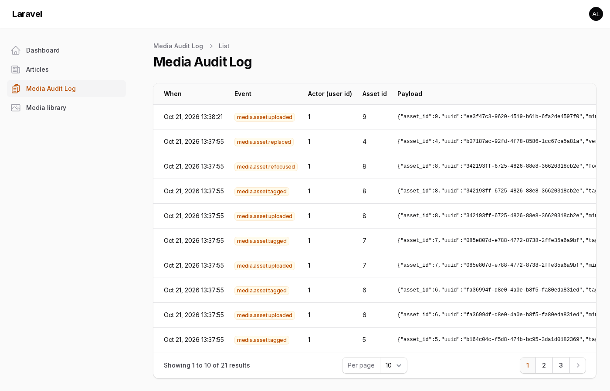

## Licence expiry

An asset may have a `license_expires_at`. The library computes expiry when you read it. It does not store a flag, so the result is never stale.

- The library page shows a "Licence governance" banner when any licence has lapsed or lapses within `expiry_warning_days` (default 30). The banner also says how many expired assets are **still used**. **Review expired** and **Review upcoming** filter the grid.
- Cards show "Licence expired", or the date it expires.
- The picker stops offering expired assets.
- Expiry does **not** stop an image being served. A page that already uses the asset keeps working. The library tells people. It does not take images down.

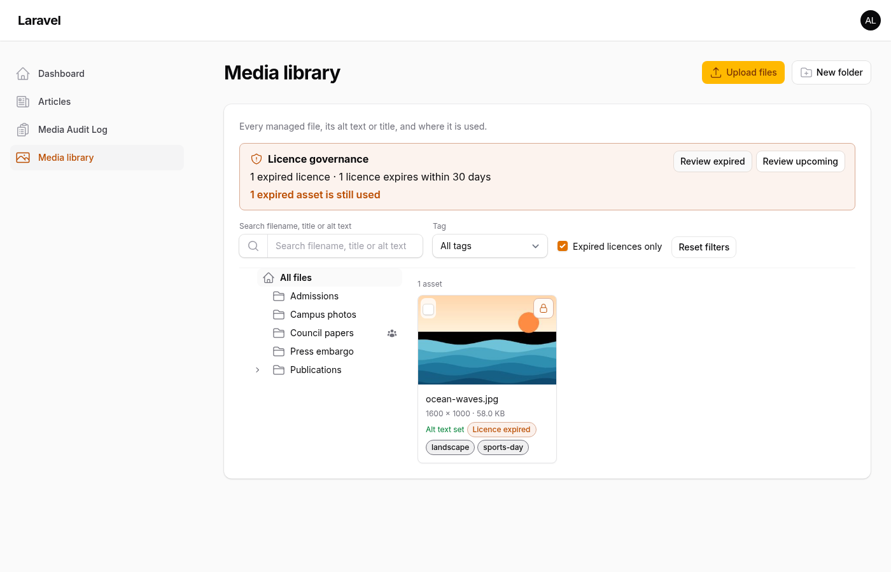

The same numbers are available in code, for a scheduled reminder or a dashboard widget:

```php
use Banyan\FilamentMediaLibrary\Governance\MediaExpiryReport;

$summary = app(MediaExpiryReport::class)->summary();   // optional: summary($now, $warningDays)

$summary->expired;                 // licences that have lapsed
$summary->expiredReferenced;       // ...of which still used
$summary->expiringSoon;            // lapsing within the warning window
$summary->expiringSoonReferenced;  // ...of which still used
$summary->warningDays;
$summary->hasIssues();             // expired > 0 or expiringSoon > 0
```

## Configuration

Publish the config with `php artisan vendor:publish --tag=media-library-config`.

| Key | Default | Meaning |
| --- | --- | --- |
| `disk` | `public` (env `MEDIA_LIBRARY_DISK`) | Laravel disk for originals and renditions |
| `paths.originals` | `media` | Prefix for original files on that disk |
| `paths.renditions` | `media/renditions` | Prefix for cached renditions |
| `driver` | `gd` (env `MEDIA_LIBRARY_DRIVER`) | `gd` or `imagick` |
| `uploads.kinds.image.mime_types` | `image/jpeg`, `image/png`, `image/gif`, `image/webp`, `image/avif` | Accepted image types |
| `uploads.kinds.image.max_size` | `12288` | Largest image, in kilobytes |
| `uploads.kinds.document.mime_types` | `application/pdf`, the `docx`, `xlsx` and `pptx` types, the `odt`, `ods` and `odp` types, `text/csv`, `text/plain`, `text/vtt` | Accepted document types |
| `uploads.kinds.document.max_size` | `51200` | Largest document, in kilobytes |
| `uploads.kinds.video.mime_types` | `video/mp4`, `video/webm` | Accepted video types |
| `uploads.kinds.video.max_size` | `512000` | Largest video, in kilobytes |
| `uploads.kinds.audio.mime_types` | `audio/mpeg`, `audio/mp4`, `audio/wav` | Accepted audio types |
| `uploads.kinds.audio.max_size` | `102400` | Largest audio file, in kilobytes |
| `uploads.kinds.archive.mime_types` | `application/zip` | Accepted archive types |
| `uploads.kinds.archive.max_size` | `102400` | Largest archive, in kilobytes |
| `uploads.archive.max_entries` | `5000` | A zip, Office or OpenDocument file with more entries than this is refused. One that expands to over 1 GB is refused too (fixed) |
| `uploads.scanner` | `null` | A class implementing `FileScanner`, run on every upload. `null` scans nothing |
| `uploads.clamav.socket` | `unix:///var/run/clamav/clamd.ctl` | The clamd socket, used by `ClamAvScanner` only. Not in the published file; add it when you use the scanner |
| `uploads.clamav.timeout` | `10` | Seconds `ClamAvScanner` waits to connect. Likewise not in the published file |
| `uploads.max_size`, `uploads.mime_types` | none | The flat keys of earlier releases. They still mean the image kind when `uploads.kinds.image` is absent |
| `renditions.max_dimension` | `4096` | Largest width or height a rendition may ask for |
| `renditions.quality` | `82` | Quality for JPEG, WebP and AVIF output |
| `expiry_warning_days` | `30` | Warn this long before a licence lapses (minimum 1) |
| `tables.assets` | `media_assets` | Table name |
| `tables.versions` | `media_versions` | Table name |
| `tables.tags` | `media_tags` | Table name |
| `tables.asset_tag` | `media_asset_tag` | Pivot table name |
| `tables.usages` | `media_usages` | Table name |
| `tables.folders` | `media_folders` | Table name |
| `tables.folder_members` | `media_folder_members` | Table name |
| `migrations` | `true` | Set `false` to skip the package's migrations |
| `abilities.view` | `media.view` | Gate ability for browsing |
| `abilities.manage` | `media.manage` | Gate ability for changing the library |
| `abilities.manage_all` | `media.manage-all` | Gate ability for the library administrator: every folder, without membership or unlocking |
| `folders.enabled` | `true` | `false` hides all folder UI and reads every asset as being at the root |
| `folders.max_depth` | `8` | How deep folders may nest |
| `folders.unlock_minutes` | `30` | How long an unlocked password folder stays open in a session |
| `folders.member_label` | `name` | The user attribute shown when choosing a folder's members; falls back to `email` |
| `routes.render.path` | `media/{uuid}/render` | Rendition route (must keep `{uuid}`) |
| `routes.render.name` | `media-library.render` | Rendition route name |
| `routes.file.path` | `media/{uuid}/file` | The signed file route (must keep `{uuid}`) |
| `routes.file.name` | `media-library.file` | File route name |
| `routes.restricted_file.path` | `media/{uuid}/restricted-file` | Route for restricted files |
| `routes.restricted_file.name` | `media-library.restricted-file` | Name of that route |
| `routes.restricted_render.path` | `media/{uuid}/restricted-render` | Route for renditions and thumbnails of restricted files |
| `routes.restricted_render.name` | `media-library.restricted-render` | Name of that route |
| `delivery.temporary_url_minutes` | `5` | How long the temporary URL a remote disk (S3, R2) is redirected to stays valid |
| `delivery.redirect_to_storage` | `downloads` | `downloads`: redirect downloads to the storage host but stream embeds from this origin (CSP-safe); `always`; `never` |
| `delivery.restricted_url_minutes` | `10` | How long the address of a file in a restricted folder works |
| `delivery.restricted_middleware` | `['web']` | Middleware of the restricted routes; they need the visitor's session |
| `navigation.register` | `true` | Add **Media library** to the sidebar |
| `navigation.group` | `null` | Navigation group: a string or a navigation-group enum |
| `navigation.sort` | `20` | Sidebar order |

Change table names before the first migration runs.

If you raise a `max_size`, also raise PHP's `upload_max_filesize` and `post_max_size`, and Livewire's temporary-upload limit in `config/livewire.php`. The defaults allow a 500 MB video, which PHP's defaults do not.

Laravel's config merge is shallow. A nested array that you publish (such as `uploads` or `delivery`) replaces the default one completely. Copy the whole block from the package's config before you edit it. Where a key is missing, the built-in default above still applies.

## Existing tables and custom table names

Set `tables.*` to your own names (there are seven now, including `folders` and `folder_members`). If those tables already exist, set `migrations` to `false` so the package does not try to create them. They then need the columns listed under [Data model](#data-model-and-querying-from-your-code). If you publish the migration (`--tag=media-library-migrations`) to edit it, also set `migrations` to `false`, so only your edited copy is loaded. The guide lists the columns the models expect.

## Look and feel, dark mode, languages

- **Colours** come from your panel's palette (`--gray-*`, `--primary-*`, `--warning-*`, `--success-*`). So the library follows your theme, including dark mode, with no extra work. To fine-tune it, set the `--ml-*` custom properties on `.ml-library`. They are listed at the top of `resources/css/media.css`.
- **Languages:** English, Traditional Chinese (`zh-Hant`) and Simplified Chinese (`zh-Hans`). Publish the translations to change the wording:

  ```bash
  php artisan vendor:publish --tag=media-library-translations
  ```

  The files land in `lang/vendor/media-library/{locale}/media.php`. Keys are read as `media-library::media.*`.

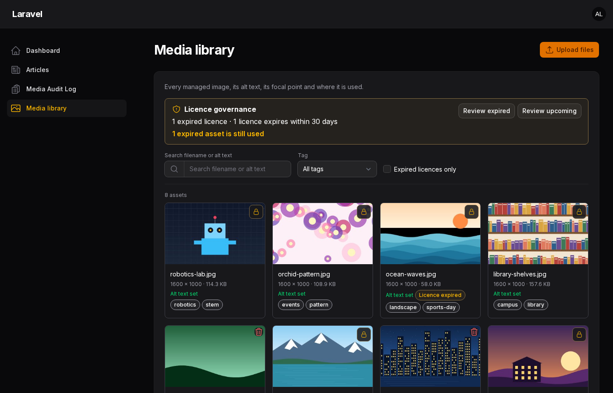

## Overriding pages and views

You can replace either page with a subclass of your own. Do this to change a query, add a header action or use your own view:

```php
use Banyan\FilamentMediaLibrary\Pages\MediaLibraryPage;

final class MediaLibrary extends MediaLibraryPage
{
    protected string $view = 'filament.pages.media-library';
}

// In your panel provider:
MediaLibraryPlugin::make()
    ->libraryPage(\App\Filament\Pages\MediaLibrary::class)
    ->assetPage(\App\Filament\Pages\MediaAsset::class);
```

The class must extend `MediaLibraryPage` or `MediaAssetPage`. The library and asset pages link to each other through the plugin, so the links go to your pages.

To change only the markup, publish the views. A view in `resources/views/vendor/media-library/` wins over the package's own:

```bash
php artisan vendor:publish --tag=media-library-views
```

Services are bound in the container, so you can rebind them too. For example, bind your own `UsageResolver` (see [Where an asset is used](#where-an-asset-is-used)).

## Using it in more than one panel

You can add the plugin to as many Filament panels as you like. All of them use **one shared library**: the same tables, the same disk and the same files.

```php
// AdminPanelProvider
->plugin(MediaLibraryPlugin::make())

// StaffPanelProvider, with its own pages if you want
->plugin(MediaLibraryPlugin::make()->libraryPage(StaffMediaLibrary::class)->assetPage(StaffMediaAsset::class))
```

What each panel gets:

- **Its own routes.** For example `/admin/media` and `/staff/media`. Links between the library page and the asset page stay inside the same panel.
- **Its own page classes**, if you swap them with `libraryPage()` and `assetPage()`.
- **The same files.** An upload in one panel shows in the other at once. A `MediaPicker` in any panel picks from the same library.
- **The same image and file URLs.** These URLs do not include the panel, so a page or an API can use them anywhere.
- **Panel tenancy works.** Banyan runs the library inside a tenant panel (`/admin/{site}/media`).

What is shared by every panel, because it lives in `config/media-library.php`:

- the disk, the table names, the upload rules and the navigation settings;
- the Gate abilities (`media.view`, `media.manage`, `media.manage-all`).

**Different files for different panels.** There is no separate storage pool per panel. Use folders for this:

- Make a top-level folder for each team, for example "Staff" and "Marketing".
- Set the folder to **Members only** and add the people who may use it.
- In a form, use `MediaPicker::make('photo_id')->folder($staffFolder)` so the field only offers that folder.

**Different permissions per panel.** The abilities are global. If a panel needs its own rule, check the current panel in your Gate:

```php
Gate::define('media.manage', fn (User $user): bool => match (Filament::getCurrentPanel()?->getId()) {
    'staff' => $user->is_staff,
    default => $user->is_editor,
});
```

The tests in `tests/MultiPanelTest.php` cover two panels on one app.

## Exceptions

All exceptions extend `Banyan\FilamentMediaLibrary\Exceptions\MediaException` (a `RuntimeException`). Messages never contain a filename, a folder name or a password.

**Uploads and files**

| Exception | When | Notes |
| --- | --- | --- |
| `AltTextRequired` | An image upload or details change has empty alt text (after trimming) | Thrown by the repository, not only the form |
| `TitleRequired` | A file that is not an image has no title | Likewise |
| `UnreadableImage` | The bytes are not an image this install can decode | Check `ext-gd` or `ext-imagick` and the driver |
| `UnsupportedFileType` | The detected type is not on the allow-list, a PDF does not start with `%PDF-`, or an Office file contains macros | The message names the detected type, or says macros are not accepted |
| `ExtensionMismatch` | The extension does not agree with what the bytes are | `cv.docx` that is really HTML |
| `FileTooLarge` | The file is over its kind's `max_size` | |
| `KindMismatch` | A replacement is not the same kind as the asset | A PDF replaced with an image |
| `UploadRejected` | A zip has too many entries or expands over 1 GB, an `AssetUploading` listener refused, or the scanner reported a threat | `UploadRejected::because($reason)`; the reason is shown to the uploader |
| `CompanionNotAllowed` | Captions on something that is not a video, a transcript on something that is not video or audio, or a captions file that is not WebVTT | |
| `AssetReferenced` | Deleting an asset that is still used | Has `$assetId` and `$usageCount`. The message names the count, never the filename |

**Folders and access**

| Exception | When | Notes |
| --- | --- | --- |
| `InvalidFolderName` | The name is empty, over 120 characters, or holds a slash or control character | |
| `FolderNameTaken` | A sibling already has this name (case-insensitive) | Also thrown when lifting contents out of a deleted folder would clash |
| `FolderCycle` | A folder is moved into its own subtree | |
| `FolderTooDeep` | Nesting would pass `folders.max_depth` | |
| `FolderNotEmpty` | Deleting a folder that holds files or sub-folders | Use `deleteMovingContentsToParent()` to lift them first |
| `InvalidFolderAccess` | A password under 8 characters, a password on a folder that is not password protected, a password folder without a password, a role other than `view` or `manage`, or a member that is not a user id | |
| `AccessDenied` | An address helper (`fileUrl()`, `downloadUrl()`, `url()`) is asked for a restricted file the signed-in user may not browse | Check `isDeliverable()` first to avoid it |

## Testing

Package tests:

```bash
composer test       # Pest
composer analyse    # PHPStan level 9
```

The suite boots a bare Laravel app with Filament and this package only. Its table names carry a `lib_` prefix, so any query that ignores the table config fails. The tests cover:

- the gate and the governance events
- the picker (including its kinds and folders) and the pages
- the signed routes, the upload guard and the scanner
- file delivery and previews
- folders and folder access, including a check that a restricted folder is absent from the HTML and the Livewire payload of someone without access
- usage tracking
- the worked example

To test your own integration (a resource with a picker, usage recording, signed URLs, an audit listener), see [Testing your integration](docs/guide.md#14-testing-your-integration).

## Running the example

[`examples/Articles`](examples/Articles) is a complete, tested module built on the plugin. It has articles with a hero image and a gallery, a usage-recording trait, an editors gate, an audit listener with its own table and Filament page, and a public page that renders a srcset. Its tests are in [`tests/Feature/Examples/ArticlesTest.php`](tests/Feature/Examples/ArticlesTest.php). The [guide](docs/guide.md) explains it piece by piece.

To try it in your app, map its namespace in `composer.json`. Composer downloads leave out `examples/`, so copy it from the repository:

```json
"autoload": { "psr-4": { "Banyan\\FilamentMediaLibrary\\Examples\\": "examples/" } }
```

Then do these steps:

1. Add `ArticlesServiceProvider` to `bootstrap/providers.php`.
2. Add `ArticleResource` and `MediaAuditResource` to your panel's `->resources([...])`.
3. List the editors' emails in `config/example-articles.php` (key `editors`).
4. Run `php artisan migrate`.

## FAQ and troubleshooting

**An image URL answers 403.** The signature is invalid. Common causes are:

- Someone edited the URL.
- `APP_KEY` changed after the URL was generated.
- The URL was generated for a different host or scheme from the one it is requested on. Check `APP_URL` and your trusted proxies.

Generate the URL again with `RenditionService::url()`. Signatures do not expire.

**An image URL answers 404.** The asset (uuid) no longer exists, or its original file is missing from the disk.

**There is no Upload button.** The signed-in user cannot manage. Either `media.manage` is undefined (managing is closed by default) or it returns `false` for this user. Define it, or use `MediaLibraryGate::manageUsing()`. If you renamed the ability in config, define that name.

**The Media library menu item does not show.** Browsing is refused (`media.view` is defined and returns `false`), or `navigation.register` is `false`.

**The usage table says "Article #1", not the title.** The default resolver only knows the model class and key. Bind your own `UsageResolver` to show titles and links.

**An asset I use shows no usage and can be deleted.** The model never called `UsageRecorder::sync()`. The picker stores ids only.

**I deleted an article and the image is still "in use".** Call `UsageRecorder::forget($article)` when the model is deleted.

**Images 404 after I changed `MEDIA_LIBRARY_DISK`.** Each asset keeps using the disk it was uploaded to (originals, replacements and renditions). Keep the old disk defined in `config/filesystems.php`. Only new uploads go to the new disk.

**Do I need `storage:link`?** No. The library never serves a file by a direct URL to the disk.

**Do I need a queue?** No. Renditions are made on the first request.

**Can I upload a PDF? An SVG?** You can upload a PDF. See [File kinds and accepted types](#file-kinds-and-accepted-types). You cannot upload an SVG. It can carry script and needs sanitising first, so it is not in this release. If you list `image/svg+xml` under `uploads.kinds.image`, it still does not work, because the image decoder cannot read it.

**An upload is refused with "Office files that contain macros are not accepted", "does not match its content" or "not accepted".** The upload guard decided from the bytes, not from the name. It refuses a `.docx` that holds a macro project, a `.pdf` that is really HTML, and any type that is not on the list. Nothing is written. See [Upload safety](#upload-safety). Convert the file, or add the type to `uploads.kinds` if you are sure you want it.

**A large upload fails before it reaches the library.** PHP's `upload_max_filesize` and `post_max_size`, and Livewire's temporary-upload limit (`config/livewire.php`), are lower than the kind's `max_size`. The defaults allow a 500 MB video, which PHP's defaults do not. Raise all three.

**PDF thumbnails show an icon, not the first page.** First-page thumbnails need `ext-imagick` with Ghostscript. Install both (`apt install ghostscript php-imagick`) and restart PHP. If both are installed and it still fails, your ImageMagick `policy.xml` probably forbids the PDF coder. Allow reading PDF there. Or bind your own `PdfThumbnailer`. See [Previews](#previews). The icon is the planned fallback, not an error.

**A video will not seek, or plays only after it has downloaded.** Seeking needs `Range` requests. They work on a local disk and, through a temporary URL, on S3-style disks. A disk without temporary URLs is streamed whole, with no ranges. You see the same problem when a proxy or CDN strips `Range`, or when an MP4 has its index at the end of the file. For the MP4 case, encode it with `ffmpeg -movflags +faststart`. See [Delivering files](#delivering-files).

**A video uploads but does not play.** The library accepts MP4 and WebM containers by what they are, but a browser plays only the codecs it knows. Use H.264 video with AAC audio in MP4. There is no transcoding in this release.

**A restricted image is broken on a public page.** This is by design. A file in a members-only or password-protected folder has a short-lived address that needs the visitor's session. So it cannot appear on a page that anonymous people see. The old permanent address also stops working as soon as the file moves into the restricted folder. Put public images in an open folder. On an intranet where everyone signs in, use `MediaPicker::...->allowRestricted()`. See [Files in restricted folders, and public pages](#files-in-restricted-folders-and-public-pages).

**A folder, or a file, is missing for someone.** A members-only folder is absent for anyone who is not the owner, a member or a `media.manage-all` holder. Everything below it is absent too (access only narrows down the tree). This is intended. The folder is not hidden, it is not there. Add the person under **Folder, Access…**. A password folder is listed with a lock until they unlock it.

**I forgot a folder's password.** The folder's owner, or anyone with `media.manage-all`, opens **Folder, Access…** and sets a new password. The old one cannot be read back, because the library stores only a hash. Setting a new password locks the folder again for everyone.

**"Too many wrong attempts".** Five wrong passwords per user per folder in 15 minutes are throttled, even if the next one is right. Wait for the time the message gives. The library records the attempts as `FolderUnlockFailed` events.

**A member can see the folder but cannot upload to it.** Their role is `view`. Give them `manage` under **Access…**. In a members-only folder the role is the grant, so they do not also need `media.manage`.

**"This folder is not empty".** You can delete a folder only when it holds nothing. Tick **Move its contents to the parent folder first** in the delete dialog to lift everything up one level. Deleting a folder never deletes a file.

**Where can I read more?** The [usage guide](docs/guide.md).

## Licence

MIT. See [LICENSE](LICENSE).
