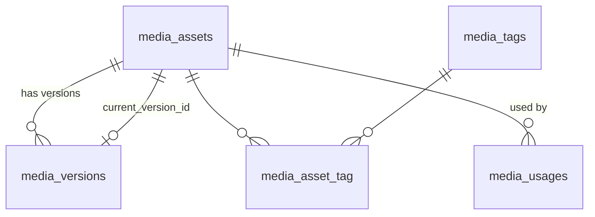

# banyancms/filament-media-library

**[READ ONLY]** Subtree split of the `filament-media-library` package from [BanyanCMS/banyan](https://github.com/BanyanCMS/banyan).

A governed **image library for Filament v5**. Every asset has alt text. Replacing a file adds a version and keeps the old one. Crops follow a focal point that an editor sets. Licences expire, and the library warns before they do. An asset that is still used cannot be deleted. Every change is a Laravel event that you can write to your own audit log.

Editors manage images in one place, and pick them from any form with a `MediaPicker` field. Your site asks for an image by size and gets a signed, cached, focal-point-aware crop.


It is a standalone Filament plugin. It needs no other Banyan package. It was extracted from [Banyan CMS](https://github.com/BanyanCMS/banyan), whose media library runs on it. Licensed **MIT**.

> **Building a real feature?** Read the **[usage guide](docs/guide.md)**. It walks through a complete, tested example (articles with a hero image and a gallery): who may upload, putting images on a model, keeping "where is it used" correct, showing images on your site, an audit log, licence expiry, customising and testing.

> **Where to change it:** the source lives in the Banyan monorepo at `packages/filament-media-library`. This repository is its published split. Open issues and pull requests against the [monorepo](https://github.com/BanyanCMS/banyan).

---

## Contents

- [What you get](#what-you-get)
- [Inspiration and how it compares](#inspiration-and-how-it-compares)
- [Requirements](#requirements)
- [Installation](#installation)
- [Quick start: an image on an article in five steps](#quick-start-an-image-on-an-article-in-five-steps)
- [Who may do what](#who-may-do-what)
- [The library and the asset page](#the-library-and-the-asset-page)
- [MediaPicker: choosing an image in a form](#mediapicker-choosing-an-image-in-a-form)
- [Where an asset is used](#where-an-asset-is-used)
- [Showing an image](#showing-an-image)
- [Writing from code](#writing-from-code)
- [Data model and querying from your code](#data-model-and-querying-from-your-code)
- [Audit log: events](#audit-log-events)
- [Licence expiry](#licence-expiry)
- [Configuration](#configuration)
- [Existing tables and custom table names](#existing-tables-and-custom-table-names)
- [Look and feel, dark mode, languages](#look-and-feel-dark-mode-languages)
- [Overriding pages and views](#overriding-pages-and-views)
- [Exceptions](#exceptions)
- [Testing](#testing)
- [Running the example](#running-the-example)
- [FAQ and troubleshooting](#faq-and-troubleshooting)
- [Licence](#licence)

---

## What you get

- **A library page** (grid, search, tag filter, licence filters) and **a page per asset** (preview, details, focal point, usage, version history), added to a panel with one line.
- **Alt text is required**, at three levels: the form, the repository (a seeder or an import cannot skip it) and a `NOT NULL` column.
- **Versions.** Replacing a file appends a version and keeps the old file. Nothing is overwritten.
- **Focal point.** An editor clicks or drags on the image. Every crop keeps that point in frame.
- **Licence expiry.** An asset can carry an expiry date. The library shows how many licences have lapsed or are about to, and how many of those are still used.
- **Usage tracking and delete protection.** An asset that is used somewhere cannot be deleted. The asset page lists where it is used.
- **`MediaPicker`**, a form field that chooses (and, for editors, uploads) an asset anywhere in your forms.
- **Signed renditions.** `RenditionService::url()` returns a signed URL for any size. The image is made on first request and cached. Replacing the file or moving the focal point changes the URL.
- **`MediaThumbnailColumn`** for Filament tables.
- **Events for an audit log.** Six events, written inside the change's own transaction. Payloads never hold alt text or filenames.
- **Gate abilities** for access, closed by default for anything that changes the library.
- **Any Laravel disk**, configurable table names, English, Traditional Chinese and Simplified Chinese.
- **No queue, no scheduler, no JavaScript build.** Renditions are made on request. Expiry is computed when you read it.


## Inspiration and how it compares

### Where the ideas come from

This library was built for Banyan, a CMS aimed at government, public bodies and schools. Those organisations are moving away from WordPress and looking at Drupal or Umbraco as the alternative. The design borrows from those systems, and from image services:

- **Drupal Media and the Focal Point module.** A media item is a reusable entity, not a file attached to one record, and every crop keeps the point an editor chose.
- **Umbraco's media section.** One shared library for the whole site, with "where is this used?" answered before anything is deleted.
- **The WordPress media library.** The grid, the per-asset page and alt text as a first-class field. Here alt text is required, not optional.
- **Image CDNs such as imgix and Cloudinary.** Renditions are made on request from a URL, cached, and signed so the URL cannot be abused as a free resizing service.
- **Digital asset management (DAM) practice.** Licence expiry, version history instead of overwriting, and an audit trail of who changed what. These are the governance needs of public-sector content.

The principle that runs through all of it: **an image is a governed asset**, not a file upload. It has an accessible description, a rights window, a history and a list of the pages that depend on it.

### How it differs from other Filament media plugins

All of these are good tools that solve different problems. This summary comes from each project's public page as of October 2026; check them for current details.

| | **This library** | [Media Library Pro](https://filamentphp.com/plugins/ralphjsmit-media-library-manager) (Ralph J. Smit) | [Crumbls Filament Media Library](https://github.com/Crumbls/filament-media-library) | [TomatoPHP Media Manager](https://github.com/tomatophp/filament-media-manager) | [Media Action](https://filamentphp.com/plugins/hugomyb-media-action) (hugomyb) |
| --- | --- | --- | --- | --- | --- |
| **What it is** | A governed image library: pages, picker, renditions, events | A media manager for the admin panel | A WordPress-style media library | A folder-based file manager | A preview action, not a library |
| **Licence** | MIT | Paid (listed at €99) | MIT | MIT | MIT |
| **Storage** | Its own tables (`media_assets`, versions, tags, usages). No spatie/laravel-medialibrary | Built on spatie/laravel-medialibrary | spatie/laravel-medialibrary plus its own `media_library` and `mediables` tables | spatie/laravel-medialibrary plus folders | None; it plays a URL you pass in |
| **Organising** | Tags, search, licence filters | Folders, filters, sorters | Grid, search, type filter | Folders and sub-folders, shared or password-protected | n/a |
| **Alt text** | **Required** (database, service and form) | Not listed | Optional field | Not listed | n/a |
| **Cropping** | Focal point: every rendition crops around it automatically | Not listed | Manual crop, rotate and flip (CropperJS) | Responsive images; no crop tool listed | n/a |
| **Replacing a file** | Adds a version; old files kept; URLs change, so caches never show old pixels | Not listed | Not listed | Not listed | n/a |
| **"Where is it used"** | Usage tracking; deleting a used asset is refused | Not listed | Polymorphic attachments | Model trait | n/a |
| **Licence and rights expiry** | Warnings, "still used" counts, picker hides expired assets | Not listed | Not listed | Not listed | n/a |
| **Audit and integration** | Events inside the transaction (an audit failure rolls back); Banyan webhooks | Custom actions | Roadmap | Folders API | n/a |
| **Permissions** | Gate abilities; managing is closed until you define it | Permissions | Not listed | Per-user folder access | n/a |
| **Image engine** | Laravel's own `Illuminate\Image` | Spatie conversions | Spatie conversions | Spatie conversions | n/a |
| **File types** | Images only | Files | Files | Files | Video, audio, PDF and images (preview) |

**When to choose another plugin.** You want folders as the main way to organise files. You manage documents, video or audio as well as images. You already use spatie/laravel-medialibrary collections on your models. You only need to preview a file in a modal; Media Action does that and composes with any library, this one included.

**When to choose this one.** Accessibility and rights are requirements, not nice-to-haves. The same image is reused on many pages. Replacing or deleting an image must be safe and traceable. You need crops that keep the subject in frame without an editor cropping every size by hand.

## Requirements

- PHP 8.3+, Laravel 13, Filament v5, Livewire v4.
- `ext-gd` (default) or `ext-imagick`. Image work uses Laravel's own image component (`Illuminate\Image`, the `Image` facade), which drives `intervention/image` v4. Set `media-library.driver` to `null` to use your app's `images.default`.
- A database. Table names are configurable; see [Configuration](#configuration).

## Installation

```bash
composer require banyancms/filament-media-library
php artisan migrate
php artisan filament:assets
```

The service provider is discovered automatically. `filament:assets` publishes the library's stylesheet; run it again after updating the package. The migration creates five tables (`media_assets`, `media_versions`, `media_tags`, `media_asset_tag`, `media_usages`). If you want other names, or you already have these tables, read [Configuration](#configuration) **before** you run `migrate`.

Add the plugin to a panel:

```php
use Banyan\FilamentMediaLibrary\MediaLibraryPlugin;

public function panel(Panel $panel): Panel
{
    return $panel
        // ...
        ->plugin(MediaLibraryPlugin::make());
}
```

The panel now has **Media library** at `/admin/media` (the sidebar item) and one page per asset at `/admin/media/{uuid}`.

**Storage.** Files go to the disk named by `media-library.disk` (default `public`, env `MEDIA_LIBRARY_DISK`). Originals and renditions are always served through the signed route, never by a URL straight to the disk. So the disk can be private and you do **not** need `php artisan storage:link`. Point the config at an S3 disk and nothing else changes.

## Quick start: an image on an article in five steps

This adds a hero image to an `Article` resource. It is the smallest useful path; the [guide](docs/guide.md) explains each step in depth.

### 1. Decide who may upload

Browsing the library and picking an image are open to any signed-in user. **Uploading, replacing, editing and deleting are refused until you define `media.manage`.** In `AppServiceProvider::boot()`:

```php
use Illuminate\Support\Facades\Gate;

Gate::define('media.manage', fn (User $user): bool => $user->is_editor);
```

### 2. Add a column that holds the asset id

```php
Schema::table('articles', function (Blueprint $table): void {
    $table->unsignedBigInteger('hero_id')->nullable();
});
```

The picker stores an **id**, not a path or a URL. For a gallery use a `json` column and cast it to `array`.

### 3. Put the picker in your resource

```php
use Banyan\FilamentMediaLibrary\Forms\MediaPicker;
use Banyan\FilamentMediaLibrary\Rendering\MediaThumbnailColumn;

// In the form
MediaPicker::make('hero_id')->label('Hero image')->thumbnails(),

// In the table
MediaThumbnailColumn::make('hero_id')->label('Hero'),
```

Remember to add `hero_id` to the model's `$fillable` (or use `$guarded = []`).

### 4. Record that the article uses the image

The picker stores ids only. It does not know which record it belongs to, so **your model has to tell the library what it uses**. Delete protection, the licence report and the "used by" table all read this. Without it the library thinks every asset is unused and lets editors delete it.

```php
use Banyan\FilamentMediaLibrary\Usage\UsageRecorder;

final class Article extends Model
{
    protected static function booted(): void
    {
        static::saved(function (self $article): void {
            app(UsageRecorder::class)->sync($article, 'hero_id', $article->hero_id === null ? [] : [(int) $article->hero_id]);
        });

        static::deleted(fn (self $article) => app(UsageRecorder::class)->forget($article));
    }
}
```

For more than one field, use the reusable trait from the example, [`RecordsMediaUsage`](examples/Articles/Concerns/RecordsMediaUsage.php).

### 5. Show the image

```php
use Banyan\FilamentMediaLibrary\Models\MediaAsset;
use Banyan\FilamentMediaLibrary\Rendering\RenditionService;

$hero = MediaAsset::find($article->hero_id);
$src = app(RenditionService::class)->url($hero, 1200, 630, 'crop');
```

```blade
alt_text }}">
```

The alt text is the asset's own and is never empty. That is the whole feature working end to end.


---

## Who may do what

Two Laravel Gate abilities. Their names are in `media-library.abilities`.

| Ability | Default name | Allows | When it is not defined |
| --- | --- | --- | --- |
| view | `media.view` | Open the library and asset pages | Any signed-in user |
| manage | `media.manage` | Upload, replace, edit details, refocus, retag, delete (including the picker's "Upload new") | **Nobody** |

Managing is refused until you define it. An undefined permission must never default to open:

```php
Gate::define('media.manage', fn (User $user): bool => $user->is_editor);
```

If your permissions do not live in a Gate ability, give the library a fallback. It is asked **only while the manage ability is undefined**:

```php
use Banyan\FilamentMediaLibrary\Access\MediaLibraryGate;

MediaLibraryGate::manageUsing(fn (): bool => auth()->user()?->hasRole('editor') === true);
```

Both checks return `false` for a guest. Every write re-checks the gate on the server (page actions, the focal point save and the picker's upload all do), so a hidden button is not the only protection.

Two things to know:

- The library asks `Gate::allows()` first, so a `Gate::before()` grant counts (this is how permission packages such as spatie/laravel-permission and super-admin shortcuts work), even when `media.manage` was never `define()`d. Only when nothing grants it and the ability is undefined does `manageUsing()` decide.
- `MediaGovernanceService` and the other classes you call from code do **not** check the gate. Only the pages and the picker do. See [Writing from code](#writing-from-code).

A signed-in user who may not manage sees a read-only library:


## The library and the asset page


- **Upload files** (managers only) asks for the file, the alt text (required), an optional licence expiry date and comma-separated tags. Tags are lower-cased on save.
- The grid shows the newest **120** assets first, with **Load more** for the next 120 and a "Showing 120 of N" count. The search box (filename or alt text), the tag filter and the licence filters narrow it.
- A card shows a trash icon when the asset is unused and a padlock when it is used. Click a card to open the asset page.
- On the asset page, **Edit details** changes alt text and licence expiry. **More** holds Edit tags, Replace file and, for an asset nothing uses, Delete asset. The focal point is set on the image itself.
- The **Version history** lists every file the asset has had. It is a record: there is no restore or download button in this release.

## MediaPicker: choosing an image in a form

```php
use Banyan\FilamentMediaLibrary\Forms\MediaPicker;

MediaPicker::make('hero_id');                       // one asset: stores an id
MediaPicker::make('gallery')->multiple();           // many assets: stores a list of ids
MediaPicker::make('hero_id')->thumbnails();         // a 48px cropped thumbnail beside each option
MediaPicker::make('hero_id')->uploadable(false);    // no "Upload new" button on this field
```

`MediaPicker` extends Filament's `Select`, so `->label()`, `->required()`, `->helperText()`, `->hint()`, `->live()`, `->maxItems()` and the other `Select` methods work as usual.


- **Options** are the newest 50 selectable assets. Typing searches filename and alt text and returns up to 50 matches.
- **Expired assets are not offered.** Choosing is where a new usage starts, and a lapsed licence is what expiry exists to stop. If a record already holds an asset that has since expired, it still shows, labelled "Licence expired".
- **Upload new** (the button at the end of the field) opens the same dialog as the library, requires alt text, goes through the same audited path, and selects the new asset. It is visible only to users who may manage, and the gate is checked again when the dialog is submitted. Wait for the file to finish uploading before you submit.
- **Thumbnails** are off by default. They turn every option into HTML (an `` with the asset's alt text). The plain list is the cheapest thing for a screen reader and a slow connection.
- **Accessibility.** The picker is a standard searchable `Select`, so it has Filament's keyboard and screen-reader behaviour. The library does not ship a bespoke widget to keep conformant.


The picker does not check the browse ability. Whoever can open the form that holds the field is already choosing which assets it shows.

## Where an asset is used

The library blocks deletion, counts "still used" licences and lists usages on the asset page. To do this it asks a `UsageResolver`. The default resolver reads the rows that `UsageRecorder` writes:

```php
use Banyan\FilamentMediaLibrary\Usage\UsageRecorder;

$recorder = app(UsageRecorder::class);

// When a post is saved: replace what its `hero` field uses (a list of asset ids).
$recorder->sync($post, 'hero', [$post->hero_id]);

// Per locale, if the field differs by language.
$recorder->sync($post, 'hero', [$post->hero_id], 'en');

// When a post is deleted.
$recorder->forget($post);
```

`sync()` replaces the assets one field of one model (and one locale) uses. `forget()` drops everything a model uses. The model must be saved and have an int or string key; otherwise `InvalidArgumentException`. Model events do not fire for query-builder updates or `insert()`, so a bulk import has to call `sync()` itself. The guide shows a reusable trait, a backfill, and the details.

If your app already knows its references, bind your own `Banyan\FilamentMediaLibrary\Contracts\UsageResolver` in a service provider. It has four methods:

```php
interface UsageResolver
{
    /** @return list<AssetUsage> */
    public function usages(int $assetId): array;           // the asset page's "Usage" table

    public function count(int $assetId): int;              // delete protection

    /** @return array<int, int> asset id => live usage count */
    public function counts(array $assetIds): array;        // one query for a library page

    public function whereUsed(Builder $query, string $assetIdColumn): void; // the licence report
}
```

A short example that reads an `article_media` pivot table directly, and links each usage to its edit page:

```php
use Banyan\FilamentMediaLibrary\Contracts\UsageResolver;
use Banyan\FilamentMediaLibrary\Usage\AssetUsage;
use Illuminate\Database\Query\Builder;
use Illuminate\Support\Facades\DB;

final class ArticleUsageResolver implements UsageResolver
{
    public function usages(int $assetId): array
    {
        return DB::table('article_media as m')
            ->join('articles as a', 'a.id', '=', 'm.article_id')
            ->where('m.media_asset_id', $assetId)
            ->orderBy('a.id')
            ->get(['a.id', 'a.title', 'm.role'])
            ->map(fn (object $row): AssetUsage => new AssetUsage(
                label: 'Article: '.$row->title,
                type: 'Article',
                field: (string) $row->role,
                url: ArticleResource::getUrl('edit', ['record' => $row->id]),
            ))
            ->all();
    }

    public function count(int $assetId): int
    {
        return DB::table('article_media')->where('media_asset_id', $assetId)->count();
    }

    public function counts(array $assetIds): array
    {
        return DB::table('article_media')
            ->whereIn('media_asset_id', $assetIds)
            ->groupBy('media_asset_id')
            ->selectRaw('media_asset_id, COUNT(*) as n')
            ->pluck('n', 'media_asset_id')
            ->map(fn (mixed $n): int => (int) $n)
            ->all();
    }

    public function whereUsed(Builder $query, string $assetIdColumn): void
    {
        $query->whereExists(fn (Builder $q) => $q->selectRaw('1')->from('article_media as m')->whereColumn('m.media_asset_id', $assetIdColumn));
    }
}

// In a service provider's register():
$this->app->singleton(UsageResolver::class, ArticleUsageResolver::class);
```

"Used" must mean **live**. A usage whose owner has been deleted has to stop counting, or a safe delete is refused and a licence report raises a false alarm.

## Showing an image

```php
use Banyan\FilamentMediaLibrary\Rendering\RenditionService;

$renditions = app(RenditionService::class);

$renditions->url($asset, 1200, 630, 'crop');      // 1200x630, cropped around the focal point
$renditions->url($asset, 1200, 630, 'contain');   // fits inside 1200x630, no crop
$renditions->url($asset, 800);                    // 800px wide, height follows
$renditions->url($asset);                         // the original bytes
```

| Call | Result |
| --- | --- |
| width and height, `'crop'` (or no fit) | Cropped to that box around the focal point |
| width and height, `'contain'` | Scaled to fit inside the box, never upscaled |
| one dimension only | Scaled to that size, never upscaled (always `contain`) |
| neither | The original file, untouched |

Sizes are clamped to `renditions.max_dimension` (default 4096). The output keeps the original format (a JPEG stays a JPEG). Lossy formats use `renditions.quality`.

A srcset from three calls:

```blade
url($asset, 1200, 630, 'crop') }}"
    srcset="{{ $renditions->url($asset, 600, 315, 'crop') }} 600w, {{ $renditions->url($asset, 1200, 630, 'crop') }} 1200w"
    sizes="(min-width: 52rem) 52rem, 100vw"
    width="1200" height="630"
    alt="{{ $asset->alt_text }}">
```


**The URL is signed.** The route `media/{uuid}/render` (named `media-library.render`, both configurable) uses Laravel's `signed` middleware, because its query string is an instruction to spend CPU and disk. It has no session and no cookies. A request with a missing or altered signature gets `403`. The signature does not expire, so a URL stays valid for as long as `APP_KEY` does.

**Caching and versioning.** The first request makes the rendition around the focal point and stores it on the disk. Every later request is a disk read. The response carries `Cache-Control: public, max-age=31536000, immutable`. The URL includes the current version and the focal point, so replacing the file or moving the focal point gives a **new** URL. Browsers and CDNs never show the old pixels. Cache the URLs freely, in your HTML cache too.

**Tables.** In a Filament table, `MediaThumbnailColumn::make('hero_id')` shows the thumbnail of an asset id (a list of ids shows each). `->thumbnailSize(96, 64)` changes the crop; the default is 80 by 80.

## Writing from code

All writes go through `MediaGovernanceService`. Each runs in a transaction and announces itself with an event:

```php
use Banyan\FilamentMediaLibrary\Governance\MediaGovernanceService;

$media = app(MediaGovernanceService::class);

$asset = $media->upload($bytes, 'campus.jpg', 'image/jpeg', 'The campus at dusk', (string) $user->id);
$media->updateDetails($asset, 'The campus at dusk, from the north gate', null, (string) $user->id);
$media->setFocalPoint($asset, 0.7, 0.4, (string) $user->id);
$media->syncTags($asset, ['campus', 'events'], (string) $user->id);
$media->replace($asset, $newBytes, 'campus-2027.jpg', 'image/jpeg', (string) $user->id);
$media->delete($asset, (string) $user->id);
```

| Method | Returns | Throws |
| --- | --- | --- |
| `upload(string $binary, string $filename, string $mimeType, string $altText, string $actorId, ?DateTimeInterface $licenseExpiresAt = null)` | `MediaAsset` | `AltTextRequired`, `UnreadableImage` |
| `replace(MediaAsset $asset, string $binary, string $filename, string $mimeType, string $actorId)` | `MediaVersion` | `UnreadableImage` |
| `updateDetails(MediaAsset $asset, string $altText, ?DateTimeInterface $licenseExpiresAt, string $actorId)` | `void` | `AltTextRequired` |
| `setFocalPoint(MediaAsset $asset, float $x, float $y, string $actorId)` | `void` | none (clamped to 0 to 1) |
| `syncTags(MediaAsset $asset, array $names, string $actorId)` | `void` | none |
| `delete(MediaAsset $asset, string $actorId)` | `void` | `AssetReferenced` |

`$actorId` is your user's id as a string. It goes into the event. `updateDetails()` sets the licence expiry to exactly what you pass, so `null` clears it. `uploaded_by` on the asset is set only when it is numeric. These methods do not check the gate: if the call is made on behalf of a user, check `MediaLibraryGate::allowsManage()` yourself.

## Data model and querying from your code

Read the tables freely from any controller, service, job or report. **Write only through `MediaGovernanceService`** ([Writing from code](#writing-from-code)): it keeps the asset/version invariant, removes files on rollback and dispatches the events your audit log and webhooks depend on.

### Tables

The names below are the defaults. Each one is configurable in `media-library.tables.*`; Banyan uses `cms_media_*`. In raw queries, read the name from `MediaConfig::table('assets')` and the others, never hard-code it.



**`media_assets`**: one row per image, the thing you reference from your own tables.

| Column | Type | Meaning |
| --- | --- | --- |
| `id` | bigint | Primary key. Store this in your own column (`hero_id`) |
| `uuid` | uuid, unique | Public identifier, used in URLs. Never expose `id` in a URL |
| `disk`, `path` | string | Where the **current** file lives. Each asset keeps the disk it was uploaded to |
| `filename` | string | Original filename of the current file. It can be personal data, so do not log it |
| `mime_type` | string | For example `image/jpeg` |
| `size_bytes`, `width`, `height` | int | Of the current file |
| `alt_text` | string, not null | Always set; the library refuses an empty one |
| `focal_x`, `focal_y` | decimal 0–1 | The point every crop keeps (0.5, 0.5 is the centre) |
| `license_expires_at` | timestamp, nullable | Null means no expiry |
| `current_version_id` | bigint, nullable | The version row of the current file |
| `uploaded_by` | bigint, nullable | Your user id, when it was numeric |
| `created_at`, `updated_at` | timestamp | |

**`media_versions`**: every file an asset has had; a replacement adds a row and the old file is kept.

| Column | Meaning |
| --- | --- |
| `id`, `media_asset_id` | Key, and the asset it belongs to (cascade on delete) |
| `disk`, `path`, `checksum` (sha256), `size_bytes`, `width`, `height` | The file |
| `uploaded_by`, `created_at` | Who uploaded it and when (no `updated_at`) |

**`media_tags`** (`id`, `name` unique, lower-cased) and **`media_asset_tag`** (`media_asset_id`, `media_tag_id`): flat, editor-authored tags.

**`media_usages`**: what the default resolver counts as "used". It is written by `UsageRecorder`.

| Column | Meaning |
| --- | --- |
| `media_asset_id` | The asset |
| `usable_type`, `usable_id` | Your model (`getMorphClass()` and key, the key stored as a string) |
| `field` | Which field holds it, for example `hero_id` |
| `locale` | Nullable, for per-locale fields |

If you bound your own `UsageResolver`, your usages live wherever your resolver reads them. Always ask the resolver (below), not this table.

### Models

All are in `Banyan\FilamentMediaLibrary\Models` and read the configured table names.

| Model | Relations | Helpers |
| --- | --- | --- |
| `MediaAsset` | `versions()` (newest first), `currentVersion()`, `tags()` | `isExpired()`, `url($w, $h, $fit)`, `humanSize()`, `dimensions()`, `MediaAsset::findByUuid($uuid)`, `MediaAsset::formatBytes($bytes)` |
| `MediaVersion` | `asset()` | `shortChecksum()`, `humanSize()` |
| `MediaTag` | `assets()` | `MediaTag::normalise($name)` |

Query scopes on `MediaAsset`:

| Scope | Selects |
| --- | --- |
| `selectable()` | Licence not expired, which is what the picker offers |
| `expired()` | Licence lapsed |
| `expiringWithin(int $days)` | Lapses within the next `$days` days |
| `search(string $term)` | Filename or alt text contains the term |
| `tagged(string\|array $names)` | Carries any of these tags |
| `used()` | Used somewhere, as the bound `UsageResolver` counts it |

### Helper services

| Class | Use it for |
| --- | --- |
| `Rendering\RenditionService` | `url($asset, $w, $h, 'crop'\|'contain')` gives a signed, cache-safe image URL; `$asset->url(...)` is the shortcut |
| `Contracts\UsageResolver` | `usages($id)`, `count($id)`, `counts([$ids])` (one query for a list), `whereUsed($query, 'column')` |
| `Usage\UsageRecorder` | `sync($model, 'field', [$ids])` and `forget($model)`, to keep usage correct |
| `Governance\MediaExpiryReport` | `summary()` gives the expired and expiring counts, and how many of them are still used |
| `Access\MediaLibraryGate` | `allowsBrowse()`, `allowsManage()` and `actorId()` before acting on a user's behalf |
| `Support\MediaConfig` | `table('assets')` and typed config reads |

### Recipes

```php
use Banyan\FilamentMediaLibrary\Contracts\UsageResolver;
use Banyan\FilamentMediaLibrary\Models\MediaAsset;
use Banyan\FilamentMediaLibrary\Support\MediaConfig;

// An article's hero image for an API response.
$hero = MediaAsset::query()->find($article->hero_id);
$data = $hero === null ? null : [
    'uuid' => $hero->uuid,
    'alt' => $hero->alt_text,
    'width' => $hero->width,
    'height' => $hero->height,
    'url' => $hero->url(1200, 630, 'crop'),
    'thumb' => $hero->url(320, 240, 'crop'),
];

// A list of articles with their heroes, without N+1 queries.
$heroes = MediaAsset::query()->whereIn('id', $articles->pluck('hero_id')->filter())->get()->keyBy('id');

// A gallery stored as a JSON array of ids, in the editor's order.
$gallery = MediaAsset::query()->whereIn('id', $article->gallery ?? [])->get()
    ->sortBy(fn (MediaAsset $a) => array_search($a->id, $article->gallery, true))->values();

// Licences to chase this month: expiring and still on a page.
$toRenew = MediaAsset::query()->expiringWithin(30)->used()->orderBy('license_expires_at')->get();

// Campus photos an editor may still pick.
$campus = MediaAsset::query()->selectable()->tagged('campus')->latest()->paginate(24);

// Where one asset is used, and usage counts for a whole list in one query.
$usages = app(UsageResolver::class)->usages($asset->id);   // list<AssetUsage>: label, type, field, locale, url
$counts = app(UsageResolver::class)->counts($ids);         // [asset id => count]

// A join from your own table, with the configured table name.
$rows = DB::table('articles as a')
    ->join(MediaConfig::table('assets').' as m', 'm.id', '=', 'a.hero_id')
    ->where('m.mime_type', 'image/png')
    ->get(['a.id', 'a.title', 'm.uuid', 'm.alt_text']);
```

**Your own columns.** Store the asset id (`unsignedBigInteger('hero_id')->nullable()`, or a JSON list for a gallery). You may add a foreign key to `media_assets.id` with `nullOnDelete()`. The library refuses to delete an asset that is still used, so the key mainly protects you from bulk imports.

**Do not** update `media_assets` or `media_versions` with `DB::table()->update()` or `$asset->save()`. That skips alt-text validation, the version history, rendition cache keys and the events. Use the service.

## Audit log: events

Every change dispatches an event that implements `Banyan\FilamentMediaLibrary\Events\MediaEvent`. It has `name()`, `assetId()`, `actorId()` and `payload()`.

| Event class | `name()` | Payload keys |
| --- | --- | --- |
| `AssetUploaded` | `media.asset.uploaded` | `asset_id`, `uuid`, `mime_type`, `size_bytes`, `width`, `height` |
| `AssetReplaced` | `media.asset.replaced` | `asset_id`, `uuid`, `version_id`, `superseded_version_id`, `size_bytes` |
| `AssetUpdated` | `media.asset.updated` | `asset_id`, `uuid`, `alt_text_changed` (bool), `license_expires_at` (ISO 8601 or null) |
| `FocalPointChanged` | `media.asset.refocused` | `asset_id`, `uuid`, `focal_x`, `focal_y` |
| `AssetTagged` | `media.asset.tagged` | `asset_id`, `uuid`, `tag_count` |
| `AssetDeleted` | `media.asset.deleted` | `asset_id`, `uuid`, `usage_count` (the count at the moment of deletion) |

Events are dispatched **inside the write's database transaction**. If a listener throws, the write is rolled back, so an audit log never describes a change that did not happen. Payloads carry ids, sizes and flags. They never carry alt text or a filename, which can name a person.

```php
use Banyan\FilamentMediaLibrary\Events\MediaEvent;
use Illuminate\Support\Facades\Event;

Event::listen(MediaEvent::class, function (MediaEvent $event): void {
    AuditLog::create([
        'event' => $event->name(),
        'actor_id' => $event->actorId(),
        'subject_id' => $event->assetId(),
        'payload' => $event->payload(),
    ]);
});
```

Keep the log on the same database connection as the library, otherwise a failed insert cannot roll the change back. The example ships a ready listener, migration and a read-only Filament page ([`RecordMediaAudit`](examples/Articles/Listeners/RecordMediaAudit.php)).


## Licence expiry

An asset may have a `license_expires_at`. Expiry is **computed when read**, not stored as a flag, so it is never stale.

- The library page shows a "Licence governance" banner when any licence has lapsed or lapses within `expiry_warning_days` (default 30). It also says how many expired assets are **still used**. **Review expired** and **Review upcoming** filter the grid.
- Cards show "Licence expired", or the date it expires.
- The picker stops offering expired assets.
- Expiry does **not** stop an image being served. A page that already uses the asset keeps working. The library tells people; it does not take images down.


The same numbers are available in code, for a scheduled reminder or a dashboard widget:

```php
use Banyan\FilamentMediaLibrary\Governance\MediaExpiryReport;

$summary = app(MediaExpiryReport::class)->summary();   // optional: summary($now, $warningDays)

$summary->expired;                 // licences that have lapsed
$summary->expiredReferenced;       // ...of which still used
$summary->expiringSoon;            // lapsing within the warning window
$summary->expiringSoonReferenced;  // ...of which still used
$summary->warningDays;
$summary->hasIssues();             // expired > 0 or expiringSoon > 0
```

## Configuration

Publish the config with `php artisan vendor:publish --tag=media-library-config`.

| Key | Default | Meaning |
| --- | --- | --- |
| `disk` | `public` (env `MEDIA_LIBRARY_DISK`) | Laravel disk for originals and renditions |
| `paths.originals` | `media` | Prefix for original files on that disk |
| `paths.renditions` | `media/renditions` | Prefix for cached renditions |
| `driver` | `gd` (env `MEDIA_LIBRARY_DRIVER`) | `gd` or `imagick` |
| `uploads.max_size` | `12288` | Largest upload, in kilobytes |
| `uploads.mime_types` | `image/jpeg`, `image/png`, `image/gif`, `image/webp`, `image/avif` | Accepted uploads |
| `renditions.max_dimension` | `4096` | Largest width or height a rendition may ask for |
| `renditions.quality` | `82` | Quality for JPEG, WebP and AVIF output |
| `expiry_warning_days` | `30` | Warn this long before a licence lapses (minimum 1) |
| `tables.assets` | `media_assets` | Table name |
| `tables.versions` | `media_versions` | Table name |
| `tables.tags` | `media_tags` | Table name |
| `tables.asset_tag` | `media_asset_tag` | Pivot table name |
| `tables.usages` | `media_usages` | Table name |
| `migrations` | `true` | Set `false` to skip the package's migrations |
| `abilities.view` | `media.view` | Gate ability for browsing |
| `abilities.manage` | `media.manage` | Gate ability for changing the library |
| `route.path` | `media/{uuid}/render` | Rendition route (must keep `{uuid}`) |
| `route.name` | `media-library.render` | Rendition route name |
| `navigation.register` | `true` | Add **Media library** to the sidebar |
| `navigation.group` | `null` | Navigation group: a string or a navigation-group enum |
| `navigation.sort` | `20` | Sidebar order |

Change table names before the first migration runs. Raise PHP's `upload_max_filesize` and `post_max_size`, and Livewire's temporary-upload limit in `config/livewire.php`, if you raise `uploads.max_size`.

## Existing tables and custom table names

Set `tables.*` to your own names. If those tables already exist, set `migrations` to `false` so the package does not try to create them. If you publish the migration (`--tag=media-library-migrations`) to edit it, set `migrations` to `false` so only your edited copy is loaded. The guide lists the columns the models expect.

## Look and feel, dark mode, languages

- **Colours** come from your panel's palette (`--gray-*`, `--primary-*`, `--warning-*`, `--success-*`), so the library follows your theme, including dark mode, with no work. To fine-tune it, set the `--ml-*` custom properties on `.bn-media`. They are listed at the top of `resources/css/media.css`.
- **Languages:** English, Traditional Chinese (`zh-Hant`) and Simplified Chinese (`zh-Hans`). Publish to change the wording:

  ```bash
  php artisan vendor:publish --tag=media-library-translations
  ```

  The files land in `lang/vendor/media-library/{locale}/media.php`. Keys are read as `media-library::media.*`.


## Overriding pages and views

Swap either page for a subclass of your own, to change a query, add a header action or use your own view:

```php
use Banyan\FilamentMediaLibrary\Admin\MediaLibraryPage;

final class MediaLibrary extends MediaLibraryPage
{
    protected string $view = 'filament.pages.media-library';
}

// In your panel provider:
MediaLibraryPlugin::make()
    ->libraryPage(\App\Filament\Pages\MediaLibrary::class)
    ->assetPage(\App\Filament\Pages\MediaAsset::class);
```

The class must extend `MediaLibraryPage` or `MediaAssetPage`. The library and asset pages link to each other through the plugin, so the links go to your pages.

To change only the markup, publish the views. A view in `resources/views/vendor/media-library/` wins over the package's own:

```bash
php artisan vendor:publish --tag=media-library-views
```

Services are bound in the container, so you can rebind them too. Bind your own `UsageResolver`, for example (see [Where an asset is used](#where-an-asset-is-used)).

## Exceptions

All extend `Banyan\FilamentMediaLibrary\Exceptions\MediaException` (a `RuntimeException`).

| Exception | When | Notes |
| --- | --- | --- |
| `AltTextRequired` | An upload or details change has empty alt text (after trimming) | Thrown by the repository, not only the form |
| `UnreadableImage` | The bytes are not an image this install can decode | Check `ext-gd` or `ext-imagick` and the driver |
| `AssetReferenced` | Deleting an asset that is still used | Has `$assetId` and `$usageCount`. The message names the count, never the filename |

## Testing

Package tests:

```bash
composer test       # Pest
composer analyse    # PHPStan level 9
```

The suite boots a bare Laravel app with Filament and this package only. Its table names carry a `lib_` prefix, so any query that ignores the table config fails. It covers the gate, the governance events, the picker, the pages, the signed route and the usage tracking, plus the worked example.

To test your own integration (a resource with a picker, usage recording, signed URLs, an audit listener), see [Testing your integration](docs/guide.md#10-testing-your-integration).

## Running the example

[`examples/Articles`](examples/Articles) is a complete, tested module built on the plugin: articles with a hero image and a gallery, a usage-recording trait, an editors gate, an audit listener with its own table and Filament page, and a public page that renders a srcset. Its tests are in [`tests/Feature/Examples/ArticlesTest.php`](tests/Feature/Examples/ArticlesTest.php). The [guide](docs/guide.md) explains it piece by piece.

To try it in your app, map its namespace in `composer.json` (`examples/` is left out of Composer downloads, so copy it from the repository):

```json
"autoload": { "psr-4": { "Banyan\\FilamentMediaLibrary\\Examples\\": "examples/" } }
```

Then add `ArticlesServiceProvider` to `bootstrap/providers.php`, add `ArticleResource` and `MediaAuditResource` to your panel's `->resources([...])`, list the editors' emails in `config/example-articles.php` (key `editors`), and run `php artisan migrate`.

## FAQ and troubleshooting

**An image URL answers 403.** The signature is invalid. Common causes: the URL was edited; `APP_KEY` changed since it was generated; the URL was generated for another host or scheme than the one it is requested on (check `APP_URL` and your trusted proxies). Generate the URL again with `RenditionService::url()`. Signatures do not expire.

**An image URL answers 404.** The asset (uuid) no longer exists, or its original file is missing from the disk.

**There is no Upload button.** The signed-in user cannot manage. `media.manage` is undefined (managing is closed by default) or it returns `false` for this user. Define it, or use `MediaLibraryGate::manageUsing()`. If you renamed the ability in config, define that name.

**The Media library menu item does not show.** Browsing is refused (`media.view` is defined and returns `false`), or `navigation.register` is `false`.

**The usage table says "Article #1", not the title.** That is the default resolver, which only knows the model class and key. Bind your own `UsageResolver` to show titles and links.

**An asset I use shows no usage and can be deleted.** The model never called `UsageRecorder::sync()`. The picker stores ids only.

**I deleted an article and the image is still "in use".** Call `UsageRecorder::forget($article)` when the model is deleted.

**Images 404 after I changed `MEDIA_LIBRARY_DISK`.** Each asset keeps using the disk it was uploaded to (originals, replacements and renditions), so keep the old disk defined in `config/filesystems.php`. Only new uploads go to the new disk.

**Do I need `storage:link`?** No. Nothing is served by a direct URL to the disk.

**Do I need a queue?** No. Renditions are made on the first request. A queued pipeline is a different feature with its own failure modes.

**Can I upload an SVG or a PDF?** No. The library accepts raster images that GD or Imagick can decode. Listing another type in `uploads.mime_types` does not make the decoder read it.

**Where can I read more?** The [usage guide](docs/guide.md).

## Licence

MIT. See [LICENSE](LICENSE).
