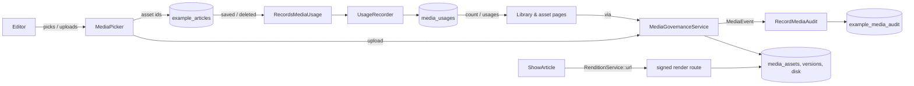

# Using Filament Media Library in a real application

The [README](../README.md) shows what the plugin does and how to put an image on a record. This guide covers the rest: running a governed library in a real application, with real permissions, real models and a real site.

It walks through a complete, working example that ships with the plugin: **articles with a hero image and a gallery**, in [`examples/Articles`](../examples/Articles). Every behaviour described here is covered by [its tests](../tests/Feature/Examples/ArticlesTest.php) or by the package's own suite, and you can copy the folder into your app as a starting point.

It answers these questions:

1. [How do I install it and wire it into an existing panel?](#1-install-and-wire-it-into-a-panel)
2. [How do I control who can upload, replace and delete?](#2-who-may-upload-replace-and-delete)
3. [How do I put an image on my model?](#3-putting-an-image-on-your-model)
4. [How do I keep "where is it used" correct?](#4-keeping-where-is-it-used-correct)
5. [How do I show images on my site?](#5-showing-images-on-your-site)
6. [How do I add an audit log?](#6-an-audit-log)
7. [Licences and expiry: what happens and what do I get?](#7-licences-and-expiry)
8. [Replacing files, versions and the focal point](#8-replacing-files-versions-and-the-focal-point)
9. [How do I customise it?](#9-customising)
10. [How do I test my integration?](#10-testing-your-integration)
11. [Limits and known rough edges](#11-limits-and-known-rough-edges)

---

## What the plugin does, and what your app does

| The plugin | Your app |
| --- | --- |
| The library and asset pages: upload, replace, details, focal point, tags, versions, licence banner | **Who** may manage media: a Gate ability that maps to your users and roles |
| `MediaPicker`, `MediaThumbnailColumn` | **Which models** hold images, and which fields |
| Storage on a Laravel disk; five tables | **Telling the library what each record uses** (`UsageRecorder`), or your own `UsageResolver` |
| Signed, cached, focal-point-aware renditions | **Your templates**: which sizes you ask for, and the `` markup |
| Six events, dispatched inside the write's transaction | **The audit log**: a listener that writes them where you keep your history |
| Licence expiry computed on read, and `MediaExpiryReport` | **Reminders**: a scheduled job or widget, if you want one |

The plugin never guesses at your schema. It stores asset **ids**; your models store those ids; and the plugin asks one contract (`UsageResolver`) whether an asset is still used.

## The example at a glance



| File | Role |
| --- | --- |
| `Access/MediaPermissions.php` | Maps `media.manage` onto this app's editors ([§2](#2-who-may-upload-replace-and-delete)) |
| `Models/Article.php`, `Concerns/RecordsMediaUsage.php` | A model with a hero id and a gallery, and the trait that keeps usage in step ([§3](#3-putting-an-image-on-your-model), [§4](#4-keeping-where-is-it-used-correct)) |
| `Filament/Resources/Articles/*` | A resource with `MediaPicker` fields and a `MediaThumbnailColumn` |
| `Http/ShowArticle.php`, `resources/views/article.blade.php` | The public page, with a srcset ([§5](#5-showing-images-on-your-site)) |
| `Listeners/RecordMediaAudit.php`, `Models/MediaAuditEntry.php`, `Filament/Resources/MediaAudit/*` | The audit log and its read-only page ([§6](#6-an-audit-log)) |
| `ArticlesServiceProvider.php` | Wires it up: gate, listener, route, migrations |
| `config/example-articles.php` | `editors` (emails) and `define_gate` |
| `database/migrations/…` | `example_articles` and `example_media_audit` |

**Try it in your app:** map the namespace in `composer.json`:

```json
"autoload": { "psr-4": { "Banyan\\FilamentMediaLibrary\\Examples\\": "vendor/banyancms/filament-media-library/examples/" } }
```

(`examples/` is left out of Composer downloads; copy it from the repository.) Then:

1. Add `ArticlesServiceProvider` to `bootstrap/providers.php`.
2. Add `ArticleResource` and `MediaAuditResource` to your panel's `->resources([...])`.
3. Put your editors' emails in `config/example-articles.php` under `editors` (the provider merges the example's defaults; an empty list means nobody may manage).
4. Run `php artisan migrate`.


---

## 1. Install and wire it into a panel

```bash
composer require banyancms/filament-media-library
php artisan migrate
php artisan filament:assets
```

Before you migrate, decide three things, because they are awkward to change afterwards:

- **The disk.** `media-library.disk` (env `MEDIA_LIBRARY_DISK`, default `public`). Each asset records the disk its original was written to. See [§9](#9-customising) for moving later.
- **The table names.** Defaults are `media_assets`, `media_versions`, `media_tags`, `media_asset_tag` and `media_usages`. If any clashes with a table in your app, or you already have media tables, read [§9](#9-customising) first.
- **The image driver.** `gd` by default. For Imagick set `MEDIA_LIBRARY_DRIVER=imagick`.

Publish the config if you need to change any of that:

```bash
php artisan vendor:publish --tag=media-library-config
```

Register the plugin on the panel (in `app/Providers/Filament/AdminPanelProvider.php`, or wherever your panel is defined):

```php
use Banyan\FilamentMediaLibrary\MediaLibraryPlugin;

return $panel
    ->id('admin')
    ->path('admin')
    // ...
    ->plugin(MediaLibraryPlugin::make());
```

That adds two pages to that panel only:

| Page | URL | In the sidebar |
| --- | --- | --- |
| Media library | `/admin/media` | yes (unless `navigation.register` is `false`) |
| One asset | `/admin/media/{uuid}` | no; reached from a card, but it is a real, linkable route |

The asset URL uses the asset's uuid, not its auto-increment id, so pasting it into a ticket does not expose a way to count your library.

The plugin does **not** need to be on the panel for `MediaPicker` or `RenditionService` to work. Those are plain classes. But without the pages there is nowhere to see an asset's usage, edit its focal point or replace its file, so register it.

One more route is added to your **application**, not the panel: the signed rendition route, `GET /media/{uuid}/render`. Make sure nothing else in your app uses that path. You can move it with `media-library.route.path`.

## 2. Who may upload, replace and delete

The library asks the Laravel Gate two questions. Their names come from `media-library.abilities`.

| Ability | Default name | Asked when | If it is not defined |
| --- | --- | --- | --- |
| view | `media.view` | Opening the library and asset pages | Any signed-in user passes |
| manage | `media.manage` | Showing and running Upload, Edit details, Edit tags, Replace file, Delete, focal point save, and the picker's "Upload new" | **Nobody passes** |

The asymmetry is deliberate. Browsing and picking an image are ordinary edits. Uploading, replacing and deleting change a shared resource that other people's pages depend on. A permission that is accidentally undefined must never default to open, so manage is closed until you define it.

### Map it to your users

The example maps `media.manage` onto a list of emails. This is [`MediaPermissions`](../examples/Articles/Access/MediaPermissions.php):

```php
Gate::define('media.manage', self::isEditor(...));
```

In a real app, read a role, a column or a permission. Pick whichever matches how you already decide things:

```php
use Illuminate\Support\Facades\Gate;

// A column on users
Gate::define('media.manage', fn (User $user): bool => $user->is_editor);

// A role (spatie/laravel-permission style)
Gate::define('media.manage', fn (User $user): bool => $user->hasRole(['editor', 'admin']));

// A permission you already seeded under another name
Gate::define('media.manage', fn (User $user): bool => $user->can('content.edit'));
```

Do this in a service provider's `boot()`. If you want browsing restricted too, define `media.view` the same way. Leave it undefined if every signed-in panel user may browse.

### Policies and permission packages that use `Gate::before()`

The library calls `Gate::allows('media.manage')` first, so a `Gate::before()` grant counts even when the ability was never `define()`d. That is how spatie/laravel-permission and most "super admin" shortcuts work, so with such a package you only need to grant users the `media.manage` permission. Only when nothing grants the ability *and* it is undefined does the library fall back to the closed default.

If your rules live somewhere a Gate cannot reach, give the library a fallback, which it asks **only while nothing grants the ability and it is undefined**:

```php
use Banyan\FilamentMediaLibrary\Access\MediaLibraryGate;

MediaLibraryGate::manageUsing(fn (): bool => auth()->user()?->hasRole('editor') === true);
```

The callback takes no arguments, so read the user from `auth()`. Register it in a service provider's `boot()`. If `media.manage` is defined, `manageUsing()` is ignored. Pass `null` to clear it (useful between tests).

To rename an ability, change `media-library.abilities.manage` (or `view`) and define the new name.

### The checks that run

Guests never pass either check. The checks happen in more than one place, on purpose:

- **The UI** hides what a user may not do (buttons, actions, the picker's upload button).
- **Every write** re-checks on the server before it touches anything: the library page's upload and delete, the asset page's edit, tags, replace and delete, the focal point save, and the picker's upload. A hidden button is not the protection; a Livewire action can be called without a button.
- **Delete** also asks the usage resolver again, inside a transaction, on a locked row. See [§4](#4-keeping-where-is-it-used-correct).

What a user without `media.manage` sees:


They can browse, search, open an asset page, see its usage and versions, and pick the asset into a form. They cannot change anything. The picker field shows no upload button for them.

> **Calling the service from your own code is not gated.** `MediaGovernanceService` trusts its caller. A console command, a seeder or a queued job should be able to import images. If you call it on behalf of a request, check `MediaLibraryGate::allowsManage()` first.

## 3. Putting an image on your model

### What the picker stores

`MediaPicker` stores **asset ids**. One id for a single field, a list of ids for `->multiple()`. It never stores a path or a URL, so a replaced file, a moved focal point or a changed disk updates every page that uses the asset, with no edit to your content.


### Columns and casts

```php
Schema::create('articles', function (Blueprint $table): void {
    $table->id();
    $table->string('title');
    $table->unsignedBigInteger('hero_id')->nullable();   // one asset
    $table->json('gallery')->nullable();                 // a list of assets
    $table->timestamps();
});
```

```php
protected function casts(): array
{
    return ['gallery' => 'array'];
}
```

`hero_id` is an integer column, so it needs no cast. Do not add a foreign key to `media_assets` unless you also decide what should happen on delete: the library already protects an asset that records use (see [§4](#4-keeping-where-is-it-used-correct)), and an extra cascade would hide that mistake rather than prevent it.

Make the fields fillable (`$fillable` or `$guarded = []`), as for any Filament form.

### The field

```php
use Banyan\FilamentMediaLibrary\Forms\MediaPicker;

public static function form(Schema $schema): Schema
{
    return $schema->columns(1)->components([
        TextInput::make('title')->required()->maxLength(160),
        MediaPicker::make('hero_id')->label('Hero image')->thumbnails(),
        MediaPicker::make('gallery')->label('Gallery')->multiple()->thumbnails(),
        Textarea::make('body')->required()->rows(6),
    ]);
}
```

This is [`ArticleResource`](../examples/Articles/Filament/Resources/Articles/ArticleResource.php) from the example. A few details:

| Option | What it does |
| --- | --- |
| `->multiple()` | The field holds a list of ids. A newly uploaded asset is appended to the list. |
| `->thumbnails()` | A 48 by 48 cropped thumbnail beside each option. Off by default. |
| `->uploadable(false)` | Removes "Upload new" from this field, even for users who may manage. |
| Any `Select` method | `->required()`, `->label()`, `->helperText()`, `->live()`, `->maxItems(6)` and so on. The field is a searchable, non-native `Select`. |

How the options behave:

- The list is the **newest 50** selectable assets. It is not paged. Typing in the search box looks at filename and alt text (a literal `%` or `_` is treated as a character, not a wildcard) and returns up to 50 matches. A large library is found by searching.
- **Expired assets are left out** of the options, so nobody can start a *new* use of an asset whose licence has lapsed ([§7](#7-licences-and-expiry)).
- An expired asset a record **already holds** is still shown, with "Licence expired" appended, rather than turning into a blank the editor cannot explain.
- A deleted asset that a record still points at shows no label.
- The label is "filename — alt text". With `thumbnails()`, it is HTML: a classed `` (no inline styles, so a strict `style-src` Content Security Policy still applies) with the asset's own alt text, plus the same text.

Thumbnails are off by default because a plain text list is the cheapest thing for a screen reader and a slow connection. The picker is Filament's own accessible searchable select; the library does not ship a custom widget that would need its own accessibility work.

### Inline upload

Users who may manage see an upload icon at the end of the field. It opens the same form as the library's **Upload files**: file, alt text (required), licence expiry and tags.


Under the hood it calls `MediaGovernanceService::upload()`, then `syncTags()` if you entered any. So it is audited exactly like an upload from the library, and alt text cannot be skipped. The gate is checked again when the dialog is submitted, so withdrawing the ability after the dialog opened stops the upload. If the file is not an image the install can decode, nothing is stored and a notification says the upload failed.

Wait for the progress indicator to finish before you submit. The submit button shows "Uploading file…" until the file has arrived.

### Validation

The picker adds no validation rule of its own beyond `Select`'s defaults. Add the rules you need:

```php
MediaPicker::make('hero_id')->required();
MediaPicker::make('gallery')->multiple()->minItems(1)->maxItems(6);
```

If an id could ever reach the model from somewhere other than the picker (an API, an import), validate it there. For a database-level check, `Rule::exists(MediaConfig::table('assets'), 'id')` uses whatever table name you configured.

### Table column

```php
use Banyan\FilamentMediaLibrary\Rendering\MediaThumbnailColumn;

MediaThumbnailColumn::make('hero_id')->label('Hero')->thumbnailSize(96, 64),
```

It is an `ImageColumn` that turns an id into the URL of a cropped thumbnail (default 80 by 80). A deleted or empty reference shows nothing. With a list of ids, each is shown.

## 4. Keeping "where is it used" correct

Three features depend on one fact, "which records use this asset":

- **Delete protection.** An asset that is used cannot be deleted. The library page shows a padlock and no trash icon on it, and the asset page does not offer **Delete asset**; its usage table shows where the asset is used instead. Underneath, `delete()` throws `AssetReferenced` whatever surface asks.
- **The licence report.** "1 expired asset is still used" is the line that turns a housekeeping reminder into an urgent one.
- **The "Usage" table** on the asset page: where, which field, which locale.

The picker cannot supply this. It stores ids and does not know which record it belongs to. **Your model has to say what it uses.** If it does not, the library believes the asset is free and lets someone delete it.


### The trait from the example

[`RecordsMediaUsage`](../examples/Articles/Concerns/RecordsMediaUsage.php) is the pattern. Declare which attributes hold assets and the rest is done:

```php
use Banyan\FilamentMediaLibrary\Examples\Articles\Concerns\RecordsMediaUsage;

class Article extends Model
{
    use RecordsMediaUsage;

    public static function mediaFields(): array
    {
        return ['hero_id', 'gallery'];
    }
}
```

The trait does two things:

```php
static::saved(function (self $model): void {
    $recorder = app(UsageRecorder::class);

    foreach (static::mediaFields() as $field) {
        $recorder->sync($model, $field, $model->assetIds($field));
    }
});

static::deleted(function (self $model): void {
    app(UsageRecorder::class)->forget($model);
});
```

`assetIds($field)` turns an attribute that holds one id, a list of ids, or nothing into a clean `list<int>`. Copy the trait into your app's namespace; do not depend on the `Examples` namespace in production.

What `UsageRecorder` does:

| Call | Effect |
| --- | --- |
| `sync(Model $owner, string $field, array $assetIds, ?string $locale = null)` | In one transaction: delete the rows for this owner, field and locale, then insert one row per distinct asset id |
| `forget(Model $owner)` | Delete every row for the owner |

- `sync()` is **replace**, not add. Pass the full list the field holds now. An empty list clears the field.
- Duplicate ids are stored once.
- The owner must be saved and have an int or string key. Otherwise `InvalidArgumentException`.
- The owner is stored by `getMorphClass()` and key, so a morph map applies, and string keys (uuid, ulid) work.
- Use `$locale` when a field differs per language. The asset page's Locale column then shows it; otherwise it shows "All locales".

### Deleting models

`forget()` in the `deleted` hook is what stops a deleted record counting. This matters: until it runs, the asset reports as used, a safe delete is refused and the licence report raises a false alarm.

If your model uses soft deletes, the `deleted` event fires on a soft delete too, so the usage is dropped; `restore()` saves the model, so the `saved` hook records it again.

### Bulk writes and imports

Eloquent model events do not fire for query-builder updates, `insert()`, `upsert()` or `Model::withoutEvents()`. If you write media fields that way, call the recorder yourself, once per owner and field:

```php
foreach (Article::query()->whereIn('id', $ids)->get() as $article) {
    app(UsageRecorder::class)->sync($article, 'hero_id', [$heroId]);
}
```

### Adding the library to an app that already stores image ids

Backfill once, then rely on the hooks:

```php
Article::query()->chunkById(200, function ($articles): void {
    foreach ($articles as $article) {
        foreach (Article::mediaFields() as $field) {
            app(UsageRecorder::class)->sync($article, $field, $article->assetIds($field));
        }
    }
});
```

### A resolver of your own

If your app already knows its references (a pivot table, a content tree, a JSON column), you do not need the `media_usages` table. Bind your own `UsageResolver`. This is what Banyan itself does, because it reads usages from its content tables.

The contract has four methods. All four must agree on what "live" means:

```php
interface UsageResolver
{
    /** @return list<AssetUsage> */
    public function usages(int $assetId): array;

    public function count(int $assetId): int;

    /** @param list<int> $assetIds  @return array<int, int> asset id => live usage count */
    public function counts(array $assetIds): array;

    public function whereUsed(Builder $query, string $assetIdColumn): void;
}
```

| Method | Used by |
| --- | --- |
| `usages()` | The asset page's "Usage" table |
| `count()` | Delete protection, the delete confirmation text and the asset page's "Used in N places" |
| `counts()` | The library grid, in **one query** for a page of assets. Assets with no usage may be absent. |
| `whereUsed()` | The licence report. It must constrain a query on the asset table so it only matches assets in use. `$assetIdColumn` is the qualified column to compare, such as `a.id`. |

`AssetUsage` is a readonly value object: `label` (the owner, for example "Article: Open day"), `type` (the kind of thing), `field`, and optionally `locale` and `url`. With a `url`, the label on the asset page becomes a link. That is how a developer, or an editor, gets from "this image is used" to "go and change it".

An example that reads an `article_media` pivot (`article_id`, `media_asset_id`, `role`) directly and links to the edit page:

```php
use Banyan\FilamentMediaLibrary\Contracts\UsageResolver;
use Banyan\FilamentMediaLibrary\Usage\AssetUsage;
use Illuminate\Database\Query\Builder;
use Illuminate\Support\Facades\DB;

final class ArticleUsageResolver implements UsageResolver
{
    public function usages(int $assetId): array
    {
        return DB::table('article_media as m')
            ->join('articles as a', 'a.id', '=', 'm.article_id')
            ->where('m.media_asset_id', $assetId)
            ->orderBy('a.id')
            ->get(['a.id', 'a.title', 'm.role'])
            ->map(fn (object $row): AssetUsage => new AssetUsage(
                label: 'Article: '.$row->title,
                type: 'Article',
                field: (string) $row->role,
                url: ArticleResource::getUrl('edit', ['record' => $row->id]),
            ))
            ->all();
    }

    public function count(int $assetId): int
    {
        return DB::table('article_media')->where('media_asset_id', $assetId)->count();
    }

    public function counts(array $assetIds): array
    {
        return DB::table('article_media')
            ->whereIn('media_asset_id', $assetIds)
            ->groupBy('media_asset_id')
            ->selectRaw('media_asset_id, COUNT(*) as n')
            ->pluck('n', 'media_asset_id')
            ->map(fn (mixed $n): int => (int) $n)
            ->all();
    }

    public function whereUsed(Builder $query, string $assetIdColumn): void
    {
        $query->whereExists(
            fn (Builder $sub) => $sub->selectRaw('1')->from('article_media as m')->whereColumn('m.media_asset_id', $assetIdColumn),
        );
    }
}
```

Bind it in a service provider:

```php
$this->app->singleton(UsageResolver::class, ArticleUsageResolver::class);
```

The library registers its default with `singletonIf`, so your binding wins whichever provider runs first. Use the same pattern if you combine sources: a resolver may call several queries and add the numbers, as long as `usages()`, `count()`, `counts()` and `whereUsed()` agree.

With your own resolver, `UsageRecorder` and the `media_usages` table are not used. Leave the table in place (the migration still creates it) or set `migrations` to `false`.

### What the default resolver shows

The default resolver knows only the model's class and key, so the Usage table says `Article #1`, type `Article` and the field name. That is not a bug; it is the cost of not knowing your schema. If you want titles and links, bind your own resolver.

### Delete protection is checked in the right place

The check is not just a disabled button. `MediaRepository::delete()` locks the asset row, asks the resolver for the count inside the same transaction, and throws `AssetReferenced` (with `$assetId` and `$usageCount`) if it is above zero. So a console command, an API and a queue worker are protected as well as the UI. The exception message gives the count and never the filename.

## 5. Showing images on your site

### Ask for a size, get a crop

```php
use Banyan\FilamentMediaLibrary\Rendering\RenditionService;

$renditions = app(RenditionService::class);

$renditions->url($asset, 1200, 630, 'crop');
```

The signature is `url(MediaAsset $asset, ?int $width = null, ?int $height = null, ?string $fit = null): string`.

| Arguments | What the visitor gets |
| --- | --- |
| width, height, `'crop'` or `null` | Exactly that box. The library cuts the largest rectangle of that shape around the focal point, then resizes. A small original is scaled up to fill the box. |
| width, height, `'contain'` | Scaled to fit inside the box, keeping its proportions. Never enlarged. |
| width only, or height only | Scaled to that size, keeping proportions. Never enlarged. |
| no size | The original file, unchanged |

Any other `$fit` value behaves as `'crop'`. Sizes are clamped to `renditions.max_dimension` (4096). The output keeps the original type (JPEG stays JPEG, PNG stays PNG); JPEG, WebP and AVIF use `renditions.quality` (82). The library does not convert between formats.

### The focal point

The focal point is a point (x and y, each 0 to 1) that every crop keeps in frame. It is set by an editor on the asset page ([§8](#8-replacing-files-versions-and-the-focal-point)). A hero image with the subject on the right does not have to be re-exported for every aspect ratio. The crop rectangle is pushed back inside the image when the point is near an edge, so a logo at the top right produces a crop that contains the logo, not one padded with background.

### A srcset

[`ShowArticle`](../examples/Articles/Http/ShowArticle.php) builds one:

```php
$hero = $article->hero();

'heroSrc' => $renditions->url($hero, 1200, 630, 'crop'),
'heroSrcset' => implode(', ', [
    $renditions->url($hero, 600, 315, 'crop').' 600w',
    $renditions->url($hero, 1200, 630, 'crop').' 1200w',
]),
```

and the view uses it, with the asset's own alt text (never empty, because the library requires it):

```blade
alt_text }}">
```

Set `width` and `height` to the largest rendition so the browser reserves space and the page does not jump. Keep the same aspect ratio across the srcset candidates.


### A Blade component

Writing those four lines in every template gets old. A small component keeps the sizes in one place. This is a suggestion, not part of the package:

```php
// app/View/Components/MediaImage.php
namespace App\View\Components;

use Banyan\FilamentMediaLibrary\Models\MediaAsset;
use Banyan\FilamentMediaLibrary\Rendering\RenditionService;
use Illuminate\View\Component;

final class MediaImage extends Component
{
    public ?MediaAsset $asset;

    public function __construct(
        ?int $id,
        public int $width = 1200,
        public int $height = 630,
        public string $sizes = '100vw',
    ) {
        $this->asset = $id === null ? null : MediaAsset::query()->find($id);
    }

    public function shouldRender(): bool
    {
        return $this->asset !== null;
    }

    public function src(): string
    {
        return app(RenditionService::class)->url($this->asset, $this->width, $this->height, 'crop');
    }

    public function srcset(): string
    {
        $renditions = app(RenditionService::class);

        return collect([0.5, 1])->map(function (float $scale) use ($renditions): string {
            $w = (int) round($this->width * $scale);
            $h = (int) round($this->height * $scale);

            return $renditions->url($this->asset, $w, $h, 'crop').' '.$w.'w';
        })->implode(', ');
    }

    public function render(): string
    {
        return <<<'BLADE'
            alt_text }}"
                 {{ $attributes->merge(['loading' => 'lazy']) }}>
            BLADE;
    }
}
```

```blade
<x-media-image :id="$article->hero_id" :width="1200" :height="630" sizes="(min-width: 52rem) 52rem, 100vw" />
```

Pass `loading="eager"` as an attribute for the image that is above the fold; it replaces the default `lazy`. For a list, load all assets with one `whereIn('id', $ids)` query as `ShowArticle` does for the gallery, instead of one query per image.

### Signed URLs, caching and CDNs

- **Signed.** The route `media/{uuid}/render` uses Laravel's `signed` middleware. The query string (`w`, `h`, `fit`, `v`) is an instruction to spend CPU and disk, so it must be one your application issued. Without a signature the endpoint would be an open resizing service attached to your storage bill. An unsigned or altered request gets `403`, and the signature is checked before the asset is looked up, so it does not reveal whether a uuid exists.
- **No expiry.** The signature does not expire. A URL stays valid until `APP_KEY` changes, so URLs may safely sit in cached HTML, a sitemap or a JSON feed.
- **No session.** The route has no `web` middleware group, so no cookies and no session. It is suitable for a public page and for a CDN.
- **Generated lazily, stored on the disk.** The first request for a size makes the rendition and writes it under `paths.renditions`. The path includes the asset uuid, version id, size, fit and the focal point. Later requests read it.
- **Versioned URLs.** The URL carries `v=<version>-<focal x>-<focal y>`. Replace the file or move the focal point and the URL changes, so a browser or CDN never shows the old pixels. This is why the response can say `Cache-Control: public, max-age=31536000, immutable` and be telling the truth.
- **CDN.** Put any CDN in front of your domain and let it cache by full URL including the query string. Do not strip the query string: the signature and the version are in it. No purge is ever needed.
- **Orphaned renditions.** When the file is replaced or the focal point moves, the old renditions are deleted as housekeeping. They were already unreachable.
- **Missing originals.** If the original is gone from the disk, the route returns `404`.
- **Proxies.** A signature is tied to the URL. Behind a load balancer, make sure Laravel sees the real scheme and host (trusted proxies, `APP_URL`), or signatures will not verify.

An expired licence does **not** stop an image from rendering ([§7](#7-licences-and-expiry)).

## 6. An audit log

The library does not store a history of changes. It announces them, and you decide where they go. That keeps one source of truth if you already have an audit package.

### The events

| Event | Name | Fired by | Payload keys |
| --- | --- | --- | --- |
| `AssetUploaded` | `media.asset.uploaded` | `upload()` | `asset_id`, `uuid`, `mime_type`, `size_bytes`, `width`, `height` |
| `AssetReplaced` | `media.asset.replaced` | `replace()` | `asset_id`, `uuid`, `version_id`, `superseded_version_id`, `size_bytes` |
| `AssetUpdated` | `media.asset.updated` | `updateDetails()` | `asset_id`, `uuid`, `alt_text_changed`, `license_expires_at` |
| `FocalPointChanged` | `media.asset.refocused` | `setFocalPoint()` | `asset_id`, `uuid`, `focal_x`, `focal_y` |
| `AssetTagged` | `media.asset.tagged` | `syncTags()` | `asset_id`, `uuid`, `tag_count` |
| `AssetDeleted` | `media.asset.deleted` | `delete()` | `asset_id`, `uuid`, `usage_count` |

All implement `Banyan\FilamentMediaLibrary\Events\MediaEvent`:

```php
interface MediaEvent
{
    public function name(): string;     // a stable dotted name
    public function assetId(): int;
    public function actorId(): string;  // your user's id, as a string
    /** @return array<string, scalar|null> */
    public function payload(): array;
}
```

Notes on what is in a payload:

- **References only.** There is no alt text and no filename. A filename is often personal data ("cv-jane-doe.png"). `AssetUpdated` records only *whether* alt text changed (`alt_text_changed`), not its value.
- `AssetDeleted` records `usage_count`: how many places used the asset when it was deleted. Delete protection normally makes this zero, but if you bind a resolver that is looser, that number is the fact an incident review needs and no later query can reconstruct.
- `AssetUpdated` is dispatched on every details save, even if nothing changed. `AssetTagged` fires for every tag save, with the count.
- Uploading in the library with tags is two writes: an `AssetUploaded` and then an `AssetTagged`, each in its own transaction.
- The event objects carry the models (`$event->asset`, `$event->version`) for listeners that want more. The `payload()` is the contract; the models are not for storing.

### The example listener

[`RecordMediaAudit`](../examples/Articles/Listeners/RecordMediaAudit.php) writes one row per change, and is registered by one line in the service provider:

```php
Event::listen(MediaEvent::class, RecordMediaAudit::class);
```

```php
public function handle(MediaEvent $event): void
{
    MediaAuditEntry::query()->create([
        'event' => $event->name(),
        'actor_id' => $event->actorId(),
        'asset_id' => $event->assetId(),
        'payload' => $event->payload(),
    ]);
}
```

Its table is small. The example's migration:

```php
Schema::create('example_media_audit', function (Blueprint $table): void {
    $table->id();
    $table->string('event', 64);
    $table->string('actor_id', 64);
    $table->unsignedBigInteger('asset_id');
    $table->json('payload');
    $table->timestamp('created_at')->nullable();

    $table->index('asset_id');
});
```

`actor_id` is a string on purpose. The library is given your user's id as a string, so uuid and ulid keys work.

### The Filament page

[`MediaAuditResource`](../examples/Articles/Filament/Resources/MediaAudit/MediaAuditResource.php) is a read-only list: no create, edit or delete (`canCreate`, `canEdit` and `canDelete` return `false`), newest first, with the payload shown as JSON.


If you keep an audit log of your own, you do not need the example's resource. Show the same columns on whatever page you already have.

### Rollback semantics

This is the part to get right. The library dispatches every event **inside the write's database transaction**, synchronously.

- If your listener throws, the transaction rolls back. The row is not written and the change did not happen. The audit log can never be missing an entry for a change that is in the database.
- If the write itself fails, the event was never recorded as a committed change.

[The example's test](../tests/Feature/Examples/ArticlesTest.php) drops the audit table and shows that an upload then fails and leaves no asset behind:

```php
it('rolls the change back when the audit listener fails', function (): void {
    DB::statement('drop table example_media_audit');

    expect(fn () => Images::upload())->toThrow(QueryException::class)
        ->and(DB::table('lib_assets')->count())->toBe(0);
});
```

Consequences for your listener:

- **Keep it fast and reliable.** A slow listener slows the editor's request. A listener that talks to an external service can fail the upload.
- **Use the default database connection** (the one the library writes to) for the audit table, so one failure undoes both. Another connection or a log service cannot be rolled back with the transaction.
- **Do not queue it** if you need the guarantee. A queued job runs after the transaction and can lose the entry.
- **Files follow the transaction.** The library writes the file before it dispatches the event. If a listener throws, the database rolls back and the file just written is deleted with it, so a refused upload or replacement leaves nothing on the disk.

### Sending events to an existing audit package

Map the event to your package's own call in a listener. The shape is the same: read `name()`, `actorId()`, `assetId()` and `payload()`.

```php
Event::listen(MediaEvent::class, function (MediaEvent $event): void {
    Audit::record(
        action: $event->name(),               // keep the library's names for easy search
        actor: $event->actorId(),
        subject: ['type' => 'media_asset', 'id' => $event->assetId()],
        context: $event->payload(),
    );
});
```

`Audit::record()` here stands for your own package's API. Banyan does exactly this, writing the events to its hash-chained audit log under the same `media.asset.*` names.

## 7. Licences and expiry

An asset may have a **licence expiry date** (the date a stock photo licence, a model release or a permission ends). Set it in the upload dialog or in **Edit details**. Leave it empty for an asset with no expiry.

Expiry is **computed when read**: `license_expires_at` is compared with "now". There is no stored "expired" flag that could be wrong for the hours between the date passing and a job running, and no scheduled job to keep alive.

### What happens

| Where | Behaviour |
| --- | --- |
| **Library banner** | "Licence governance" appears when any licence has lapsed or lapses within `expiry_warning_days` (default 30). It shows both counts, and a bold line when an expired asset is **still used**. |
| **Library filters** | **Review expired** and **Review upcoming** filter the grid. "Expired licences only" is also a checkbox. |
| **Cards and asset page** | "Licence expired", or "Licence expires <date>". |
| **MediaPicker** | Expired assets are not offered for a new choice. One already held is labelled expired. |
| **Rendering** | Expired assets keep rendering. The library does not take an image off a live page. |


The warning says "still used" using your `UsageResolver`. A usage row that the resolver does not count as live never raises a false alert, which is another reason [§4](#4-keeping-where-is-it-used-correct) matters.

### The report in code

```php
use Banyan\FilamentMediaLibrary\Governance\MediaExpiryReport;

$summary = app(MediaExpiryReport::class)->summary();
// or: ->summary(now()->addMonth(), 60) to ask "what is the picture then, with a 60-day window"
```

`summary(?DateTimeInterface $now = null, ?int $warningDays = null): MediaExpirySummary`. It reads the database and changes nothing.

| Property | Meaning |
| --- | --- |
| `expired` | Assets whose expiry is at or before `$now` |
| `expiredReferenced` | ...of which the resolver says are still used |
| `expiringSoon` | Assets whose expiry is after `$now` and within `warningDays` of it |
| `expiringSoonReferenced` | ...of which are still used |
| `warningDays` | The window used (at least 1) |
| `hasIssues()` | `expired > 0` or `expiringSoon > 0` |

### A weekly reminder

The plugin has no scheduler. If you want an email, write a small command and schedule it:

```php
public function handle(MediaExpiryReport $report): int
{
    $summary = $report->summary();

    if ($summary->expiredReferenced > 0 || $summary->expiringSoonReferenced > 0) {
        Notification::send(User::role('editor')->get(), new MediaLicencesNeedAttention($summary));
    }

    return self::SUCCESS;
}
```

```php
Schedule::command('media:licence-reminder')->weeklyOn(1, '08:00');
```

(`MediaLicencesNeedAttention` is your own notification class. The package ships none.)

Renewing a licence is **Edit details**, then a new date (or empty for no expiry). Changing the file is **Replace file** ([§8](#8-replacing-files-versions-and-the-focal-point)); that does not touch the licence date. Both are audited.

## 8. Replacing files, versions and the focal point

### Replace keeps history

On the asset page, **More** then **Replace file** uploads a new image for the same asset. The asset keeps its id, uuid, alt text, tags, licence and usage rows. A new row is added to the version history and the asset points at it. **The old file is not deleted or overwritten.** Every page that uses the asset now shows the new image, with no edit to any page.


- The version history lists each file, newest first: its number (#1 is the original upload), size (e.g. 114.3 KB), dimensions, a short checksum and when it was uploaded. The current one is marked.
- The history is a record. There is no restore or download button in this release. The old files are still on the disk under `paths.originals`.
- Replacing changes the asset's filename, type, size and dimensions to the new file's. It does not change the alt text. If the new picture shows something else, edit the alt text.
- A replacement of a different shape than the old file is fine. Crops are computed from the new bytes and the same focal point; check the point is still in a sensible place.
- The cached renditions of the old file are deleted. Because the URL carries the version, the old URLs stop being valid for that content anyway.
- Nothing reclaims the space of old versions. Deleting an asset deletes all of its version files.

Replacing from code:

```php
app(MediaGovernanceService::class)->replace($asset, $bytes, 'campus-2027.jpg', 'image/jpeg', (string) $user->id);
```

### The focal point

The asset page shows the image with a crosshair.

- **Click or drag** on the image to set the point.
- **Arrow keys** nudge it; hold **Shift** for larger steps. The position is announced to a screen reader.
- **Centre** resets to the middle. **Save focal point** stores it.
- Beneath the image, two sample crops (square and wide) show what the point does to the shapes your pages will ask for.

The point is stored as two fractions of the width and height, clamped to 0 to 1 and rounded to five decimals. It is applied to every crop made after you save it, because the cache path and URL include it ([§5](#5-showing-images-on-your-site)). The preview itself uses `contain`, not a crop, because the crosshair is placed against the whole image.

Setting the focal point from code (`x` and `y` are 0 to 1, values outside are clamped):

```php
app(MediaGovernanceService::class)->setFocalPoint($asset, 0.7, 0.4, (string) $user->id);
```

### Upload dialog


| Field | Rule |
| --- | --- |
| Image file | Required; an image; at most `uploads.max_size` kilobytes; one of `uploads.mime_types` |
| Alt text | Required; at most 512 characters |
| Licence expires | Optional date and time |
| Tags | Optional, comma separated; lower-cased on save; whole field at most 512 characters; each tag is at most 64 characters (the column) |

The file is not stored by Filament. The library reads the bytes and its repository decides the path, version number and disk. The stored path looks like `media/ab/<uuid>-v1.jpg`; a replacement is `-v2` and so on. Only a short, plain extension is kept; anything else becomes `.bin`, and an upload whose bytes cannot be decoded as an image is refused (`UnreadableImage`).

Two limits outside the package also apply: PHP's `upload_max_filesize` and `post_max_size`, and Livewire's temporary-upload rules in `config/livewire.php`. Raise them if you raise `uploads.max_size`.

## 9. Customising

### Table names, and an existing schema

Table names come from `media-library.tables`:

```php
'tables' => [
    'assets' => 'media_assets',
    'versions' => 'media_versions',
    'tags' => 'media_tags',
    'asset_tag' => 'media_asset_tag',
    'usages' => 'media_usages',
],
```

Set them **before** the first `migrate`. The models, the migration and every query read these names, so nothing else needs to change. The package's own test suite runs with a `lib_` prefix to prove it.

If the tables already exist, set `media-library.migrations` to `false` so the package does not try to create them. If you want to edit the migration instead, publish it (`php artisan vendor:publish --tag=media-library-migrations`) **and set `migrations` to `false`**. Otherwise the package's copy and your published copy both run.

An existing table has to have these columns:

| Table | Columns |
| --- | --- |
| assets | `id`, `uuid` (unique), `disk`, `path`, `filename`, `mime_type`, `size_bytes`, `width`, `height`, `alt_text` (not null), `focal_x`, `focal_y` (decimal, default 0.5), `license_expires_at` (nullable timestamp), `current_version_id` (nullable), `uploaded_by` (nullable), `created_at`, `updated_at` |
| versions | `id`, `media_asset_id`, `disk`, `path`, `checksum`, `size_bytes`, `width`, `height`, `uploaded_by`, `created_at` (no `updated_at`) |
| tags | `id`, `name` (unique), `created_at`, `updated_at` |
| asset_tag | `media_asset_id`, `media_tag_id` (primary key on both; no timestamps) |
| usages | `id`, `media_asset_id`, `usable_type`, `usable_id` (string), `field`, `locale` (nullable), `created_at` |

The package does not add a foreign key from `current_version_id` to versions, because versions already point at assets and the cycle would make the first insert impossible.

If your existing library has no alt text for some rows, the column still says not null: backfill a real description first. The library is built on the idea that an empty alt text should be impossible to store.

### The disk, S3 and moving later

```php
// .env
MEDIA_LIBRARY_DISK=s3
```

Any Laravel disk works. The library reads and writes through Laravel's filesystem, and serves every image through its own route, so the bucket can be private. There is no `storage:link` and no public URL to configure. `paths.originals` and `paths.renditions` are prefixes on that disk.

Each asset stores the disk it was uploaded to, and everything about that asset stays there: its replacements, its renditions and its deletion all use the asset's own disk. If you change `MEDIA_LIBRARY_DISK`:

- existing assets keep working from the disk they were stored on, so keep that disk defined in `config/filesystems.php`;
- new uploads go to the new disk;
- to move a library, copy the files to the new disk at the same paths, then update the `disk` column on the asset and version rows.

A remote disk adds latency to the first request for each size, so put a CDN in front of the render route ([§5](#5-showing-images-on-your-site)).

### Your own pages and views

`MediaLibraryPlugin::make()->libraryPage(MyLibrary::class)->assetPage(MyAsset::class)` registers your subclasses instead of the defaults, and the links between the two pages follow them. For markup only, `php artisan vendor:publish --tag=media-library-views` copies the Blade views to `resources/views/vendor/media-library/`, where they override the package's. See the README section "Overriding pages and views".

### Navigation

```php
// config/media-library.php
'navigation' => [
    'register' => true,
    'group' => 'Content',   // a string, or a navigation-group enum
    'sort' => 20,
],
```

Set `register` to `false` to hide the item and link to the page yourself with `MediaLibraryPage::getUrl()`. The label is the translation `media.nav.label`.

### Translations

English, Traditional Chinese (`zh-Hant`) and Simplified Chinese (`zh-Hans`) ship with the package, with identical keys in all three. Publish to change any wording:

```bash
php artisan vendor:publish --tag=media-library-translations
```

The files are copied to `lang/vendor/media-library/{locale}/media.php`. Keys are `media-library::media.<key>`: for example `media-library::media.actions.upload`, `media-library::media.expiry.heading` and `media-library::media.picker.upload`. Change a value there and keep the keys. A key that is missing from a locale is shown as its raw name, so copy the whole file when you add a language.

### Dark mode and CSS tokens


The library follows your panel's palette and Filament's dark mode with no setup. Its stylesheet (`resources/css/media.css`, registered as a Filament asset) reads every colour, size and radius from `--ml-*` custom properties declared on `.bn-media`. Each falls back to Filament's own variables (`--gray-*`, `--primary-*`, `--warning-*`, `--success-*`), with a `.dark` variant where the colour needs to differ. For example:

| Token | Falls back to (light) | Falls back to (dark) |
| --- | --- | --- |
| `--ml-text` | `--gray-950` | `#fff` |
| `--ml-text-muted` | `--gray-500` | `--gray-400` |
| `--ml-surface` | `#fff` | `--gray-900` |
| `--ml-border` | `--gray-200` | `--gray-700` |
| `--ml-warning`, `--ml-state-expired` | `--warning-700` | `--warning-400` |
| `--ml-focus-ring` | `--primary-600` | `--primary-500` |

To change one, set it on `.bn-media` in your own stylesheet (a Filament custom theme or a render hook):

```css
.bn-media {
    --ml-radius-card: 0.25rem;
    --ml-state-expired: #b42318;
}
```

Spacing, type sizes and the control height are tokens too (`--ml-space-*`, `--ml-text-*`, `--ml-control-height`). Run `php artisan filament:assets` after upgrading the package so the browser gets the current stylesheet.

### Other settings

| Key | Notes |
| --- | --- |
| `driver` | `gd` or `imagick`; `ext-gd` or `ext-imagick` must be installed. |
| `renditions.max_dimension`, `renditions.quality` | A hard ceiling on requested sizes, and encoder quality. Lower the ceiling if you never need big images: the endpoint is a resource amplifier. |
| `route.path`, `route.name` | The signed route. The path must contain `{uuid}`. |
| `abilities.view`, `abilities.manage` | See [§2](#2-who-may-upload-replace-and-delete). |
| `expiry_warning_days` | The window for "expiring soon" (minimum 1). |

## 10. Testing your integration

The package's own tests show the pattern. In your app, use a fake disk and a real image.

### Setup

```php
use Illuminate\Support\Facades\Storage;

beforeEach(function (): void {
    Storage::fake('media-test');
    config(['media-library.disk' => 'media-test']);
});
```

A real image is easier to get than a fixture file: GD can draw one.

```php
function pngBytes(int $width = 400, int $height = 200): string
{
    $image = imagecreatetruecolor($width, $height);
    imagefilledrectangle($image, 0, 0, intdiv($width, 2) - 1, $height - 1, (int) imagecolorallocate($image, 255, 0, 0));
    imagefilledrectangle($image, intdiv($width, 2), 0, $width - 1, $height - 1, (int) imagecolorallocate($image, 0, 0, 255));

    ob_start();
    imagepng($image);

    return (string) ob_get_clean();
}

function uploadAsset(string $alt = 'A red and blue split', string $actor = '1', ?string $expires = null): MediaAsset
{
    return app(MediaGovernanceService::class)->upload(
        pngBytes(), 'split.png', 'image/png', $alt, $actor,
        $expires === null ? null : new DateTimeImmutable($expires),
    );
}
```

The left half is red and the right half blue, so a crop can be checked by reading one pixel.

### Permissions

```php
it('lets only editors manage media', function (): void {
    Gate::define('media.manage', fn (User $user): bool => $user->is_editor);

    $this->actingAs(User::factory()->create(['is_editor' => true]));
    expect(MediaLibraryGate::allowsManage())->toBeTrue();

    $this->actingAs(User::factory()->create(['is_editor' => false]));
    expect(MediaLibraryGate::allowsManage())->toBeFalse()
        ->and(MediaLibraryGate::allowsBrowse())->toBeTrue();
});

it('hides the upload action from a reader', function (): void {
    Livewire::actingAs(User::factory()->create(['is_editor' => false]))
        ->test(MediaLibraryPage::class)
        ->assertActionHidden('upload');
});
```

`afterEach(fn () => MediaLibraryGate::manageUsing(null));` if a test sets a fallback.

### A resource with a picker, and its usage rows

From the example's tests:

```php
it('creates and edits an article through the resource, syncing usage', function (): void {
    [$a, $b] = [Images::upload(), Images::upload()];
    $user = User::make();

    Livewire::actingAs($user)->test(CreateArticle::class)
        ->fillForm(['title' => 'Hello', 'body' => 'World', 'hero_id' => $a->id, 'gallery' => [$b->id]])
        ->call('create')
        ->assertHasNoFormErrors();

    $article = Article::query()->firstOrFail();

    Livewire::actingAs($user)->test(EditArticle::class, ['record' => $article->id])
        ->fillForm(['hero_id' => $b->id, 'gallery' => []])
        ->call('save')
        ->assertHasNoFormErrors();

    expect(DB::table('media_usages')->where('usable_id', (string) $article->id)->pluck('media_asset_id')->all())
        ->toBe([$b->id]);
});
```

And the rule that matters most: **delete protection**.

```php
it('refuses to delete an asset an article uses until the article lets go', function (): void {
    $asset = uploadAsset();
    $article = Article::create(['title' => 'Open day', 'body' => 'x', 'gallery' => [$asset->id]]);

    expect(fn () => app(MediaGovernanceService::class)->delete($asset, '1'))->toThrow(AssetReferenced::class);

    $article->delete();
    app(MediaGovernanceService::class)->delete($asset, '1');

    expect(MediaAsset::query()->count())->toBe(0);
});
```

### The picker

The package tests the field in a tiny Livewire form that holds one single and one multiple picker (`tests/Support/PickerForm.php`), and calls the field's `uploadMedia` action:

```php
Gate::define('media.manage', fn (): bool => true);

Livewire::actingAs($user)
    ->test(PickerForm::class)
    ->callAction(TestAction::make('uploadMedia')->schemaComponent('hero_id'), [
        'file' => UploadedFile::fake()->createWithContent('campus.png', pngBytes()),
        'alt_text' => 'The campus at dusk',
    ])
    ->assertHasNoActionErrors()
    ->assertSet('data.hero_id', MediaAsset::query()->sole()->id);
```

Copy that form into your own test support if you want the same coverage. For your real resource, `fillForm(['hero_id' => $asset->id])` and `->call('create')` or `->call('save')` is enough, as in the article test above.

To test that expired assets are not offered, upload one with `'-1 day'` as the licence and assert its id is not a key of the field's options.

### Audit

```php
it('writes one audit row per change, with references only', function (): void {
    $asset = uploadAsset('Mia Chan at the open day', '7');
    app(MediaGovernanceService::class)->setFocalPoint($asset, 0.25, 0.75, '7');

    $rows = MediaAuditEntry::query()->orderBy('id')->get();

    expect($rows->pluck('event')->all())->toBe(['media.asset.uploaded', 'media.asset.refocused']);

    $stored = (string) json_encode(DB::table('media_audit')->get());
    expect($stored)->not->toContain('Mia Chan')->not->toContain('split.png');
});
```

For security and privacy, assert that restricted data is **absent from the payload** and not only hidden in a view. The `not->toContain` lines are the test.

### Signed URLs

```php
it('serves a focal-point crop from a signed URL and refuses an unsigned one', function (): void {
    $asset = uploadAsset();
    app(MediaGovernanceService::class)->setFocalPoint($asset, 0.9, 0.5, '1');

    $url = app(RenditionService::class)->url($asset->refresh(), 100, 100, 'crop');

    $this->get($url)->assertOk()->assertHeader('Content-Type', 'image/png');
    $this->get('/media/'.$asset->uuid.'/render?w=50')->assertForbidden();
});
```

With the 400 by 200 red and blue image and a focal point at 0.9, the 100 by 100 crop is entirely from the blue half. Read the pixel with `imagecreatefromstring($response->getContent())`.

### The package's own suite

```bash
composer test     # Pest
composer analyse  # PHPStan level 9
```

| Test file | Covers |
| --- | --- |
| `GateTest` | Both abilities, the fallback, guests, renamed abilities |
| `GovernanceEventsTest` | Each event, payload keys, no alt text or filenames, rollback |
| `MediaPickerTest` | Options, search, expired assets, thumbnails, the upload action |
| `UsageTest` | Recorder, resolver, delete protection, the expiry report |
| `PagesTest` | Plugin registration, library and asset pages, three languages, the stylesheet |
| `RenditionRouteTest` | Signed crop around the focal point, unsigned refused |
| `Feature/Examples/ArticlesTest` | The worked example end to end |

## 11. Limits and known rough edges

Things worth knowing before you rely on it:

- **Manage is closed until you define it.** On a fresh install nobody can upload, not even an admin. This is intended; see [§2](#2-who-may-upload-replace-and-delete). The usual symptom is "there is no Upload button".
- **The default resolver labels usages as `Article #1`.** It does not know your titles or URLs. Bind a `UsageResolver` to improve it ([§4](#4-keeping-where-is-it-used-correct)).
- **Usage is only as good as your hooks.** The picker stores ids; your model must call the recorder. Bulk writes skip model events.
- **The picker hides expired assets** from the options. An editor who wants to reuse one has to renew its licence first.
- **The picker offers the newest 50.** Search finds the rest. There is no paging in the dropdown.
- **The library grid loads 120 at a time.** **Load more** fetches the next 120; search, tags and the licence filters narrow it. There are no bulk actions.
- **Thumbnail labels in the picker are plain strings,** not objects: Livewire serialises an `HtmlString` to JSON and the select would show `[object Object]`. The consequence is that the label HTML cannot be customised per field, only turned on or off with `thumbnails()`.
- **An upload must finish before submit.** The dialog's button is disabled while the file uploads.
- **Version history is read-only.** No restore, no download, no deletion of an old version. Old files stay on the disk.
- **Images only.** JPEG, PNG, GIF, WebP and AVIF by default; no SVG, PDF, audio or video. Renditions keep the original format, with no WebP or AVIF conversion.
- **Tags are flat and manual.** No taxonomy, no automatic tagging, no automatic alt text.
- **Expiry does not take an image down.** It informs; it does not enforce.
- **Calling the services is not gated.** Only the pages and the picker check the ability.
- **A rendition is a CPU cost on first request.** The first visit to a new size pays for it. If you launch a campaign page, open it once yourself, or put a CDN in front.
- **Changing the disk later needs a file move** ([§9](#9-customising)).
- **`navigation.group` is configuration, not a translation.** The default is no group.

### Upgrading

The package is 0.x. Read the release notes before each update, run `php artisan filament:assets` after every update, and run `php artisan migrate` (a new migration is added, an old one is never changed).

Your own code should depend on these public pieces and treat the rest as internal:

- `MediaLibraryPlugin`, `MediaPicker`, `MediaThumbnailColumn`
- `MediaLibraryGate`
- `MediaGovernanceService`, `MediaExpiryReport`
- `RenditionService`, `UsageRecorder`, `UsageResolver`, `AssetUsage`
- The six event classes and `MediaEvent`
- The exceptions under `Banyan\FilamentMediaLibrary\Exceptions`
- The models `MediaAsset`, `MediaVersion`, `MediaTag` (read them; write through the service)
- The config keys and the translation keys

## A checklist before you go live

- [ ] `media.manage` is defined and mapped to the right people; a non-editor test user sees a read-only library.
- [ ] `MEDIA_LIBRARY_DISK` is the disk you want, and the disk is backed up. Originals and every old version live there.
- [ ] Every model that holds an image calls `UsageRecorder::sync()` on save and `forget()` on delete (or you bound a `UsageResolver`). Check an asset page: "Used in N places" matches reality.
- [ ] The existing images were backfilled into usage (see [§4](#4-keeping-where-is-it-used-correct)).
- [ ] Templates ask for sizes through `RenditionService` and use the asset's `alt_text`.
- [ ] `APP_KEY` is set and stable, and `APP_URL` and trusted proxies are right, or signed URLs will not verify.
- [ ] A CDN caches the render route by full URL, including the query string.
- [ ] An audit listener is registered, on the same database connection, and a test shows no alt text or filename reaches it.
- [ ] Someone gets a reminder about licences, or looks at the library banner regularly.
- [ ] `php artisan filament:assets` ran on deploy.
