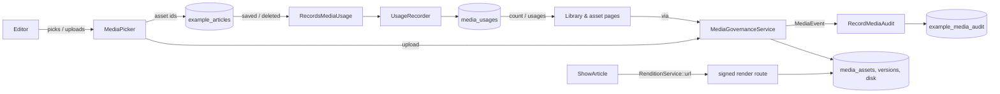

# Using Filament Media Library in a real application

The [README](../README.md) shows what the plugin does and how to put an image on a record. This guide covers the rest. It shows how to run a governed library in a real application, with real permissions, real models and a real site.

The guide follows one working example that ships with the plugin: **articles with a hero image and a gallery**, in [`examples/Articles`](../examples/Articles). [Its tests](../tests/Feature/Examples/ArticlesTest.php) or the package's own suite cover every behaviour described here. You can copy the folder into your app as a starting point.

Chapters 9 to 12 cover documents, video and audio, folders, folder access, and the rules for restricted files on public pages. They use the same article example.

The guide answers these questions:

1. [How do I install it and wire it into an existing panel?](#1-install-and-wire-it-into-a-panel)
2. [How do I control who can upload, replace and delete?](#2-who-may-upload-replace-and-delete)
3. [How do I put an image on my model?](#3-putting-an-image-on-your-model)
4. [How do I keep "where is it used" correct?](#4-keeping-where-is-it-used-correct)
5. [How do I show images on my site?](#5-showing-images-on-your-site)
6. [How do I add an audit log?](#6-an-audit-log)
7. [Licences and expiry: what happens and what do I get?](#7-licences-and-expiry)
8. [Replacing files, versions and the focal point](#8-replacing-files-versions-and-the-focal-point)
9. [How do I put documents, video and audio on a page?](#9-documents-video-and-audio)
10. [How do I organise a large library in folders?](#10-folders)
11. [How do I keep some files inside a team, or behind a password?](#11-folder-access)
12. [Why can't a public page show a restricted file, and what do I do instead?](#12-restricted-files-and-public-pages)
13. [How do I customise it?](#13-customising)
14. [How do I test my integration?](#14-testing-your-integration)
15. [Limits and known rough edges](#15-limits-and-known-rough-edges)

---

## What the plugin does, and what your app does

| The plugin | Your app |
| --- | --- |
| The library and asset pages: upload, replace, details, focal point, tags, versions, licence banner | **Who** may manage media: a Gate ability that maps to your users and roles |
| `MediaPicker`, `MediaThumbnailColumn` | **Which models** hold images, and which fields |
| Storage on a Laravel disk; seven tables | **Telling the library what each record uses** (`UsageRecorder`), or your own `UsageResolver` |
| Signed, cached, focal-point-aware renditions, and one signed file route for everything else | **Your templates**: which sizes you ask for, and the markup (or the `<x-media-library::file>` component) |
| Upload checks: type detected from the bytes, macros and zip bombs refused, a scanner hook | **Which scanner**, if any, and which kinds and sizes you accept |
| Folders, and who may open each one | **Who the library administrator is** (`media.manage-all`), and which folders are for whom |
| An event for every change to a file or a folder, dispatched inside the write's transaction | **The audit log**: a listener that writes them where you keep your history |
| Licence expiry computed on read, and `MediaExpiryReport` | **Reminders**: a scheduled job or widget, if you want one |

The plugin does not guess your schema. It stores asset **ids**. Your models store those ids. The plugin asks one contract (`UsageResolver`) whether an asset is still used.

## The example at a glance



| File | Role |
| --- | --- |
| `Access/MediaPermissions.php` | Maps `media.manage` onto this app's editors ([§2](#2-who-may-upload-replace-and-delete)) |
| `Models/Article.php`, `Concerns/RecordsMediaUsage.php` | A model with a hero id and a gallery, and the trait that keeps usage in step ([§3](#3-putting-an-image-on-your-model), [§4](#4-keeping-where-is-it-used-correct)) |
| `Filament/Resources/Articles/*` | A resource with `MediaPicker` fields and a `MediaThumbnailColumn` |
| `Http/ShowArticle.php`, `resources/views/article.blade.php` | The public page, with a srcset ([§5](#5-showing-images-on-your-site)) |
| `Listeners/RecordMediaAudit.php`, `Models/MediaAuditEntry.php`, `Filament/Resources/MediaAudit/*` | The audit log and its read-only page ([§6](#6-an-audit-log)) |
| `ArticlesServiceProvider.php` | Sets up the gate, listener, route and migrations |
| `config/example-articles.php` | `editors` (emails) and `define_gate` |
| `database/migrations/…` | `example_articles` and `example_media_audit` |

To try it in your app, map the namespace in `composer.json`:

```json
"autoload": { "psr-4": { "Banyan\\FilamentMediaLibrary\\Examples\\": "vendor/banyancms/filament-media-library/examples/" } }
```

Composer downloads leave out `examples/`, so copy it from the repository. Then:

1. Add `ArticlesServiceProvider` to `bootstrap/providers.php`.
2. Add `ArticleResource` and `MediaAuditResource` to your panel's `->resources([...])`.
3. Put your editors' emails in `config/example-articles.php` under `editors`. The provider merges the example's defaults. An empty list means nobody may manage.
4. Run `php artisan migrate`.


---

## 1. Install and wire it into a panel

```bash
composer require banyancms/filament-media-library
php artisan migrate
php artisan filament:assets
```

Decide three things before you migrate. They are hard to change afterwards.

- **The disk.** `media-library.disk` (env `MEDIA_LIBRARY_DISK`, default `public`). Each asset records the disk its original was written to. See [§13](#13-customising) for moving later.
- **The table names.** Defaults are `media_assets`, `media_versions`, `media_tags`, `media_asset_tag`, `media_usages`, `media_folders` and `media_folder_members`. If one clashes with a table in your app, or you already have media tables, read [§13](#13-customising) first.
- **The image driver.** `gd` by default. For Imagick, set `MEDIA_LIBRARY_DRIVER=imagick`.

Publish the config if you need to change any of these:

```bash
php artisan vendor:publish --tag=media-library-config
```

Register the plugin on the panel (in `app/Providers/Filament/AdminPanelProvider.php`, or wherever you define your panel):

```php
use Banyan\FilamentMediaLibrary\MediaLibraryPlugin;

return $panel
    ->id('admin')
    ->path('admin')
    // ...
    ->plugin(MediaLibraryPlugin::make());
```

This adds two pages to that panel only:

| Page | URL | In the sidebar |
| --- | --- | --- |
| Media library | `/admin/media` | yes (unless `navigation.register` is `false`) |
| One asset | `/admin/media/{uuid}` | no; you reach it from a card, but it is a real, linkable route |

The asset URL uses the asset's uuid, not its auto-increment id. If someone pastes the URL into a ticket, it does not show how many assets you have.

`MediaPicker` and `RenditionService` are plain classes. They work without the plugin on the panel. But without the pages, you cannot see an asset's usage, edit its focal point or replace its file. So register the plugin.

The plugin also adds routes to your **application**, not the panel. These are the signed rendition route `GET /media/{uuid}/render`, the signed file route `GET /media/{uuid}/file`, and two routes for files in restricted folders (`restricted-file` and `restricted-render`, under the same prefix, behind your `web` middleware). Make sure nothing else in your app uses those paths. You can move them with `media-library.route.path` and `media-library.delivery.*`.

If you accept video or large documents, raise PHP's `upload_max_filesize` and `post_max_size`, and Livewire's temporary-upload limit. Set them to match the biggest `uploads.kinds.*.max_size` you allow.

## 2. Who may upload, replace and delete

The library asks the Laravel Gate three questions. The names come from `media-library.abilities`.

| Ability | Default name | Asked when | If it is not defined |
| --- | --- | --- | --- |
| view | `media.view` | Opening the library and asset pages | Any signed-in user passes |
| manage | `media.manage` | Showing and running Upload, Edit details, Edit tags, Move, Captions, Transcript, Replace file, Delete, focal point save, folder actions, and the picker's "Upload new" | **Nobody passes** |
| manage all | `media.manage-all` | Seeing and managing **every** folder, including members-only and password-protected ones, and changing any folder's access | **Nobody passes** |

`media.manage-all` is for the library administrator. You can leave it alone if you never use members-only or password folders ([§11](#11-folder-access)).

This difference is deliberate. Browsing and picking an image are ordinary edits. Uploading, replacing and deleting change a shared resource that other people's pages depend on. An undefined permission must never default to open, so manage stays closed until you define it.

### Map it to your users

The example maps `media.manage` onto a list of emails. This is [`MediaPermissions`](../examples/Articles/Access/MediaPermissions.php):

```php
Gate::define('media.manage', self::isEditor(...));
```

In a real app, read a role, a column or a permission. Choose the one that matches how you already decide things:

```php
use Illuminate\Support\Facades\Gate;

// A column on users
Gate::define('media.manage', fn (User $user): bool => $user->is_editor);

// A role (spatie/laravel-permission style)
Gate::define('media.manage', fn (User $user): bool => $user->hasRole(['editor', 'admin']));

// A permission you already seeded under another name
Gate::define('media.manage', fn (User $user): bool => $user->can('content.edit'));
```

Do this in a service provider's `boot()`. To restrict browsing too, define `media.view` the same way. Leave it undefined if every signed-in panel user may browse.

### Policies and permission packages that use `Gate::before()`

The library calls `Gate::allows('media.manage')` first. So a `Gate::before()` grant counts even when you never called `define()` for the ability. spatie/laravel-permission and most "super admin" shortcuts work this way. With such a package, you only need to grant users the `media.manage` permission. The library falls back to the closed default only when nothing grants the ability and it is undefined.

If your rules live somewhere a Gate cannot reach, give the library a fallback. The library asks it only while nothing grants the ability and it is undefined:

```php
use Banyan\FilamentMediaLibrary\Access\MediaLibraryGate;

MediaLibraryGate::manageUsing(fn (): bool => auth()->user()?->hasRole('editor') === true);
```

The callback takes no arguments, so read the user from `auth()`. Register it in a service provider's `boot()`. If `media.manage` is defined, `manageUsing()` is ignored. Pass `null` to clear it (useful between tests).

`MediaLibraryGate::manageAllUsing()` does the same for `media.manage-all`. A blanket `Gate::before()` super-admin grant also grants `media.manage-all`, which is usually what you want.

To rename an ability, change `media-library.abilities.manage` (or `view`, or `manage_all`) and define the new name.

### The checks that run

Guests never pass either check. The library checks in more than one place, on purpose:

- The UI hides what a user may not do (buttons, actions, the picker's upload button).
- Every write checks again on the server before it changes anything. This covers the library page's upload, delete and folder actions, the asset page's edit, tags, captions, replace and delete, the focal point save, and the picker's upload. A hidden button is not the protection, because a Livewire action can be called without a button.
- Folders add their own check on top. `FolderAccess` decides which folder a person may open or change ([§11](#11-folder-access)), in the same handlers.
- Delete also asks the usage resolver again, inside a transaction, on a locked row. See [§4](#4-keeping-where-is-it-used-correct).

This is what a user without `media.manage` sees:


They can browse, search, open an asset page, see its usage and versions, and pick the asset into a form. They cannot change anything. The picker field shows no upload button for them.

> **Calling the services from your own code is not gated.** `MediaGovernanceService` and `MediaFolderService` trust their caller. A console command, a seeder or a queued job should be able to import files. If you call them on behalf of a request, check `MediaLibraryGate::allowsManage()` and `FolderAccess::canManage($folder)` first.

## 3. Putting an image on your model

### What the picker stores

`MediaPicker` stores **asset ids**. It stores one id for a single field, and a list of ids for `->multiple()`. It never stores a path or a URL. So when you replace a file, move a focal point or change the disk, every page that uses the asset updates. You do not edit any content.


### Columns and casts

```php
Schema::create('articles', function (Blueprint $table): void {
    $table->id();
    $table->string('title');
    $table->unsignedBigInteger('hero_id')->nullable();   // one asset
    $table->json('gallery')->nullable();                 // a list of assets
    $table->timestamps();
});
```

```php
protected function casts(): array
{
    return ['gallery' => 'array'];
}
```

`hero_id` is an integer column, so it needs no cast. Do not add a foreign key to `media_assets` unless you also decide what happens on delete. The library already protects an asset that records use (see [§4](#4-keeping-where-is-it-used-correct)). An extra cascade would hide a mistake instead of preventing it.

Make the fields fillable (`$fillable` or `$guarded = []`), as for any Filament form.

### The field

```php
use Banyan\FilamentMediaLibrary\Forms\MediaPicker;

public static function form(Schema $schema): Schema
{
    return $schema->columns(1)->components([
        TextInput::make('title')->required()->maxLength(160),
        MediaPicker::make('hero_id')->label('Hero image')->thumbnails(),
        MediaPicker::make('gallery')->label('Gallery')->multiple()->thumbnails(),
        Textarea::make('body')->required()->rows(6),
    ]);
}
```

This is [`ArticleResource`](../examples/Articles/Filament/Resources/Articles/ArticleResource.php) from the example. These are the options:

| Option | What it does |
| --- | --- |
| `->multiple()` | The field holds a list of ids. A newly uploaded asset is added to the list. |
| `->thumbnails()` | A 48 by 48 cropped thumbnail beside each option. Off by default. |
| `->uploadable(false)` | Removes "Upload new" from this field, even for users who may manage. |
| Any `Select` method | `->required()`, `->label()`, `->helperText()`, `->live()`, `->maxItems(6)` and so on. The field is a searchable, non-native `Select`. |

How the options behave:

- The list shows the **newest 50** selectable assets. It is not paged. The search box looks at filename and alt text and returns up to 50 matches. A literal `%` or `_` is treated as a character, not a wildcard. In a large library, people find assets by searching.
- **Expired assets are left out** of the options. Nobody can start a *new* use of an asset whose licence has lapsed ([§7](#7-licences-and-expiry)).
- If a record **already holds** an expired asset, the field still shows it, with "Licence expired" added. The editor does not see an unexplained blank.
- A deleted asset that a record still points at shows no label.
- The label is the filename and the alt text, joined by a dash. With `thumbnails()`, the label is HTML. It has a classed `` with the asset's own alt text, plus the same text. The `` has no inline styles, so a strict `style-src` Content Security Policy still applies.

Thumbnails are off by default. A plain text list is the cheapest option for a screen reader and a slow connection. The picker is Filament's own accessible searchable select. The library does not ship a custom widget, because a custom widget needs its own accessibility work.

### Inline upload

Users who may manage see an upload icon at the end of the field. It opens the same form as the library's **Upload files**: file, alt text (required), licence expiry and tags.


The upload calls `MediaGovernanceService::upload()`, then `syncTags()` if you entered any tags. So it is audited exactly like an upload from the library, and nobody can skip the alt text. The gate is checked again when the dialog is submitted. If you withdraw the ability after the dialog opens, the upload stops. If the file is not an image that your install can decode, nothing is stored and a notification says the upload failed.

Wait for the progress indicator to finish before you submit. The submit button shows "Uploading file…" until the file has arrived.

### Validation

The picker adds no validation rule beyond `Select`'s defaults. Add the rules you need:

```php
MediaPicker::make('hero_id')->required();
MediaPicker::make('gallery')->multiple()->minItems(1)->maxItems(6);
```

If an id can reach the model from somewhere other than the picker (an API, an import), validate it there. For a database-level check, `Rule::exists(MediaConfig::table('assets'), 'id')` uses the table name you configured.

### Table column

```php
use Banyan\FilamentMediaLibrary\Rendering\MediaThumbnailColumn;

MediaThumbnailColumn::make('hero_id')->label('Hero')->thumbnailSize(96, 64),
```

It is an `ImageColumn` that turns an id into the URL of a cropped thumbnail (default 80 by 80). A deleted or empty reference shows nothing. With a list of ids, it shows each one.

## 4. Keeping "where is it used" correct

Three features depend on one fact: which records use this asset.

- **Delete protection.** You cannot delete an asset that is used. The library page shows a padlock and no trash icon on it. The asset page does not offer **Delete asset** and shows the usage table instead. Underneath, `delete()` throws `AssetReferenced`, whatever surface asks.
- **The licence report.** The line "1 expired asset is still used" turns a housekeeping reminder into an urgent one.
- **The "Usage" table** on the asset page. It shows where, which field and which locale.

The picker cannot supply this. It stores ids and does not know which record it belongs to. **Your model has to say what it uses.** If it does not, the library thinks the asset is free and lets someone delete it.


### The trait from the example

[`RecordsMediaUsage`](../examples/Articles/Concerns/RecordsMediaUsage.php) shows the pattern. You declare which attributes hold assets, and the trait does the rest:

```php
use Banyan\FilamentMediaLibrary\Examples\Articles\Concerns\RecordsMediaUsage;

class Article extends Model
{
    use RecordsMediaUsage;

    public static function mediaFields(): array
    {
        return ['hero_id', 'gallery'];
    }
}
```

The trait does two things:

```php
static::saved(function (self $model): void {
    $recorder = app(UsageRecorder::class);

    foreach (static::mediaFields() as $field) {
        $recorder->sync($model, $field, $model->assetIds($field));
    }
});

static::deleted(function (self $model): void {
    app(UsageRecorder::class)->forget($model);
});
```

`assetIds($field)` turns an attribute that holds one id, a list of ids, or nothing into a clean `list<int>`. Copy the trait into your app's namespace. Do not depend on the `Examples` namespace in production.

This is what `UsageRecorder` does:

| Call | Effect |
| --- | --- |
| `sync(Model $owner, string $field, array $assetIds, ?string $locale = null)` | In one transaction: delete the rows for this owner, field and locale, then insert one row per distinct asset id |
| `forget(Model $owner)` | Delete every row for the owner |

- `sync()` **replaces** the rows, it does not add to them. Pass the full list the field holds now. An empty list clears the field.
- Duplicate ids are stored once.
- The owner must be saved and have an int or string key. Otherwise `sync()` throws `InvalidArgumentException`.
- The owner is stored by `getMorphClass()` and key. So a morph map applies, and string keys (uuid, ulid) work.
- Use `$locale` when a field differs per language. The asset page's Locale column then shows it. Otherwise the column shows "All locales".

### Deleting models

`forget()` in the `deleted` hook stops a deleted record from counting. Until it runs, the asset reports as used, the library refuses a safe delete and the licence report raises a false alarm.

If your model uses soft deletes, the `deleted` event fires on a soft delete too, so the usage is dropped. `restore()` saves the model, so the `saved` hook records the usage again.

### Bulk writes and imports

Eloquent model events do not fire for query-builder updates, `insert()`, `upsert()` or `Model::withoutEvents()`. If you write media fields in one of these ways, call the recorder yourself, once per owner and field:

```php
foreach (Article::query()->whereIn('id', $ids)->get() as $article) {
    app(UsageRecorder::class)->sync($article, 'hero_id', [$heroId]);
}
```

### Adding the library to an app that already stores image ids

Backfill once, then rely on the hooks:

```php
Article::query()->chunkById(200, function ($articles): void {
    foreach ($articles as $article) {
        foreach (Article::mediaFields() as $field) {
            app(UsageRecorder::class)->sync($article, $field, $article->assetIds($field));
        }
    }
});
```

### A resolver of your own

If your app already knows its references (a pivot table, a content tree, a JSON column), you do not need the `media_usages` table. Bind your own `UsageResolver`. Banyan itself does this, because it reads usages from its content tables.

The contract has four methods. All four must agree on what "live" means:

```php
interface UsageResolver
{
    /** @return list<AssetUsage> */
    public function usages(int $assetId): array;

    public function count(int $assetId): int;

    /** @param list<int> $assetIds  @return array<int, int> asset id => live usage count */
    public function counts(array $assetIds): array;

    public function whereUsed(Builder $query, string $assetIdColumn): void;
}
```

| Method | Used by |
| --- | --- |
| `usages()` | The asset page's "Usage" table |
| `count()` | Delete protection, the delete confirmation text and the asset page's "Used in N places" |
| `counts()` | The library grid, in **one query** for a page of assets. Assets with no usage may be absent. |
| `whereUsed()` | The licence report. It must constrain a query on the asset table so it only matches assets in use. `$assetIdColumn` is the qualified column to compare, such as `a.id`. |

`AssetUsage` is a readonly value object. It has `label` (the owner, for example "Article: Open day"), `type` (the kind of thing), `field`, and optionally `locale` and `url`. With a `url`, the label on the asset page becomes a link. That link takes an editor or developer from "this image is used" to the place where they can change it.

This example reads an `article_media` pivot (`article_id`, `media_asset_id`, `role`) directly and links to the edit page:

```php
use Banyan\FilamentMediaLibrary\Contracts\UsageResolver;
use Banyan\FilamentMediaLibrary\Usage\AssetUsage;
use Illuminate\Database\Query\Builder;
use Illuminate\Support\Facades\DB;

final class ArticleUsageResolver implements UsageResolver
{
    public function usages(int $assetId): array
    {
        return DB::table('article_media as m')
            ->join('articles as a', 'a.id', '=', 'm.article_id')
            ->where('m.media_asset_id', $assetId)
            ->orderBy('a.id')
            ->get(['a.id', 'a.title', 'm.role'])
            ->map(fn (object $row): AssetUsage => new AssetUsage(
                label: 'Article: '.$row->title,
                type: 'Article',
                field: (string) $row->role,
                url: ArticleResource::getUrl('edit', ['record' => $row->id]),
            ))
            ->all();
    }

    public function count(int $assetId): int
    {
        return DB::table('article_media')->where('media_asset_id', $assetId)->count();
    }

    public function counts(array $assetIds): array
    {
        return DB::table('article_media')
            ->whereIn('media_asset_id', $assetIds)
            ->groupBy('media_asset_id')
            ->selectRaw('media_asset_id, COUNT(*) as n')
            ->pluck('n', 'media_asset_id')
            ->map(fn (mixed $n): int => (int) $n)
            ->all();
    }

    public function whereUsed(Builder $query, string $assetIdColumn): void
    {
        $query->whereExists(
            fn (Builder $sub) => $sub->selectRaw('1')->from('article_media as m')->whereColumn('m.media_asset_id', $assetIdColumn),
        );
    }
}
```

Bind it in a service provider:

```php
$this->app->singleton(UsageResolver::class, ArticleUsageResolver::class);
```

The library registers its default with `singletonIf`, so your binding wins whichever provider runs first. You can also combine sources. A resolver may run several queries and add the numbers, as long as `usages()`, `count()`, `counts()` and `whereUsed()` agree.

With your own resolver, the library does not use `UsageRecorder` or the `media_usages` table. Leave the table in place (the migration still creates it), or set `migrations` to `false`.

### What the default resolver shows

The default resolver knows only the model's class and key. So the Usage table shows `Article #1`, the type `Article` and the field name. This is not a bug. The resolver does not know your schema. If you want titles and links, bind your own resolver.

### Delete protection is checked in the right place

The check is more than a disabled button. `MediaRepository::delete()` locks the asset row and asks the resolver for the count inside the same transaction. If the count is above zero, it throws `AssetReferenced` (with `$assetId` and `$usageCount`). So the check protects a console command, an API and a queue worker as well as the UI. The exception message gives the count and never the filename.

## 5. Showing images on your site

### Ask for a size, get a crop

```php
use Banyan\FilamentMediaLibrary\Rendering\RenditionService;

$renditions = app(RenditionService::class);

$renditions->url($asset, 1200, 630, 'crop');
```

The signature is `url(MediaAsset $asset, ?int $width = null, ?int $height = null, ?string $fit = null): string`.

| Arguments | What the visitor gets |
| --- | --- |
| width, height, `'crop'` or `null` | Exactly that box. The library cuts the largest rectangle of that shape around the focal point, then resizes. A small original is scaled up to fill the box. |
| width, height, `'contain'` | Scaled to fit inside the box, keeping its proportions. Never enlarged. |
| width only, or height only | Scaled to that size, keeping proportions. Never enlarged. |
| no size | The original file, unchanged |

Any other `$fit` value behaves as `'crop'`. The library clamps sizes to `renditions.max_dimension` (4096). The output keeps the original type (JPEG stays JPEG, PNG stays PNG). JPEG, WebP and AVIF use `renditions.quality` (82). The library does not convert between formats.

### The focal point

The focal point is a point (x and y, each 0 to 1) that every crop keeps in frame. An editor sets it on the asset page ([§8](#8-replacing-files-versions-and-the-focal-point)). If the subject of a hero image is on the right, you do not need to export the image again for every aspect ratio. When the point is near an edge, the library pushes the crop rectangle back inside the image. So a logo at the top right gives a crop that contains the logo, with no padding around it.

### A srcset

[`ShowArticle`](../examples/Articles/Http/ShowArticle.php) builds one:

```php
$hero = $article->hero();

'heroSrc' => $renditions->url($hero, 1200, 630, 'crop'),
'heroSrcset' => implode(', ', [
    $renditions->url($hero, 600, 315, 'crop').' 600w',
    $renditions->url($hero, 1200, 630, 'crop').' 1200w',
]),
```

The view uses it with the asset's own alt text. The alt text is never empty, because the library requires it:

```blade
alt_text }}">
```

Set `width` and `height` to the largest rendition. The browser then reserves space and the page does not jump. Keep the same aspect ratio across all srcset candidates.


### A Blade component

Writing those lines in every template is tedious. The package ships `<x-media-library::file>` ([§9](#9-documents-video-and-audio)). It renders any asset by its kind, with a fixed set of sizes. If you want your own sizes in one place, write a small component. This one is a suggestion and is not part of the package:

```php
// app/View/Components/MediaImage.php
namespace App\View\Components;

use Banyan\FilamentMediaLibrary\Models\MediaAsset;
use Banyan\FilamentMediaLibrary\Rendering\RenditionService;
use Illuminate\View\Component;

final class MediaImage extends Component
{
    public ?MediaAsset $asset;

    public function __construct(
        ?int $id,
        public int $width = 1200,
        public int $height = 630,
        public string $sizes = '100vw',
    ) {
        $this->asset = $id === null ? null : MediaAsset::query()->find($id);
    }

    public function shouldRender(): bool
    {
        return $this->asset !== null;
    }

    public function src(): string
    {
        return app(RenditionService::class)->url($this->asset, $this->width, $this->height, 'crop');
    }

    public function srcset(): string
    {
        $renditions = app(RenditionService::class);

        return collect([0.5, 1])->map(function (float $scale) use ($renditions): string {
            $w = (int) round($this->width * $scale);
            $h = (int) round($this->height * $scale);

            return $renditions->url($this->asset, $w, $h, 'crop').' '.$w.'w';
        })->implode(', ');
    }

    public function render(): string
    {
        return <<<'BLADE'
            alt_text }}"
                 {{ $attributes->merge(['loading' => 'lazy']) }}>
            BLADE;
    }
}
```

```blade
<x-media-image :id="$article->hero_id" :width="1200" :height="630" sizes="(min-width: 52rem) 52rem, 100vw" />
```

For an image above the fold, pass `loading="eager"` as an attribute. It replaces the default `lazy`. For a list, load all assets with one `whereIn('id', $ids)` query, as `ShowArticle` does for the gallery. Do not run one query per image.

### Signed URLs, caching and CDNs

- **Signed.** The route `media/{uuid}/render` uses Laravel's `signed` middleware. The query string (`w`, `h`, `fit`, `v`) tells the server to spend CPU and disk, so your application must be the one that issued it. Without a signature, the endpoint would be an open resizing service on your storage bill. An unsigned or altered request gets `403`. The library checks the signature before it looks up the asset, so the response does not show whether a uuid exists.
- **No expiry.** The signature does not expire. A URL stays valid until `APP_KEY` changes. So you can keep URLs in cached HTML, a sitemap or a JSON feed.
- **No session.** The route has no `web` middleware group, so it sets no cookies and starts no session. It suits a public page and a CDN.
- **Generated lazily, stored on the disk.** The first request for a size makes the rendition and writes it under `paths.renditions`. The path includes the asset uuid, version id, size, fit and the focal point. Later requests read the stored file.
- **Versioned URLs.** The URL carries `v=<version>-<focal x>-<focal y>`. If you replace the file or move the focal point, the URL changes. So a browser or CDN never shows the old pixels. This is why the response can say `Cache-Control: public, max-age=31536000, immutable`.
- **CDN.** Put any CDN in front of your domain and let it cache by full URL, including the query string. Do not strip the query string, because the signature and the version are in it. You never need to purge.
- **Orphaned renditions.** When you replace the file or move the focal point, the library deletes the old renditions as housekeeping. They were already unreachable.
- **Missing originals.** If the original is gone from the disk, the route returns `404`.
- **Proxies.** A signature is tied to the URL. Behind a load balancer, make sure Laravel sees the real scheme and host (trusted proxies, `APP_URL`). Otherwise signatures do not verify.

An expired licence does **not** stop an image from rendering ([§7](#7-licences-and-expiry)).

## 6. An audit log

The library does not store a history of changes. It announces them, and you decide where they go. This gives you one source of truth if you already have an audit package.

### The events

| Event | Name | Fired by | Payload keys |
| --- | --- | --- | --- |
| `AssetUploaded` | `media.asset.uploaded` | `upload()` | `asset_id`, `uuid`, `kind`, `folder_id`, `mime_type`, `size_bytes`, `width`, `height` |
| `AssetReplaced` | `media.asset.replaced` | `replace()` | `asset_id`, `uuid`, `kind`, `folder_id`, `version_id`, `superseded_version_id`, `size_bytes` |
| `AssetUpdated` | `media.asset.updated` | `updateDetails()` | `asset_id`, `uuid`, `kind`, `folder_id`, `alt_text_changed`, `title_changed`, `license_expires_at` |
| `FocalPointChanged` | `media.asset.refocused` | `setFocalPoint()` | `asset_id`, `uuid`, `kind`, `folder_id`, `focal_x`, `focal_y` |
| `AssetTagged` | `media.asset.tagged` | `syncTags()` | `asset_id`, `uuid`, `kind`, `folder_id`, `tag_count` |
| `AssetMoved` | `media.asset.moved` | `moveAssets()` | `asset_id`, `from_folder_id`, `to_folder_id` |
| `CaptionsChanged` | `media.asset.captions_changed` | `setCaptions()` | `asset_id`, `uuid`, `kind`, `folder_id`, `captions_asset_id` |
| `TranscriptChanged` | `media.asset.transcript_changed` | `setTranscript()` | `asset_id`, `uuid`, `kind`, `folder_id`, `has_transcript` |
| `AssetDeleted` | `media.asset.deleted` | `delete()` | `asset_id`, `uuid`, `kind`, `folder_id`, `usage_count` |
| `FolderCreated` | `media.folder.created` | `create()` | `folder_id`, `uuid`, `parent_id`, `depth` |
| `FolderRenamed` | `media.folder.renamed` | `rename()` | `folder_id`, `uuid` |
| `FolderMoved` | `media.folder.moved` | `move()` | `folder_id`, `from_parent_id`, `to_parent_id` |
| `FolderDeleted` | `media.folder.deleted` | `delete()` | `folder_id`, `uuid` |
| `FolderAccessChanged` | `media.folder.access_changed` | `setAccess()` | `folder_id`, `from`, `to`, `members_count` |
| `FolderMembersChanged` | `media.folder.members_changed` | `addMember()`, `removeMember()` | `folder_id`, `user_id`, `change`, `role`, `members_count` |
| `FolderUnlockFailed` | `media.folder.unlock_failed` | a wrong or throttled password | `folder_id`, `attempts` |

All events implement `Banyan\FilamentMediaLibrary\Events\MediaEvent`. An event about one asset is also a `MediaAssetEvent`, which adds `assetId()`. An event about one folder is also a `MediaFolderEvent`, which adds `folderId()`:

```php
interface MediaEvent
{
    public function name(): string;         // a stable dotted name
    public function subjectType(): string;  // 'media_asset' or 'media_folder'
    public function subjectId(): string;
    public function actorId(): string;      // your user's id, as a string
    /** @return array<string, scalar|null> */
    public function payload(): array;
}
```

Notes on what is in a payload:

- **References only.** A payload has no alt text, title or filename, and no folder name or password. A filename is often personal data ("cv-jane-doe.png"), and so is a folder called "Jane Doe HR file". `AssetUpdated` records only *whether* the alt text or the title changed, not the value. `TranscriptChanged` records only whether a transcript exists.
- `AssetDeleted` records `usage_count`, the number of places that used the asset when it was deleted. Delete protection normally makes this zero. If you bind a looser resolver, this number is the fact an incident review needs, and no later query can rebuild it.
- The library dispatches `AssetUpdated` on every details save, even if nothing changed. `AssetTagged` fires for every tag save, with the count.
- Uploading in the library with tags is two writes: an `AssetUploaded` and then an `AssetTagged`. Each has its own transaction.
- A successful folder unlock is not an event, to avoid noise. A wrong password is an event. It records the number of attempts and never the password.
- The asset event objects carry the models (`$event->asset`, `$event->version`) for listeners that want more. The `payload()` is the contract. Do not store the models.
- `AssetUploading` runs before the library accepts a file ([README](../README.md#upload-safety)). It is not a `MediaEvent` and is never an audit entry.

### The example listener

[`RecordMediaAudit`](../examples/Articles/Listeners/RecordMediaAudit.php) writes one row per change. One line in the service provider registers it:

```php
Event::listen(MediaEvent::class, RecordMediaAudit::class);
```

```php
public function handle(MediaEvent $event): void
{
    // The example's table is keyed by asset; folder events are not recorded here.
    if (! $event instanceof MediaAssetEvent) {
        return;
    }

    MediaAuditEntry::query()->create([
        'event' => $event->name(),
        'actor_id' => $event->actorId(),
        'asset_id' => $event->assetId(),
        'payload' => $event->payload(),
    ]);
}
```

The example's table has an `asset_id` column, so it keeps the asset events only. You probably want folder events too, because "who changed the access" is an audit question for a members-only folder. In that case, key your table by `subjectType()` and `subjectId()` instead.

The table is small. This is the example's migration:

```php
Schema::create('example_media_audit', function (Blueprint $table): void {
    $table->id();
    $table->string('event', 64);
    $table->string('actor_id', 64);
    $table->unsignedBigInteger('asset_id');
    $table->json('payload');
    $table->timestamp('created_at')->nullable();

    $table->index('asset_id');
});
```

`actor_id` is a string on purpose. The library gets your user's id as a string, so uuid and ulid keys work.

### The Filament page

[`MediaAuditResource`](../examples/Articles/Filament/Resources/MediaAudit/MediaAuditResource.php) is a read-only list. It has no create, edit or delete (`canCreate`, `canEdit` and `canDelete` return `false`). It shows the newest rows first, with the payload as JSON.


If you already keep an audit log, you do not need the example's resource. Show the same columns on the page you already have.

### Rollback semantics

Get this part right. The library dispatches every event **inside the write's database transaction**, synchronously.

- If your listener throws, the transaction rolls back. The row is not written and the change does not happen. So the audit log cannot miss an entry for a change that is in the database.
- If the write itself fails, the library never records the event as a committed change.

[The example's test](../tests/Feature/Examples/ArticlesTest.php) drops the audit table. It shows that an upload then fails and leaves no asset behind:

```php
it('rolls the change back when the audit listener fails', function (): void {
    DB::statement('drop table example_media_audit');

    expect(fn () => Images::upload())->toThrow(QueryException::class)
        ->and(DB::table('lib_assets')->count())->toBe(0);
});
```

What this means for your listener:

- **Keep it fast and reliable.** A slow listener slows the editor's request. A listener that calls an external service can fail the upload.
- **Use the default database connection** (the one the library writes to) for the audit table. Then one failure undoes both writes. A transaction cannot roll back another connection or a log service.
- **Do not queue it** if you need the guarantee. A queued job runs after the transaction and can lose the entry.
- **Files follow the transaction.** The library writes the file before it dispatches the event. If a listener throws, the database rolls back and the library deletes the file it just wrote. A refused upload or replacement leaves nothing on the disk.

### Sending events to an existing audit package

Map the event to your package's own call in a listener. The shape is the same. Read `name()`, `actorId()`, `subjectType()`, `subjectId()` and `payload()`.

```php
Event::listen(MediaEvent::class, function (MediaEvent $event): void {
    Audit::record(
        action: $event->name(),               // keep the library's names for easy search
        actor: $event->actorId(),
        subject: ['type' => $event->subjectType(), 'id' => $event->subjectId()],
        context: $event->payload(),
    );
});
```

`Audit::record()` stands for your own package's API. Banyan does this. It writes the events to its hash-chained audit log under the same `media.asset.*` and `media.folder.*` names.

## 7. Licences and expiry

An asset may have a **licence expiry date**. This is the date a stock photo licence, a model release or a permission ends. Set it in the upload dialog or in **Edit details**. Leave it empty for an asset with no expiry.

The library computes expiry when it reads: it compares `license_expires_at` with "now". There is no stored "expired" flag, so the flag cannot be wrong in the hours between the date passing and a job running. You also have no scheduled job to keep alive.

### What happens

| Where | Behaviour |
| --- | --- |
| **Library banner** | "Licence governance" appears when any licence has lapsed or lapses within `expiry_warning_days` (default 30). It shows both counts. It adds a bold line when an expired asset is **still used**. |
| **Library filters** | **Review expired** and **Review upcoming** filter the grid. "Expired licences only" is also a checkbox. |
| **Cards and asset page** | "Licence expired", or "Licence expires <date>". |
| **MediaPicker** | Expired assets are not offered for a new choice. The picker labels an expired asset that a record already holds. |
| **Rendering** | Expired assets keep rendering. The library does not take an image off a live page. |


The "still used" warning comes from your `UsageResolver`. If the resolver does not count a usage row as live, it never raises a false alert. This is another reason [§4](#4-keeping-where-is-it-used-correct) matters.

### The report in code

```php
use Banyan\FilamentMediaLibrary\Governance\MediaExpiryReport;

$summary = app(MediaExpiryReport::class)->summary();
// or: ->summary(now()->addMonth(), 60) to ask "what is the picture then, with a 60-day window"
```

`summary(?DateTimeInterface $now = null, ?int $warningDays = null): MediaExpirySummary`. It reads the database and changes nothing.

| Property | Meaning |
| --- | --- |
| `expired` | Assets whose expiry is at or before `$now` |
| `expiredReferenced` | ...of which the resolver says are still used |
| `expiringSoon` | Assets whose expiry is after `$now` and within `warningDays` of it |
| `expiringSoonReferenced` | ...of which are still used |
| `warningDays` | The window used (at least 1) |
| `hasIssues()` | `expired > 0` or `expiringSoon > 0` |

### A weekly reminder

The plugin has no scheduler. If you want an email, write a small command and schedule it:

```php
public function handle(MediaExpiryReport $report): int
{
    $summary = $report->summary();

    if ($summary->expiredReferenced > 0 || $summary->expiringSoonReferenced > 0) {
        Notification::send(User::role('editor')->get(), new MediaLicencesNeedAttention($summary));
    }

    return self::SUCCESS;
}
```

```php
Schedule::command('media:licence-reminder')->weeklyOn(1, '08:00');
```

(`MediaLicencesNeedAttention` is your own notification class. The package ships none.)

To renew a licence, use **Edit details** and enter a new date (or leave it empty for no expiry). To change the file, use **Replace file** ([§8](#8-replacing-files-versions-and-the-focal-point)). This does not change the licence date. The library audits both.

## 8. Replacing files, versions and the focal point

### Replace keeps history

On the asset page, choose **More**, then **Replace file**, to upload a new file for the same asset. The asset keeps its id, uuid, alt text or title, folder, captions, tags, licence and usage rows. The library adds a new row to the version history and the asset points at it. **The old file is not deleted or overwritten.** Every page that uses the asset now shows the new image. You do not edit any page.


- The version history lists each file, newest first. It shows the number (#1 is the original upload), size (for example 114.3 KB), dimensions, a short checksum and the upload time. It marks the current one.
- The history is a record. This release has no restore or download button. The old files stay on the disk under `paths.originals`.
- Replacing changes the asset's filename, type, size, dimensions and (for a PDF) page count to those of the new file. It does not change the alt text or the title. If the new picture shows something else, edit the alt text.
- **A replacement must be the same kind.** You can replace a PDF with another PDF or a Word file (both are documents). If you replace it with an image, the library refuses with `KindMismatch`. So an asset can never change what it is under the pages that use it. The new file goes through the same [upload checks](../README.md#upload-safety) as any other file.
- For a file that is not an image, the file route's address also carries the version. So a replaced PDF gets a new address, and no cache shows the old one.
- A replacement may have a different shape from the old file. The library computes crops from the new bytes and the same focal point. Check that the point is still in a sensible place.
- The library deletes the cached renditions of the old file. The URL carries the version, so the old URLs stop being valid for that content anyway.
- Nothing reclaims the space of old versions. Deleting an asset deletes all of its version files.

To replace from code:

```php
app(MediaGovernanceService::class)->replace($asset, $bytes, 'campus-2027.jpg', 'image/jpeg', (string) $user->id);
```

### The focal point

The asset page shows the image with a crosshair.

- **Click or drag** on the image to set the point.
- **Arrow keys** move the point a little. Hold **Shift** for larger steps. A screen reader announces the position.
- **Centre** resets the point to the middle. **Save focal point** stores it.
- Below the image, two sample crops (square and wide) show what the point does to the shapes your pages will ask for.

The library stores the point as two fractions of the width and height, clamped to 0 to 1 and rounded to five decimals. It applies to every crop made after you save it, because the cache path and URL include it ([§5](#5-showing-images-on-your-site)). The preview uses `contain`, not a crop, because the crosshair sits against the whole image.

To set the focal point from code (`x` and `y` are 0 to 1, and the library clamps values outside this range):

```php
app(MediaGovernanceService::class)->setFocalPoint($asset, 0.7, 0.4, (string) $user->id);
```

### Upload dialog


| Field | Rule |
| --- | --- |
| File | Required; one of the types in `uploads.kinds.*.mime_types`; at most that kind's `max_size` kilobytes |
| Title | Required unless the file is an image: the link text people read |
| Alt text | Required for an image; at most 512 characters |
| Licence expires | Optional date and time |
| Tags | Optional, comma separated; lower-cased on save; whole field at most 512 characters; each tag is at most 64 characters (the column) |

Filament does not store the file. The library reads the bytes, and its repository decides the path, version number and disk. The stored path looks like `media/ab/<uuid>-v1.jpg`. A replacement is `-v2` and so on. The library keeps only a short, plain extension. Anything else becomes `.bin`. The library inspects the bytes before it writes anything. It refuses an image that it cannot decode (`UnreadableImage`), and anything that the [upload guard](../README.md#upload-safety) turns away.

Two limits outside the package also apply. They are PHP's `upload_max_filesize` and `post_max_size`, and Livewire's temporary-upload rules in `config/livewire.php`. Raise them if you raise a kind's `max_size`.

## 9. Documents, video and audio

So far this guide has been about images. A government or school site publishes many more documents than pictures: annual reports, forms, circulars and minutes. They need the same governance. This chapter puts a PDF, a video with captions and an audio file with a transcript on an article.

### A PDF annual report on an article

The article needs a column for the report's id, the same as for the hero image:

```php
Schema::table('articles', function (Blueprint $table): void {
    $table->unsignedBigInteger('report_id')->nullable();
});
```

In the resource, add a picker that offers documents only:

```php
use Banyan\FilamentMediaLibrary\Forms\MediaPicker;

MediaPicker::make('report_id')
    ->label('Annual report (PDF)')
    ->documents()
    ->helperText('Only documents are offered.'),
```

`->documents()` limits the options, the search and the inline upload to PDF, Word, Excel, PowerPoint, OpenDocument, CSV and text. A field without `->documents()` still offers images only. So nobody can give a hero field a PDF by accident. For video use `->videos()`, for audio use `->audio()`, for several kinds use `->kinds([MediaKind::Image, MediaKind::Video])`, and for any kind use `->anyKind()`.


Record the usage the same way as for the hero ([§4](#4-keeping-where-is-it-used-correct)). Add `report_id` to the `mediaFields()` list of the `RecordsMediaUsage` trait (`['hero_id', 'gallery', 'report_id']`). Then the library protects the report from deletion, and its asset page says where it is used.

An editor who has the PDF on their desktop uses the **Upload** button at the end of the field. The dialog asks for the file and a **title**. It does not ask for alt text, because a document has no picture to describe. The title is the text of the link, so write it for a person scanning a page: "Annual report 2025", not "scan0042".

Open the asset to see what the library stored:


The browser's own viewer shows the PDF inline. The library read the page count from the file. **Download** and **Open in new tab** are beside the viewer. The library converted nothing.

On the site, render the file with the component:

```blade
<x-media-library::file :asset="$article->report" />
```

It prints a link that names the document, its format and its size. WCAG asks for this in a document link:

```html
<a href="https://example.test/media/…/file?v=9&signature=…">Annual report 2025 (PDF, 2.4 MB)</a>
```

A PDF link opens in the browser. A Word, Excel, PowerPoint, CSV or ZIP link downloads the file. You can also build the link yourself. Use `$report->fileUrl()` (inline for a PDF, an attachment for the rest) or `$report->downloadUrl()` (always an attachment).

**Next year's report.** Open the asset, choose **More, Replace file**, and choose the new PDF. The asset keeps its id, so every page that uses it shows the new report. You do not edit any page. The old file stays in the version history. A replacement must be the same kind ([§8](#8-replacing-files-versions-and-the-focal-point)). The file's address carries the version. So a freshly rendered page links to a new address, and a browser or CDN that cached last year's file never serves it for the new link. A page whose HTML is cached keeps the old address until it is regenerated. After you replace an important file, clear such caches.

### A video with captions

Upload the video (MP4 with H.264/AAC, or WebM) with a title. The asset page shows a player with `preload="metadata"`, so nothing large downloads until someone plays it. Seeking works because the file route answers `Range` requests (through a temporary URL on S3-style disks).


Captions are a separate file. One set of captions is a document in its own right, with its own history.

1. Upload the captions as a WebVTT file (`.vtt`, which must start with `WEBVTT`) with a title, such as "Welcome tour captions". The library stores it as a document.
2. Open the video, choose **More, Captions**, and choose the `.vtt` file. The list offers only WebVTT files.
3. The player now has a captions track, and the component renders it:

```blade
<x-media-library::file :asset="$article->tour" />
```

```html
<video controls preload="metadata" src="…/file?v=12&signature=…">
    <track kind="captions" src="…/file?v=13&signature=…" label="English">
    <a href="…/file?download=1&…">Your browser cannot play this video. Welcome tour</a>
</video>
```

From code, use `app(MediaGovernanceService::class)->setCaptions($video, $vtt, (string) $user->id)`. Captions are for video only. A transcript is for video and audio.

There are two limits. The captions track has one fixed label ("English" in the English translation), whatever the language of the file. There is also no poster frame, because reading a video needs ffmpeg and the package depends on none. The library does not read the duration either. `duration_seconds` stays empty unless your app sets it.

### Audio with a transcript

Upload the audio (MP3, M4A or WAV) with a title. On its page, **More, Transcript** takes the spoken words as plain text. The transcript appears under the player for people who cannot listen. The component adds it to a page as a collapsible block:


```html
<audio controls preload="metadata" src="…/file?v=11&signature=…">…</audio>
<details class="bn-media__transcript">
    <summary>Transcript</summary>
    <p>Good morning, and welcome to the school. …</p>
</details>
```

The audit event for a transcript says that a transcript exists. It never says what the transcript contains, because speech is often by named people.

### What is refused, and why

A form that takes any file will take the worst file. The library judges every upload by what its bytes are, before it writes anything. Try a Word file that contains a macro:


The library stored nothing. The same checks run for the picker's upload button, for `MediaGovernanceService::upload()` in a seeder, and for a replacement. The [README](../README.md#upload-safety) has the whole list. In summary:

- The extension must agree with the content.
- HTML, SVG and executables are not on the list.
- A zip with thousands of entries or a gigabyte of expansion is refused.
- An `AssetUploading` listener or a `FileScanner` can refuse anything else. ClamAV ships as an opt-in.

Test this in your own suite, with bytes and no fixtures:

```php
use Banyan\FilamentMediaLibrary\Enums\MediaKind;
use Banyan\FilamentMediaLibrary\Exceptions\ExtensionMismatch;
use Banyan\FilamentMediaLibrary\Exceptions\TitleRequired;
use Banyan\FilamentMediaLibrary\Governance\MediaGovernanceService;
use Banyan\FilamentMediaLibrary\Models\MediaAsset;

it('files a PDF with a title, and refuses one without', function (): void {
    $pdf = "%PDF-1.4\n1 0 obj\n<< /Type /Page >>\nendobj\ntrailer\n<< /Root 1 0 R >>\n%%EOF\n";
    $media = app(MediaGovernanceService::class);

    $report = $media->upload($pdf, 'ar-2025.pdf', 'application/pdf', '', '1', null, 'Annual report 2025');

    expect($report->kind)->toBe(MediaKind::Document)
        ->and($report->page_count)->toBe(1)
        ->and($report->fileUrl())->toContain('/file');

    expect(fn () => $media->upload($pdf, 'ar.pdf', 'application/pdf', '', '1'))->toThrow(TitleRequired::class);
});

it('refuses HTML that is named .pdf, and writes nothing', function (): void {
    $html = '<html><script>alert(1)</script></html>';

    expect(fn () => app(MediaGovernanceService::class)->upload($html, 'report.pdf', 'application/pdf', '', '1', null, 'Report'))
        ->toThrow(ExtensionMismatch::class);

    expect(MediaAsset::query()->count())->toBe(0);
});
```

## 10. Folders

A library of fifty images is a grid. A library of three thousand files is not usable without folders. A school or a department reaches that size in a few years. WordPress needs a plugin for folders. Here they are built in.

### Organising a large library

Open the library. The tree on the left is the folder structure. The folder tiles in the grid are the folders inside the open folder. The root, **All files**, holds everything that is not filed anywhere. Every existing asset starts there.


1. **New folder** (in the page header) creates a folder inside the open one. Make **Publications** at the root, open it, and make **Annual reports** and **Circulars** inside it.
2. **Open a folder** from the tree or a tile. The breadcrumb above the grid (`All files / Publications`) shows where you are and takes you back up.


3. **Upload files** while a folder is open files the upload in that folder. A new PDF uploaded inside `Publications / Annual reports` lives there.
4. **Search** inside a folder searches that folder and everything below it. An editor looking for a file rarely knows which folder it is in. The tag and licence filters work the same way. **Search the whole library** appears while a filter is on, and widens the search to everything.

### Moving things

- **Several files.** Tick the checkboxes on their cards, then choose **Move to folder…** in the bar that appears. If you may not change a file, the library leaves it where it is and shows a notice.
- **One file.** On its page, choose **More, Move to folder**.
- **A folder, with everything in it.** Open it, choose **Folder, Move folder**, and choose the new parent or the library root. You cannot move a folder into its own subtree. The library also refuses, with a message, a move that would go deeper than `folders.max_depth` (8 by default) or clash with a sibling's name.

Moving a file does **not** break a page that uses it. The file keeps its id and uuid, and its addresses do not contain the folder. So every usage keeps working. The one exception is moving it into a restricted folder ([§12](#12-restricted-files-and-public-pages)).

### Deleting a folder

You can delete a folder only when it is empty. If it is not empty, the dialog says so and offers **Move its contents to the parent folder first**. The sub-folders and files go up one level, then the library deletes the empty folder. This happens in one step or not at all. Deleting a folder never deletes a file, and nothing cascades.

### From code: an import

A seeder or an import can load a whole structure through the services, with no clicks:

```php
use Banyan\FilamentMediaLibrary\Folders\MediaFolderService;

$folders = app(MediaFolderService::class);
$media = app(MediaGovernanceService::class);
$actor = (string) $admin->id;

$publications = $folders->create(null, 'Publications', $actor);
$reports = $folders->create($publications, 'Annual reports', $actor);

$media->upload(file_get_contents($path), 'ar-2025.pdf', 'application/pdf', '', $actor, null, 'Annual report 2025', $reports);

// Move what is already there.
$folders->moveAssets(MediaAsset::query()->tagged('annual-report')->get()->all(), $reports, $actor);
```

The services do not check the Gate. A console command or a job may do all of this. A request on behalf of a person must check `FolderAccess::canManage($folder)` first.

### A field that only offers one folder

```php
MediaPicker::make('report_id')->documents()->folder($reports);
```

The field offers the files in `Annual reports` and below it. Its upload button files new files there. Pass a `MediaFolder` or its uuid (a stored setting would hold the uuid). If a uuid no longer matches a folder, the field offers nothing, never the whole library. Without `->folder()`, the field offers the whole library. In a large library, scoping each field keeps the dropdown useful. The option labels show the folder path ("in Publications / Annual reports") either way.

### Switching folders off

Set `media-library.folders.enabled` to `false` for a flat library. The tree, the tiles and every folder action disappear, and every asset reads as being at the root. The tables stay.

## 11. Folder access

Some material must not be in front of everyone who can open the library: council papers, personnel files, a press release under embargo. Every folder has an access mode. A restricted folder does not only look locked to someone outside it. It is **not there** for them.

| Mode | Who can browse and pick | Who can upload, edit and delete |
| --- | --- | --- |
| Shared | Anyone with `media.view` | Anyone with `media.manage` |
| Members only | The owner, the members, and `media.manage-all` | The owner, `manage` members and `media.manage-all` |
| Password protected | Anyone with `media.view` who has unlocked it | Anyone with `media.manage` who has unlocked it |

A new folder is `inherit`. It follows the folder above it, and at the top level that means shared.

Define the administrator's ability first. It stays closed until you define it, so an install that never defines it has no administrator for restricted folders:

```php
Gate::define('media.manage-all', fn (User $user): bool => $user->is_administrator);
```

### Members-only council papers

Alice is the clerk. She creates the folder **Council papers**, so she is its owner. She opens **Folder, Access…**.

1. Choose **Members only**.
2. **Add a member**. Choose Carol, and the role **Can browse and pick**. For a colleague who files the papers, choose **Can also upload, edit and delete**.
3. **Submit**.


The owner and library administrators always have access, without being listed. A member does not need the `media.manage` ability in this folder. The role is the grant.

Bob is not a member. This is what he sees:


He sees nothing of the folder. It is absent from his tree, his tiles, his breadcrumbs, his search results, the picker's options, the counts and the page's Livewire payload. Suppose he has the address of one of its files or its page. He gets a 404, never a 403, so the library does not even confirm that the file exists. A test for this looks for the folder's name and uuid in the **payload**, not only in what is visible:

```php
it('leaves no trace of the council folder for a non-member', function (): void {
    $page = Livewire::actingAs($bob)->test(MediaLibraryPage::class);

    expect($page->html().json_encode($page->snapshot))
        ->not->toContain('Council papers')
        ->not->toContain($council->uuid)
        ->not->toContain('Council minutes');
});
```

### Access only narrows

A folder inside a members-only folder cannot be more open than its parent. Suppose Alice makes a **Drafts** folder inside Council papers and sets it to Shared. It stays members-only, because a person must pass **every** folder on the path from the top. The access dialog says so: "A sub-folder can be stricter than the folder above it, never more open". If a child could re-publish its parent's contents, or if its breadcrumb printed the parent's name, a members-only folder would leak. `$folder->effectiveAccess()` returns the nearest mode (what the dialog shows). `$folder->isRestricted()` says whether anything on the path is restricted (what the library enforces).

### A password for a press embargo

Sometimes the people are not a fixed list. For example, a newsroom gets a press release for an hour. Alice makes **Press embargo**, chooses **Folder, Access…** and **Password protected**, and types a password of at least eight characters. The library stores only a hash, so she cannot read the password back. She shares it by a means of her own.

Bob has `media.view`. He sees **Press embargo** in the tree and as a tile marked **Locked**, but no count, no files and no sub-folders. When he opens it, he gets a panel with an **Unlock** button:


- The unlock lasts `folders.unlock_minutes` (30 by default) and covers the folder and everything below it. The server-side session keeps an expiry for each folder, so the browser cannot forge it.
- **The library throttles five wrong passwords in 15 minutes per user.** After that, even the right password is refused until the window passes. Each failure is a `FolderUnlockFailed` event. A security team can alert on it, and it never contains the password.
- **Changing the password locks the folder again for everyone.** This is how Alice ends the embargo access.
- **Alice and the administrator do not unlock.** She chose the password and an administrator can reset it, so typing it would protect nothing. Everybody else unlocks, even a holder of `media.manage`.
- The password does not replace permissions. Bob still needs `media.view`.

### What this does not protect

A password folder keeps casual editors out of the library. It does not encrypt anything on the disk. It is not a way to publish something to the web behind a password. The library does not serve a file in a restricted folder by a permanent address (see the next chapter). This release has no public-facing password pages for site visitors.

### In code, and in your audit log

```php
use Banyan\FilamentMediaLibrary\Enums\FolderAccessMode;

$folders->setAccess($council, FolderAccessMode::Members, null, $actor);
$folders->addMember($council, $carol->id, 'view', $actor);   // or 'manage'
$folders->removeMember($council, $carol->id, $actor);
$folders->setAccess($press, FolderAccessMode::Password, 'Embargo-2026', $actor);

app(FolderAccess::class)->canBrowse($council, $bob);   // false
```

`setAccess()`, `addMember()` and `removeMember()` are not gated. In the panel, only the folder's owner or `media.manage-all` may change a folder's access (`FolderAccess::canAdminister()`). A job or console command that calls the service must do that check itself. Each change dispatches `FolderAccessChanged` or `FolderMembersChanged` ([§6](#6-an-audit-log)), with ids and modes and never a name or a password.

## 12. Restricted files and public pages

A permanent signed address makes a public page fast. Anyone with the address may open it, a CDN may cache it, and the route needs no session. This cannot be true of a file in a members-only folder. So the library delivers files in restricted folders (members-only or password-protected, anywhere on the path) in a different way:

| | An ordinary file | A file in a restricted folder |
| --- | --- | --- |
| Address | Permanent, signed | **Temporary**, signed: valid `delivery.restricted_url_minutes` (10 by default) |
| Issued to | Anyone | Only a signed-in user who may browse the folder. `fileUrl()` throws `AccessDenied` for anyone else |
| Route | `media/{uuid}/file`, no session | `media/{uuid}/restricted-file`, inside your `web` middleware |
| Checked when opened | The signature | The signature **and** that the signed-in user may still browse the folder |
| Cache | Public, immutable | `private, no-store` |

So a leaked address fails for a logged-out visitor. It stops working after ten minutes. It also stops working at once for the same person if you remove their membership. When you move a file into a restricted folder, its old permanent address stops working, because the public route answers 404 for it.

### The consequence: restricted files stay off public pages

A page that anonymous visitors see cannot carry a ten-minute address that was issued to whoever rendered it. So:

- **The picker hides restricted folders by default**, even from people who can open them. Nobody can set a public content field to a file that its page could not show.
- **`<x-media-library::file>` prints a lock** instead of a restricted file for a visitor who may not have it. It shows a marker "Restricted file", and no URL, title or filename.
- **Moving files that pages still use into a restricted folder warns the editor.** The dialog says how many of the files are in use. It asks the editor to confirm that those pages will lose the file. The server asks again, so a forged request cannot skip the question. Restricting a whole folder that holds such files asks the same.
- **The headless API** (in Banyan) never describes a restricted asset. The entry is `{"id": 18, "restricted": true}` and everything else is null.

If you build public pages from asset ids yourself, ask only for assets that are safe:

```php
$downloads = MediaAsset::query()->unrestricted()->ofKind(MediaKind::Document)->whereIn('id', $ids)->get();
```

Also check `$asset->isDeliverable()` before you print an address that you did not choose.

### Intranet sites: opt in

On an intranet, every visitor signs in. A restricted file in a page is what you want there. Opt in per field:

```php
MediaPicker::make('minutes_id')->documents()->allowRestricted();
```

The field now offers the restricted folders that the user may browse, and nothing that the user may not. The page that renders the file must itself sit behind a login, because the library issues the address to the signed-in user. The page **must not be cached for everyone**. An address expires after ten minutes, so a cached page full of addresses breaks. Generate the addresses on each request.

### A test for this

```php
it('serves a member a restricted file, and stops when the membership ends', function (): void {
    $this->actingAs($carol);
    $url = $minutes->fileUrl();                       // temporary, on the restricted route

    expect($url)->toContain('expires=')->toContain('restricted-file');
    $this->get($url)->assertOk();

    $this->actingAs($bob);
    expect(fn () => $minutes->fileUrl())->toThrow(AccessDenied::class);
    $this->get($url)->assertNotFound();               // Carol's address is no use to Bob

    app(MediaFolderService::class)->removeMember($council, $carol->id, '1');
    $this->actingAs($carol);
    $this->get($url)->assertNotFound();               // and not to Carol, once she is removed
});
```

## 13. Customising

### Table names, and an existing schema

Table names come from `media-library.tables`:

```php
'tables' => [
    'assets' => 'media_assets',
    'versions' => 'media_versions',
    'tags' => 'media_tags',
    'asset_tag' => 'media_asset_tag',
    'usages' => 'media_usages',
    'folders' => 'media_folders',
    'folder_members' => 'media_folder_members',
],
```

Set them **before** the first `migrate`. The models, the migration and every query read these names, so nothing else needs to change. The package's own test suite runs with a `lib_` prefix to prove this.

If the tables already exist, set `media-library.migrations` to `false` so the package does not try to create them. If you want to edit the migration instead, publish it (`php artisan vendor:publish --tag=media-library-migrations`) **and set `migrations` to `false`**. Otherwise both the package's copy and your published copy run.

An existing table must have these columns.

The README section [Data model and querying from your code](../README.md#data-model-and-querying-from-your-code) describes every column, the models, scopes and helper services, and query recipes for controllers and services.

| Table | Columns |
| --- | --- |
| assets | `id`, `uuid` (unique), `disk`, `path`, `filename`, `mime_type`, `size_bytes`, `width`, `height`, `alt_text` (not null), `focal_x`, `focal_y` (decimal, default 0.5), `license_expires_at` (nullable timestamp), `current_version_id` (nullable), `uploaded_by` (nullable), `created_at`, `updated_at` |
| versions | `id`, `media_asset_id`, `disk`, `path`, `checksum`, `size_bytes`, `width`, `height`, `uploaded_by`, `created_at` (no `updated_at`) |
| tags | `id`, `name` (unique), `created_at`, `updated_at` |
| asset_tag | `media_asset_id`, `media_tag_id` (primary key on both; no timestamps) |
| usages | `id`, `media_asset_id`, `usable_type`, `usable_id` (string), `field`, `locale` (nullable), `created_at` |

The package does not add a foreign key from `current_version_id` to versions. Versions already point at assets, and the cycle would make the first insert impossible.

If some rows in your existing library have no alt text, the column is still not null. Backfill a real description first. The library is built so that an empty alt text cannot be stored.

### The disk, S3 and moving later

```php
// .env
MEDIA_LIBRARY_DISK=s3
```

Any Laravel disk works. The library reads and writes through Laravel's filesystem, and serves every image through its own route. So the bucket can be private. You do not need `storage:link` or a public URL. `paths.originals` and `paths.renditions` are prefixes on that disk.

Each asset stores the disk it was uploaded to, and everything about that asset stays there. Its replacements, its renditions and its deletion all use the asset's own disk. If you change `MEDIA_LIBRARY_DISK`:

- Existing assets keep working from the disk they were stored on, so keep that disk defined in `config/filesystems.php`.
- New uploads go to the new disk.
- To move a library, copy the files to the new disk at the same paths, then update the `disk` column on the asset and version rows.

A remote disk adds latency to the first request for each size, so put a CDN in front of the render route ([§5](#5-showing-images-on-your-site)).

### Your own pages and views

`MediaLibraryPlugin::make()->libraryPage(MyLibrary::class)->assetPage(MyAsset::class)` registers your subclasses instead of the defaults. The links between the two pages follow them. To change markup only, run `php artisan vendor:publish --tag=media-library-views`. This copies the Blade views to `resources/views/vendor/media-library/`, where they override the package's views. See the README section "Overriding pages and views".

### Navigation

```php
// config/media-library.php
'navigation' => [
    'register' => true,
    'group' => 'Content',   // a string, or a navigation-group enum
    'sort' => 20,
],
```

Set `register` to `false` to hide the item, then link to the page yourself with `MediaLibraryPage::getUrl()`. The label is the translation `media.nav.label`.

### Translations

The package ships English, Traditional Chinese (`zh-Hant`) and Simplified Chinese (`zh-Hans`), with identical keys in all three. Publish the files to change any wording:

```bash
php artisan vendor:publish --tag=media-library-translations
```

The files are copied to `lang/vendor/media-library/{locale}/media.php`. Keys are `media-library::media.<key>`, for example `media-library::media.actions.upload`, `media-library::media.expiry.heading` and `media-library::media.picker.upload`. Change a value and keep the keys. If a locale is missing a key, the page shows the raw key name. So copy the whole file when you add a language.

### Dark mode and CSS tokens


The library follows your panel's palette and Filament's dark mode with no setup. Its stylesheet (`resources/css/media.css`, registered as a Filament asset) reads every colour, size and radius from `--ml-*` custom properties declared on `.bn-media`. Each property falls back to Filament's own variables (`--gray-*`, `--primary-*`, `--warning-*`, `--success-*`). A `.dark` variant sets the colours that need to differ. For example:

| Token | Falls back to (light) | Falls back to (dark) |
| --- | --- | --- |
| `--ml-text` | `--gray-950` | `#fff` |
| `--ml-text-muted` | `--gray-500` | `--gray-400` |
| `--ml-surface` | `#fff` | `--gray-900` |
| `--ml-border` | `--gray-200` | `--gray-700` |
| `--ml-warning`, `--ml-state-expired` | `--warning-700` | `--warning-400` |
| `--ml-focus-ring` | `--primary-600` | `--primary-500` |

To change a token, set it on `.bn-media` in your own stylesheet (a Filament custom theme or a render hook):

```css
.bn-media {
    --ml-radius-card: 0.25rem;
    --ml-state-expired: #b42318;
}
```

Spacing, type sizes and the control height are tokens too (`--ml-space-*`, `--ml-text-*`, `--ml-control-height`). After you upgrade the package, run `php artisan filament:assets` so the browser gets the current stylesheet.

### Other settings

| Key | Notes |
| --- | --- |
| `driver` | `gd` or `imagick`; `ext-gd` or `ext-imagick` must be installed. |
| `renditions.max_dimension`, `renditions.quality` | A hard ceiling on requested sizes, and encoder quality. Lower the ceiling if you never need big images, because the endpoint multiplies resource use. |
| `route.path`, `route.name` | The signed route. The path must contain `{uuid}`. |
| `abilities.view`, `abilities.manage`, `abilities.manage_all` | See [§2](#2-who-may-upload-replace-and-delete). |
| `uploads.kinds.*`, `uploads.archive.max_entries`, `uploads.scanner` | Which files are accepted, how big, and what scans them. See the [README](../README.md#file-kinds-and-accepted-types). |
| `delivery.*` | The file route, temporary-URL lifetimes and the restricted routes ([§12](#12-restricted-files-and-public-pages)). |
| `folders.*` | `enabled`, `max_depth`, `unlock_minutes` and `member_label` ([§10](#10-folders), [§11](#11-folder-access)). |
| `expiry_warning_days` | The window for "expiring soon" (minimum 1). |

## 14. Testing your integration

The package's own tests show the pattern. In your app, use a fake disk and a real image.

### Setup

```php
use Illuminate\Support\Facades\Storage;

beforeEach(function (): void {
    Storage::fake('media-test');
    config(['media-library.disk' => 'media-test']);
});
```

GD can draw a real image, which is easier than keeping a fixture file.

```php
function pngBytes(int $width = 400, int $height = 200): string
{
    $image = imagecreatetruecolor($width, $height);
    imagefilledrectangle($image, 0, 0, intdiv($width, 2) - 1, $height - 1, (int) imagecolorallocate($image, 255, 0, 0));
    imagefilledrectangle($image, intdiv($width, 2), 0, $width - 1, $height - 1, (int) imagecolorallocate($image, 0, 0, 255));

    ob_start();
    imagepng($image);

    return (string) ob_get_clean();
}

function uploadAsset(string $alt = 'A red and blue split', string $actor = '1', ?string $expires = null): MediaAsset
{
    return app(MediaGovernanceService::class)->upload(
        pngBytes(), 'split.png', 'image/png', $alt, $actor,
        $expires === null ? null : new DateTimeImmutable($expires),
    );
}
```

The left half is red and the right half is blue. So you can check a crop by reading one pixel.

### Permissions

```php
it('lets only editors manage media', function (): void {
    Gate::define('media.manage', fn (User $user): bool => $user->is_editor);

    $this->actingAs(User::factory()->create(['is_editor' => true]));
    expect(MediaLibraryGate::allowsManage())->toBeTrue();

    $this->actingAs(User::factory()->create(['is_editor' => false]));
    expect(MediaLibraryGate::allowsManage())->toBeFalse()
        ->and(MediaLibraryGate::allowsBrowse())->toBeTrue();
});

it('hides the upload action from a reader', function (): void {
    Livewire::actingAs(User::factory()->create(['is_editor' => false]))
        ->test(MediaLibraryPage::class)
        ->assertActionHidden('upload');
});
```

If a test sets a fallback, add `afterEach(fn () => MediaLibraryGate::manageUsing(null));`.

### A resource with a picker, and its usage rows

From the example's tests:

```php
it('creates and edits an article through the resource, syncing usage', function (): void {
    [$a, $b] = [Images::upload(), Images::upload()];
    $user = User::make();

    Livewire::actingAs($user)->test(CreateArticle::class)
        ->fillForm(['title' => 'Hello', 'body' => 'World', 'hero_id' => $a->id, 'gallery' => [$b->id]])
        ->call('create')
        ->assertHasNoFormErrors();

    $article = Article::query()->firstOrFail();

    Livewire::actingAs($user)->test(EditArticle::class, ['record' => $article->id])
        ->fillForm(['hero_id' => $b->id, 'gallery' => []])
        ->call('save')
        ->assertHasNoFormErrors();

    expect(DB::table('media_usages')->where('usable_id', (string) $article->id)->pluck('media_asset_id')->all())
        ->toBe([$b->id]);
});
```

The most important rule to test is **delete protection**.

```php
it('refuses to delete an asset an article uses until the article lets go', function (): void {
    $asset = uploadAsset();
    $article = Article::create(['title' => 'Open day', 'body' => 'x', 'gallery' => [$asset->id]]);

    expect(fn () => app(MediaGovernanceService::class)->delete($asset, '1'))->toThrow(AssetReferenced::class);

    $article->delete();
    app(MediaGovernanceService::class)->delete($asset, '1');

    expect(MediaAsset::query()->count())->toBe(0);
});
```

### The picker

The package tests the field in a tiny Livewire form. The form holds one single picker and one multiple picker (`tests/Support/PickerForm.php`). The test calls the field's `uploadMedia` action:

```php
Gate::define('media.manage', fn (): bool => true);

Livewire::actingAs($user)
    ->test(PickerForm::class)
    ->callAction(TestAction::make('uploadMedia')->schemaComponent('hero_id'), [
        'file' => UploadedFile::fake()->createWithContent('campus.png', pngBytes()),
        'alt_text' => 'The campus at dusk',
    ])
    ->assertHasNoActionErrors()
    ->assertSet('data.hero_id', MediaAsset::query()->sole()->id);
```

Copy that form into your own test support if you want the same coverage. For your real resource, `fillForm(['hero_id' => $asset->id])` and `->call('create')` or `->call('save')` is enough, as in the article test above.

To test that the picker does not offer expired assets, upload one with `'-1 day'` as the licence. Then assert that its id is not a key of the field's options.

### Audit

```php
it('writes one audit row per change, with references only', function (): void {
    $asset = uploadAsset('Mia Chan at the open day', '7');
    app(MediaGovernanceService::class)->setFocalPoint($asset, 0.25, 0.75, '7');

    $rows = MediaAuditEntry::query()->orderBy('id')->get();

    expect($rows->pluck('event')->all())->toBe(['media.asset.uploaded', 'media.asset.refocused']);

    $stored = (string) json_encode(DB::table('media_audit')->get());
    expect($stored)->not->toContain('Mia Chan')->not->toContain('split.png');
});
```

For security and privacy, assert that restricted data is **absent from the payload**, not only hidden in a view. The `not->toContain` lines are the test. [§11](#11-folder-access) does the same for a members-only folder. It searches the page's HTML and its whole Livewire snapshot.

### Signed URLs

```php
it('serves a focal-point crop from a signed URL and refuses an unsigned one', function (): void {
    $asset = uploadAsset();
    app(MediaGovernanceService::class)->setFocalPoint($asset, 0.9, 0.5, '1');

    $url = app(RenditionService::class)->url($asset->refresh(), 100, 100, 'crop');

    $this->get($url)->assertOk()->assertHeader('Content-Type', 'image/png');
    $this->get('/media/'.$asset->uuid.'/render?w=50')->assertForbidden();
});
```

The test image is 400 by 200, red and blue. With a focal point at 0.9, the 100 by 100 crop comes entirely from the blue half. Read the pixel with `imagecreatefromstring($response->getContent())`.

### The package's own suite

```bash
composer test     # Pest
composer analyse  # PHPStan level 9
```

| Test file | Covers |
| --- | --- |
| `GateTest` | Both abilities, the fallback, guests, renamed abilities |
| `GovernanceEventsTest` | Each event, payload keys, no alt text or filenames, rollback |
| `MediaPickerTest` | Options, search, expired assets, thumbnails, the upload action |
| `UsageTest` | Recorder, resolver, delete protection, the expiry report |
| `PagesTest` | Plugin registration, library and asset pages, three languages, the stylesheet |
| `RenditionRouteTest` | Signed crop around the focal point, unsigned refused |
| `FileKindsTest`, `ClamAvScannerTest` | The upload guard: every accepted kind, macros, extension mismatch, zip bombs, size limits, the scan hook |
| `FileDeliveryTest`, `FilePreviewTest` | The file route's headers, ranges and temporary URLs; previews, captions, transcripts, PDF thumbnails |
| `PickerKindsTest` | The picker's kinds and its inline upload |
| `FolderServiceTest`, `FolderPageTest`, `FolderPickerTest` | The folder rules, the tree, moving, deleting, and picker folders |
| `FolderAccessTest`, `FolderAccessPagesTest`, `FolderAccessPickerTest`, `RestrictedDeliveryTest` | Modes, members, passwords and throttling, a restricted folder's absence from the page and its payload, and the restricted routes |
| `Feature/Examples/ArticlesTest` | The worked example end to end |

## 15. Limits and known rough edges

Know these before you rely on the plugin:

- **Manage is closed until you define it.** On a fresh install nobody can upload, not even an admin. This is intended. See [§2](#2-who-may-upload-replace-and-delete). The usual symptom is "there is no Upload button".
- **The default resolver labels usages as `Article #1`.** It does not know your titles or URLs. Bind a `UsageResolver` to improve this ([§4](#4-keeping-where-is-it-used-correct)).
- **Usage is only as good as your hooks.** The picker stores ids, so your model must call the recorder. Bulk writes skip model events.
- **The picker hides expired assets** from the options. An editor who wants to reuse one must renew its licence first.
- **The picker offers the newest 50.** Search finds the rest. The dropdown has no paging.
- **The library grid loads 120 at a time.** **Load more** fetches the next 120. Search, tags and the licence filters narrow the grid. The only bulk action is **Move to folder…**. There is no bulk delete, no bulk tagging, and no drag and drop between folders.
- **Thumbnail labels in the picker are plain strings,** not objects. Livewire serialises an `HtmlString` to JSON, and the select would show `[object Object]`. So you cannot customise the label HTML per field. You can only turn it on or off with `thumbnails()`.
- **An upload must finish before submit.** The dialog's button is disabled while the file uploads.
- **Version history is read-only.** You cannot restore, download or delete an old version. Old files stay on the disk.
- **No SVG.** An SVG can carry script and needs sanitising first. Raster images keep their original format in renditions, with no WebP or AVIF conversion.
- **No transcoding.** A video plays if the browser plays its codec (use H.264 and AAC in MP4). There is no HLS and no poster frame, and the library does not read the duration.
- **No full-text search inside documents.** Search covers filename, title and alt text.
- **Office files are not previewed.** The browser's own viewer shows a PDF. Word, Excel, PowerPoint and the rest show an icon and a download button.
- **PDF thumbnails need Imagick with Ghostscript** (and a `policy.xml` that allows PDF). Without them the grid shows an icon.
- **Upload is one file at a time,** and a file must finish uploading before submit.
- **Captions are one file per video,** and the track has one fixed label.
- **Folders have one password per folder, not per file.** There are no password pages for site visitors. A password folder protects the library, not a public page.
- **A restricted file cannot appear on a public page** ([§12](#12-restricted-files-and-public-pages)).
- **A password folder is not encryption.** Files sit on the disk as they always did. The protection is in the library and in the routes that serve the files. Do not put a private disk's files behind a public web path.
- **Folder members are users,** not roles. A role-based member list would be an addition.
- **PHP computes the visibility of folders over the whole folder table** (one query per request). This is fine for thousands of folders. It is not meant for hundreds of thousands.
- **Moving a folder rewrites the path of everything beneath it,** in one transaction. A very large subtree takes a moment.
- **Tags are flat and manual.** There is no taxonomy, no automatic tagging and no automatic alt text.
- **Expiry does not take an image down.** It informs, and does not enforce.
- **Calling the services is not gated.** Only the pages and the picker check the ability.
- **A rendition costs CPU on the first request.** The first visit to a new size pays for it. If you launch a campaign page, open it once yourself, or put a CDN in front.
- **Changing the disk later needs a file move** ([§13](#13-customising)).
- **`navigation.group` is configuration, not a translation.** The default is no group.

### Upgrading

The package is 0.x. Read the release notes before each update. After every update, run `php artisan filament:assets` and `php artisan migrate`. New migrations are added, and an old one is never changed. Moving from the image-only releases to file kinds and folders adds three migrations:

- the `kind`, `title`, `page_count` and `duration_seconds` columns (existing rows read as images)
- the captions and transcript columns
- the folder tables

Existing assets stay at the library root and keep their behaviour.

Your own code should depend only on these public pieces. Treat the rest as internal:

- `MediaLibraryPlugin`, `MediaPicker`, `MediaThumbnailColumn`
- `MediaLibraryGate`
- `MediaGovernanceService`, `MediaFolderService`, `FolderAccess`, `MediaExpiryReport`
- `FileScanner`, `ScanResult`, `PdfThumbnailer`, and the `<x-media-library::file>` component
- `RenditionService`, `UsageRecorder`, `UsageResolver`, `AssetUsage`
- The event classes (assets and folders), `MediaEvent`, `MediaAssetEvent`, `MediaFolderEvent` and `AssetUploading`
- The exceptions under `Banyan\FilamentMediaLibrary\Exceptions`
- The models `MediaAsset`, `MediaVersion`, `MediaTag`, `MediaFolder`, `MediaFolderMember` (read them, and write through the services), `MediaKind` and `FolderAccessMode`
- The config keys and the translation keys

## A checklist before you go live

- [ ] `media.manage` is defined and mapped to the right people. A non-editor test user sees a read-only library.
- [ ] `MEDIA_LIBRARY_DISK` is the disk you want, and the disk is backed up. Originals and every old version live there.
- [ ] Every model that holds an image calls `UsageRecorder::sync()` on save and `forget()` on delete (or you bound a `UsageResolver`). Check an asset page: "Used in N places" matches reality.
- [ ] The existing images were backfilled into usage (see [§4](#4-keeping-where-is-it-used-correct)).
- [ ] Templates ask for sizes through `RenditionService` and use the asset's `alt_text`.
- [ ] `APP_KEY` is set and stable, and `APP_URL` and trusted proxies are right. Otherwise signed URLs do not verify.
- [ ] A CDN caches the render route by full URL, including the query string.
- [ ] An audit listener is registered, on the same database connection, and a test shows no alt text or filename reaches it.
- [ ] Someone gets a reminder about licences, or looks at the library banner regularly.
- [ ] `php artisan filament:assets` ran on deploy.
- [ ] `uploads.kinds` lists only what you want to host, with sizes your PHP and Livewire limits allow.
- [ ] If you accept documents from the public or from many editors, `uploads.scanner` is set (ClamAV, or your own) and a test shows an infected file is refused.
- [ ] `media.manage-all` is defined for the library administrator, and a non-member test user shows no trace of a members-only folder in the page or its payload.
- [ ] Public pages ask for `unrestricted()` assets, and no public content field uses `->allowRestricted()`.
- [ ] If PDF thumbnails matter, `ext-imagick` and Ghostscript are installed and the grid shows first pages.
- [ ] Video seeking works on the real disk (local, or an S3 disk with temporary URLs) and behind your CDN.
